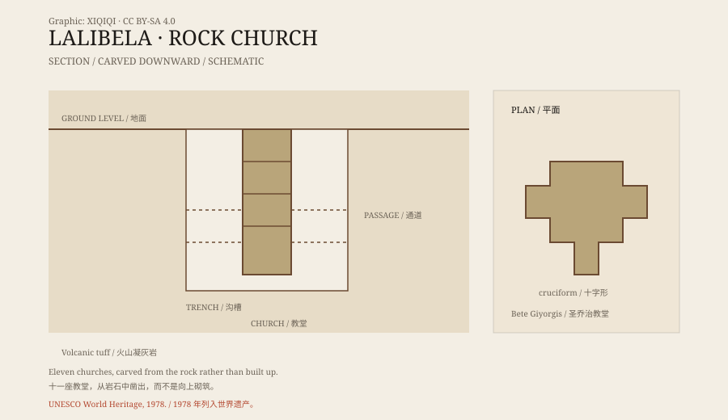

## 一、新耶路撒冷

拉利贝拉在埃塞俄比亚北部的高原上，海拔约两千五百米。

十二世纪末到十三世纪初，扎格维王朝的国王拉利贝拉下令在这里建造一组教堂。传统说法是，他希望把这里变成“新耶路撒冷”，让无法前往耶路撒冷朝圣的信徒，也能在本地完成朝圣。

这个说法解释了教堂的布局：有的建筑对应圣墓，有的对应耶稣受难的地点，沟槽和通道则像一条条朝圣路线。

## 二、从岩石里凿出来

拉利贝拉的教堂，和大多数教堂的建造方式相反。

通常的教堂是往上盖的：打地基，砌墙，架屋顶。这里的教堂是从地面往下凿的。

工匠先在火山凝灰岩上画好轮廓，然后向下挖出一圈深沟，把整块岩石孤立出来。接着，他们在这块岩石内部凿出门、窗、柱、拱顶和房间。建筑与岩床原本是一体的，最后只剩下内部空间和外壳。

因为是从上往下凿，施工时不需要脚手架，也不需要把材料运到高处。但这也意味着，一旦凿错，很难补救。

*原创示意图：拉利贝拉教堂从岩床上凿出的剖面与沟槽结构。不是精确测绘图。稀奇奇编辑部，CC BY-SA 4.0。*

## 三、十一座教堂

拉利贝拉的教堂通常算作十一座，分布在几个区域。

最著名的是圣乔治教堂（Bete Giyorgis），整栋建筑呈十字形，沉在一个深坑里，从坑边往下看，像一个巨大的十字架。

最大的教堂是救世主教堂（Bete Medhane Alem），有高大的柱廊和宽阔的内部空间。还有几座教堂通过隧道和通道相连，形成一组地下建筑群。

这些教堂不是废墟。它们至今仍被埃塞俄比亚正教会使用，里面有色泽古老的壁画、祭祀器具和朝圣者留下的痕迹。

## 四、怎么建

没有留下施工图，也没有留下文字记录。

研究者只能从岩石上的凿痕、教堂的布局和当地的石工传统来推断。可能的工序是：先规划整体，再沿着轮廓开沟，把岩块分离出来；然后从顶部向下，一层一层凿出空间；最后修整墙面、柱子和装饰。

工程量巨大。以圣乔治教堂为例，仅外部的坑槽就要挖掉大量岩石。传统说法把建造归功于国王拉利贝拉，但具体用了多少年、多少人力，没有可靠数字。

## 五、朝圣

拉利贝拉至今是埃塞俄比亚最重要的朝圣地之一。

每年一月的主显节（Timkat）和圣诞（Genna），会有大量信徒前来。白色长袍、烛光、歌声和队伍，填满教堂周围的沟槽和通道。

在这些日子里，教堂不是博物馆，而是仍在使用的宗教空间。游客需要避开仪式，尊重当地的规矩。

## 六、现在

1978 年，拉利贝拉的岩石教堂被列入联合国教科文组织世界遗产。

它们面临的主要威胁不是游客，而是水和时间。雨水渗入岩石，冻融和风化让一些结构开裂；部分教堂上方搭建了保护棚，但这也改变了景观。

石头教堂还在使用，也还在慢慢老化。它们不是被建起来的，而是从岩石里被“减”出来的；现在，风化和侵蚀正在做相反的事。

## 新耶路撒冷

拉利贝拉，在埃塞俄比亚北部。

它是一座岩石教堂群，建于十二到十三世纪。传说，国王拉利贝拉想建一个“新耶路撒冷”，让朝圣者不用去耶路撒冷。

## 从岩石里凿出来

教堂不是用石头砌的，而是从岩石里凿出来的。

工匠先在山体上画线，再往下挖，挖出教堂的外形、屋顶、门和窗。教堂和地面连在一起，像一个从土里长出来的建筑。

## 十一座教堂

拉利贝拉有十一座教堂。

每座教堂有不同的形状和大小。有的像十字架，有的像堡垒。它们之间有通道、隧道和庭院。

## 怎么建

建造方法，没有完整记录。

研究者认为，工匠先用工具凿出粗坯，再慢慢修整。没有起重机，没有大型机械，只有人力、绳索和耐心。

## 朝圣

拉利贝拉是埃塞俄比亚正教的圣地。

每年，成千上万的朝圣者来这里祈祷、洗礼和庆祝。教堂不是博物馆，是活着的宗教场所。

教堂是活的。

每天有祈祷、洗礼和节日。朝圣者穿白袍，拿蜡烛，唱圣歌。

## 现在

拉利贝拉是联合国教科文组织世界遗产。

教堂被修复、加固，部分区域限制游客。宗教活动仍然继续。

一座从岩石里凿出来的教堂，用了人的手，也用了人的信仰。

## 岩石

拉利贝拉的教堂，是从火山岩里凿出来的。

岩石软，容易雕刻。但岩石也有裂缝，会渗水。工匠要避开裂缝，选择完整的岩体。

## 保护

教堂被雨水、游客和地震损坏。

保护者加固屋顶，清理排水，限制游客。修复要用同样的岩石和工具。

## 旅游

拉利贝拉是埃塞俄比亚的旅游点。

游客可以看教堂、参加仪式、走隧道。导游会讲拉利贝拉的传说。

一座岩石教堂，用了人的手，也用了人的信仰。

## 扎格维

拉利贝拉，属于扎格维王朝。

扎格维王朝在十二到十三世纪，统治埃塞俄比亚。国王拉利贝拉，是王朝的成员。

## 档案

拉利贝拉有 11 座岩石教堂，全部从岩壁向下凿成。最著名的是圣乔治教堂，形状像十字。1978 年列入世界遗产。教堂至今仍在使用，朝圣者从各地来。

教堂群分成南北两组，由一条沟槽连接。传说国王拉利贝拉想建一个“新耶路撒冷”。

这些教堂不是一个朝代建完的，前后花了几十年。

拉利贝拉的教堂，用整块岩石凿成，没有拼接。

教堂的窗户，凿成十字形。教堂的门，很低。朝圣者要弯腰才能进去。

---

**来源与许可**：本文的事实来源见条目底部来源台账 S1–S3。文字与原创示意图采用 CC BY-SA 4.0。文中把建筑结构、历史背景、传统说法与现代保护分开叙述；建造年代和工期存在不同估计。
