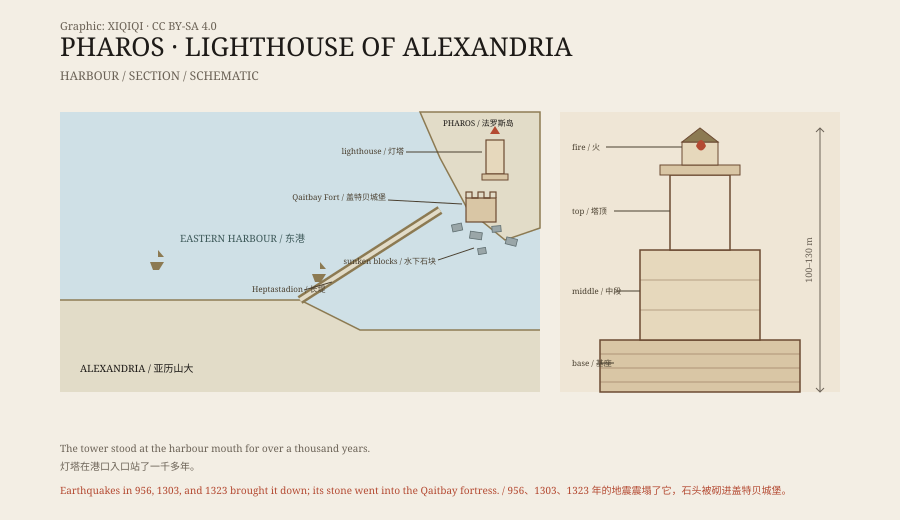

## 1. The door to the harbour

In 331 BCE, Alexander founded a new city on the Egyptian coast.

A long mole joined the island of Pharos to the mainland. The island sat at the mouth of the Eastern Harbour, so every ship entering Alexandria had to pass it. The coast was low and treacherous, and entering at night was dangerous.

The Ptolemies built a lighthouse there. It was completed around 280 BCE, and its designer was Sostratus of Cnidus.

*Original schematic: the Eastern Harbour, the island of Pharos, the lighthouse, and the later Qaitbay fortress. Not a precise chart. Oddity Archive, CC BY-SA 4.0.*

## 2. A tower in three stages

The lighthouse was not a simple tower.

Its base was square, the middle stage octagonal, and the top cylindrical. The whole structure is estimated at between one hundred and one hundred and thirty metres high. For centuries it was one of the tallest buildings on earth.

A ramp ran up the inside, so people and fuel could be carried to the top. A fire burned there at night, visible for tens of kilometres. Ancient accounts also mention a metal mirror that reflected the sun. How the mirror actually worked is no longer clear.

An inscription on the tower was dedicated to the gods. One story says Sostratus carved his own name into the stone, covered it with plaster, and carved the king's name on top. When the plaster weathered away, the architect's name was left behind. The story may not be true, but it shows how much the tower mattered.

## 3. A thousand years

The lighthouse stood at the harbour mouth for more than a thousand years.

Earthquakes weakened it. Major tremors struck the region in 956, 1303, and 1323 CE, and the tower came down in stages. By the fifteenth century it was a ruin.

In 1480, Sultan Qaitbay built a fortress on the site. The building material came from the fallen lighthouse: granite blocks, columns, and statues were built directly into the walls.

From then on, the lighthouse was gone from the surface.

## 4. Stones under the sea

In 1994, the French underwater archaeologist Jean-Yves Empereur took a diving team into the Eastern Harbour.

Near the fortress they found large quantities of stone: huge granite blocks, column shafts, capitals, sphinxes, and pharaonic statues. Thousands of pieces lay scattered in the silt. Some of the statues were several metres high and are thought to represent Ptolemaic kings and queens.

Diving was difficult. In 1993, hundreds of concrete blocks had been dropped into the harbour to protect the Qaitbay fortress, and they came down on top of the site. Visibility was poor, and the blocks were heavy; much of the work had to be done piece by piece.

The survey established roughly where the lighthouse had stood and brought a number of objects to the surface.

## 5. The name of a tower

The lighthouse disappeared, but its name survived.

“Pharos” was originally the name of the island and became a word for a lighthouse. French phare, Italian and Spanish faro, and Portuguese farol all come from it.

Later lighthouses followed the same basic idea: a tall tower, a fire at the top, a conspicuous position. The Pharos was not the first lighthouse, but it was the first one the whole Mediterranean remembered.

## 6. Now

The Qaitbay fortress still stands on the site.

Its walls contain stones from the lighthouse. Visitors can see the harbour and the breakwater from the walls, but not the tower. Some of its remains are still on the seabed; others have been restored and placed in museums.

The Antiquities Museum at the Bibliotheca Alexandrina has a collection of objects raised from the Eastern Harbour and Abukir Bay. Statues and blocks sit in glass cases, with the depth they came from written on the labels.

A building made to guide ships ended up sinking into the harbour it once guarded.

---

**Sources and licenses**: the factual sources are listed in the source ledger S1–S3 at the bottom of this entry. Text and original diagrams are licensed under CC BY-SA 4.0. This article separates the construction record, the ancient accounts, the earthquake damage, and the underwater survey; the exact height and the mirror mechanism are described differently in the ancient sources.
