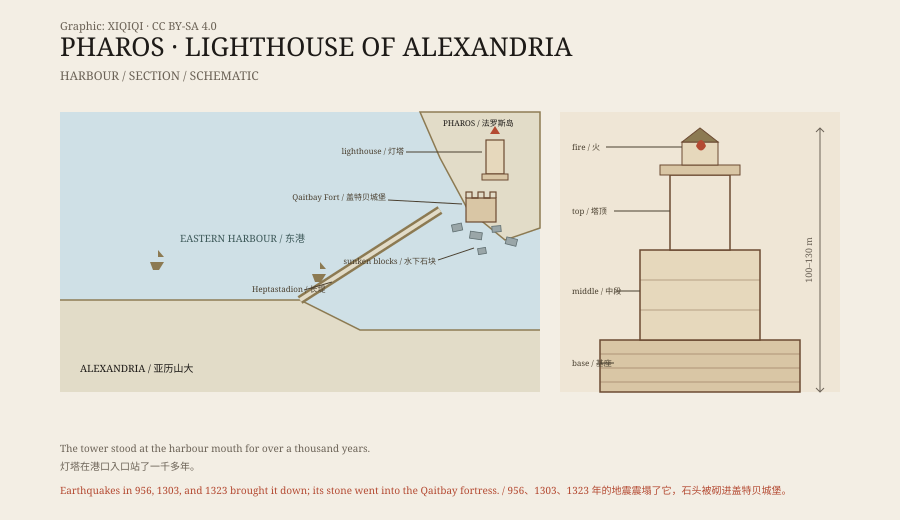

## 一、港口的门

公元前 331 年，亚历山大在埃及海边建立了一座新城。

城市有一道长长的防波堤，把法罗斯岛和陆地连起来。岛在东港的入口，船只要进港，就得从岛边经过。这里的海岸低平，暗礁不少，夜里进港很危险。

托勒密王朝在这里建了一座灯塔。它大约在公元前 280 年完工，设计者是尼多斯的索斯特拉图斯。

*原创示意图：亚历山大东港、法罗斯岛、灯塔与盖特贝城堡的位置关系。不是精确海图。稀奇奇编辑部，CC BY-SA 4.0。*

## 二、三层塔

灯塔不是一座简单的塔。

它的底座是方的，中间一段是八边形，最上面是圆柱形。三层加起来，高度估计在一百到一百三十米之间。在很长一段时间里，它是地球上最高的人造建筑之一。

塔内有坡道，人和燃料可以一路运到顶部。塔顶夜里点火，火光在几十公里外都能看见。古代记载还提到一面金属镜，说它能把日光反射出去。镜子的具体构造，今天已经说不清了。

塔身上刻着献给神明的铭文。传说索斯特拉图斯把自己的名字刻在石头上，外面覆了一层灰泥，再刻上国王的名字。等灰泥风化脱落，留下的就是建筑师的名字。这个故事不一定真，但它说明这座塔在当时有多重要。

## 三、站了一千多年

灯塔在港口入口站了一千多年。

地震一次次削弱它。公元 956 年、1303 年和 1323 年，这一带发生了多次强震，塔身一段段塌下来。到了十五世纪，它已经不成样子。

1480 年，苏丹盖特贝在灯塔的遗址上建了一座城堡。建筑材料就取自倒塌的灯塔：花岗岩石块、柱子、雕像，被直接砌进了城墙。

从那时起，灯塔从地面上消失了。

## 四、海底的石头

1994 年，法国水下考古学家让-伊夫·昂佩勒带着潜水队进入东港。

他们在城堡附近的海底找到了大量石块：巨大的花岗岩块、柱身、柱头、斯芬克斯像和法老雕像。这些石块散落在淤泥里，数量以千计。其中一些雕像有几米高，被认为是托勒密王朝的国王和王后。

潜水并不容易。1993 年，港口里投下数百块混凝土块，用来保护盖特贝城堡，这些石块正好压在遗址上方。海底能见度低，石块又重，很多工作只能一小块一小块地做。

调查确认了灯塔的大致位置，也把一批文物打捞出水。

## 五、一座塔的名字

灯塔消失后，它的名字留了下来。

“法罗斯”（Pharos）原本是岛名，后来成了灯塔的代称。法语里的 phare、意大利语和西班牙语里的 faro、葡萄牙语里的 farol，都从这个词来。

后世的灯塔也沿用了它的基本思路：高塔、顶部火光、醒目的位置。亚历山大灯塔不是第一座灯塔，但它是第一座被整个地中海记住的灯塔。

## 六、现在

今天，盖特贝城堡还立在原来的位置上。

城堡的墙里混着灯塔的石头。游客站在墙边，可以看到港口和防波堤，但看不到那座塔。它的残块一部分还在海底，一部分被修复后放进了博物馆。

亚历山大图书馆的文物博物馆里，专门有一批从东港和阿布基尔湾打捞上来的沉船文物。玻璃柜里摆着雕像和石块，标签上写着出水的深度。

一座为船只指路的建筑，最后自己沉进了它守护过的港口。

---

**来源与许可**：本文的事实来源见条目底部来源台账 S1–S3。文字与原创示意图采用 CC BY-SA 4.0。文中把建造记录、古代记载、地震损毁与水下调查分开叙述；灯塔的确切高度和镜面装置在古代文献中说法不一。
