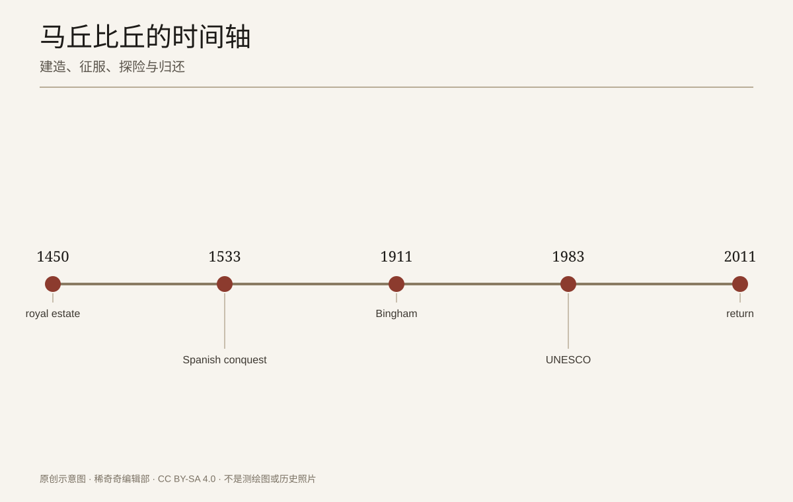
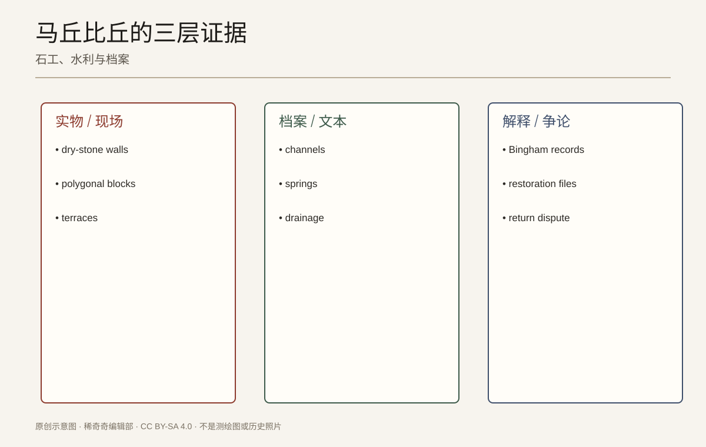

## 1. A city on a ridge

Machu Picchu lies in Urubamba Province, Cusco Region, Peru, at about 2,430 metres, on a ridge above the Urubamba River. The site consists of stone walls, terraces, plazas, temples, residences, and a water system, with Huayna Picchu behind it. It is not an 'air city' wholly hidden by cloud but a carefully sited royal estate: backed by the mountain, facing the valley, with water, drainage, and landslide risk built into the design.

## 2. Inca masonry and water

Much of Machu Picchu's masonry uses dry-stone technique: blocks are cut and fitted to interlock without mortar. Important buildings and temples use finer polygonal stone, while ordinary houses are rougher. The site has channels, springs, reservoirs, and drains; rainwater is directed to terraces and drainage channels to prevent erosion of foundations. The terraces are not merely scenery: they stabilise soil, provide cultivation surfaces, and help drain water.

*Original diagram: Machu Picchu from construction to the return of objects. Not a survey drawing. XIQIQI Editorial, CC BY-SA 4.0.*

## 3. Bingham and the 'discovery' story

In 1911 the American explorer Hiram Bingham, searching for the last Inca stronghold, was led to Machu Picchu by local guides. He later wrote that it was a forgotten city. But local farmers had always known the site and some families cultivated nearby; Bingham's 'discovery' is an outside narrative. More importantly, he took and photographed many objects, which later led to a decades-long dispute between Peru and Yale University over their return.

## 4. Construction, use, and abandonment

Archaeological research places the main construction of Machu Picchu in the mid-fifteenth century, roughly during Pachacuti's reign. It may have combined a royal estate, religious centre, administrative node, and agricultural laboratory rather than serving a single function. After the Spanish conquest the Inca state collapsed and Machu Picchu lost its maintenance; but when it was completely emptied, and whether a small population remained, still lacks continuous evidence. Describing the abandonment as a single overnight event is a common simplification of later accounts.

*Original diagram: masonry, water system, and archival evidence at Machu Picchu. Not a survey drawing. XIQIQI Editorial, CC BY-SA 4.0.*

## 5. Restoration, tourism, and carrying capacity

Machu Picchu was inscribed as a World Heritage Site in 1983. Twentieth-century clearance and restoration exposed much of the architecture but also changed the appearance of some walls and terraces. Today it faces visitor pressure, landslides, floods, erosion from trains and roads, and urban expansion around the site. Peruvian authorities use timed entry, one-way routes, and daily caps to balance revenue and conservation.

## 6. Return of objects and research

Around 2011 Yale University returned thousands of objects Bingham had taken to Peru and helped establish a research institution in Cusco. The return resolved part of the ownership dispute but did not end research debate: the objects' dates, functions, and find spots need rechecking, and errors in early records need correction. Machu Picchu is not a site whose file is 'finished'; its archive is still being reread.

The cover is an AI-assisted reconstruction of “Machu Picchu: An Inca Estate Above the Clouds”, not a site photograph; the two inline figures are original diagrams, not survey drawings. Image types and licences are recorded row by row in research/image-audit.csv.

## Archive location

Machu Picchu's archive falls into three sets: the Bingham expedition diaries, photographs, and object registers, now held between Yale and Peruvian institutions; the Peruvian Ministry of Culture's site-management, restoration, and carrying-capacity records; and UNESCO's World Heritage nomination and monitoring files. The numbering and place names in these sets are not uniform, and early photographs often lack precise locations. To match a wall in an old photograph to its present restored state, a researcher needs survey drawings and restoration logs. The construction dates and main functions used here come from published archaeological overviews and management documents; finer stratigraphy and the object-return lists still depend on the catalogues of both institutions. One further caveat: official names, elevations, and coordinates vary slightly between sources, and this entry uses the figures common to the World Heritage text and the Peruvian Ministry of Culture's public pages; visitor routes and open areas change with conservation needs, so current notices from the site authority should be checked before a visit; the figures here are descriptive, not a legal boundary. The site is a living administrative space, not a frozen museum object.

## Limits of the record

The builders, function, and abandonment of Machu Picchu remain disputed. Whether it was a royal estate of Pachacuti, whether it combined religious and administrative functions, and when it was finally emptied after the Spanish conquest all lack a single answer. The walls visitors see have been restored, and reconstruction in some areas changed the original appearance; early explorers' accounts also carried a 'discovery of emptiness' bias. This entry puts survey, excavation, and restoration records first and the romantic 'lost city' narrative second.

---

**Sources and licenses**: for “Machu Picchu: An Inca Estate Above the Clouds”, the factual claims above are traced to S1 and S2 in the source ledger; S3 covers the AI-assisted cover and the two original diagrams. Text and original diagrams are licensed CC BY-SA 4.0. This entry separates the documented record from reconstruction and marks remaining uncertainty under 'Limits of the record'. Where the archive is silent, the text says so rather than filling the gap with narrative. Dates and figures follow the cited pages; interpretations are identified as interpretations, and no hypothesis is presented as a settled fact.
