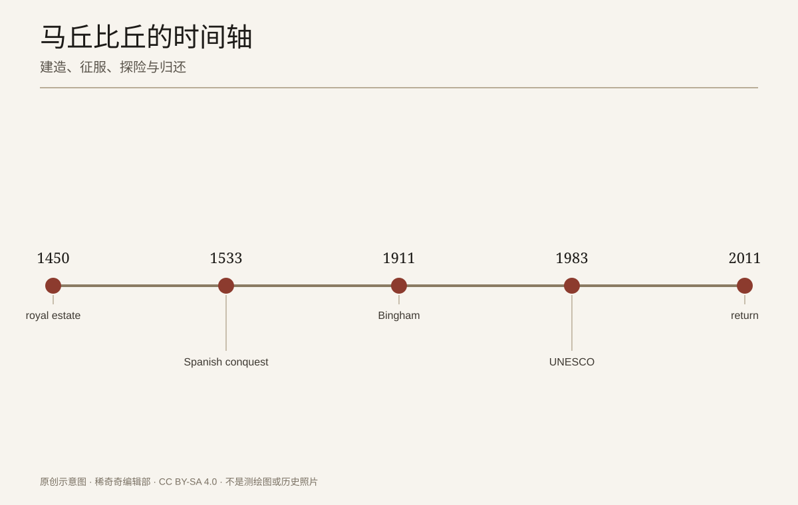
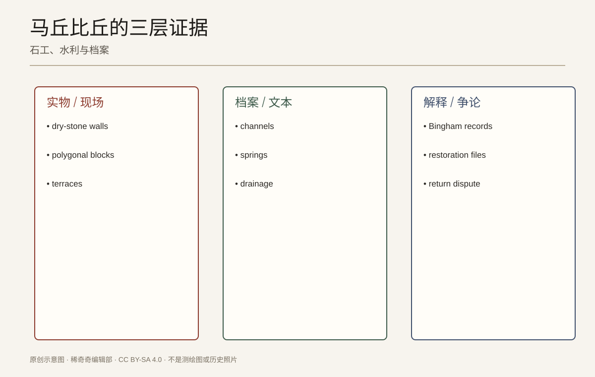

## 一、山脊上的城

马丘比丘在秘鲁库斯科大区的乌鲁班巴省，海拔约 2430 米，坐落在乌鲁班巴河上方的一道山脊上。遗址由石墙、梯田、广场、庙宇、住宅和水利系统组成，背后是华纳比丘峰。它不是一座被云雾完全遮住的“空中城市”，而是一处经过精确选址的皇家庄园：背靠山峰，面向河谷，水源、排水和滑坡风险都被纳入设计。

## 二、印加的石工与水利

马丘比丘的墙体多用“干砌”技术：石块经过切割，彼此咬合，不用砂浆也能稳定。重要的建筑和庙宇使用更精细的多边形石，普通住宅则相对粗糙。遗址有引水渠、泉眼、蓄水池和排水口，雨季的水被引导到梯田和排水沟，避免冲刷地基。梯田不只是景观，它们固定土壤、提供耕作面，也承担排水功能。

*原创示意图：马丘比丘从建造到文物归还的时间轴。不是测绘图。稀奇奇编辑部，CC BY-SA 4.0。*

## 三、宾厄姆与“发现”叙事

1911 年，美国探险家海勒姆·宾厄姆在寻找印加最后的抵抗据点时，被当地向导带到马丘比丘。他后来写书，把这里描述成一座被遗忘的城市。但当地农民一直知道遗址的存在，也有家庭在附近耕作；宾厄姆的“发现”是外部视角的叙事。更重要的是，他带走并拍摄了大量器物，后来引发了秘鲁与耶鲁大学之间长达数十年的归还争议。

## 四、建造、使用与废弃

考古研究把马丘比丘的主要建造期放在 15 世纪中叶，约在帕查库提统治时期。它可能是皇家庄园、宗教中心、行政节点和农业实验场的组合，而不是单一功能的城市。西班牙征服后，印加国家瓦解，马丘比丘逐渐失去维护；但它何时完全空置、是否仍有少量人口居住，仍缺少连续证据。把“废弃”说成一夜之间发生，是后世叙事常见的简化。

*原创示意图：马丘比丘的石工、水利与档案三层证据。不是测绘图。稀奇奇编辑部，CC BY-SA 4.0。*

## 五、修复、旅游与承载量

马丘比丘在 1983 年列入世界遗产。20 世纪的清理和修复让大量建筑重新露出，但也改变了部分墙体和梯田的原貌。今天它面对的是游客压力、山体滑坡、洪水、火車与道路带来的侵蚀，以及遗址周边的城市扩张。秘鲁当局实行分时预约、单行路线和每日上限，试图在收入与保护之间取得平衡。

## 六、文物归还与研究

2011 年前后，耶鲁大学向秘鲁归还了数千件宾厄姆当年带走的器物，并在库斯科设立研究机构。归还解决了部分所有权争议，却没有结束研究争论：器物的年代、用途和出土位置需要重新核对，早期记录中的误差也要纠正。马丘比丘不是一座已经“写完”的遗址，它的档案仍在被重读。

封面是「马丘比丘：云端上的印加庄园」的 AI 辅助场景复原，不是现场照片；两张插图为原创示意图，不是测绘图。图片类型与许可逐条记录在文末来源台账。

## 档案位置

马丘比丘的档案分成三套：宾厄姆探险队的日记、照片与器物登记，现存于耶鲁大学与秘鲁的机构；秘鲁文化部的遗址管理、修复和游客承载记录；以及联合国教科文组织的世界遗产申报与监测文件。三套档案的编号和地名并不统一，早期照片还常常没有精确的拍摄位置。研究者要把照片中的墙体与今天的修复状态对应起来，必须借助测绘图和修复日志。本文的建造年代与主要建筑功能，来自公开的考古综述与管理文件；更细的出土层位与器物归还清单，仍以两边机构的目录为准。还须说明：遗址的官方名称、海拔与坐标在不同资料中有细微差异，本文采用世界遗产文本与秘鲁文化部公开页面通用的数值；游客线路与开放区域会随保护状况调整，行前应以管理方公告为准。

## 档案空白

马丘比丘的建造者、用途和废弃过程仍有争议。它是不是帕查库提的皇家庄园、是否兼具宗教与行政功能、在西班牙征服后何时彻底空置，都没有单一答案。游客看到的石墙经过修复，部分区域的重建改变了原貌；早期探险者的叙述又带有“发现空白”的偏见。本文把测绘、发掘与修复记录放在前面，把“失落之城”的浪漫叙事放在后面。

---

**来源与许可**：文字与原创示意图采用 CC BY-SA 4.0；第三方图片与资料的许可见文末来源台账。
