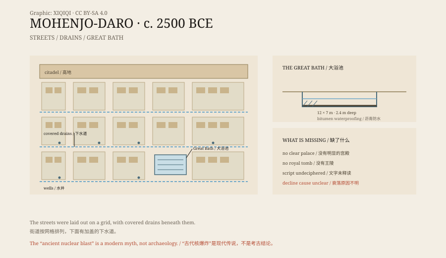

## 1. The mound of the dead

Mohenjo-daro lies in Sindh, Pakistan, not far from the Indus.

The name comes from Sindhi and means “Mound of the Dead”. Local people had long known that something lay under the mound, but systematic excavation began only in 1922.

What came out was a city. It was built around 2500 BCE and was one of the largest cities of the Indus Valley Civilisation. Compared with the cities of the Yellow River, Mesopotamia, and the Nile, it appeared no later and was no smaller.

## 2. A city on a grid

The streets are straight.

The main streets run roughly north-south and east-west, cutting the city into blocks. Houses are built of fired brick, and the bricks are remarkably uniform in size. Houses differ in scale, but the thickness of walls and the proportions of bricks are similar.

Stranger still is the drainage. Under the streets run brick drains covered with stone slabs, with inspection holes at intervals. Many houses have bathrooms, and wastewater flows through pipes into the street drains. The city also had more than seven hundred wells.

Five thousand years ago, urban infrastructure like this was extremely rare.

*Original schematic: the street layout, drainage, and Great Bath of Mohenjo-daro. Not an archaeological survey drawing. Oddity Archive, CC BY-SA 4.0.*

## 3. The Great Bath

The most famous structure in the city is a large bath.

The pool is about twelve metres long, seven metres wide, and 2.4 metres deep. Its floor and walls are brick, with bitumen in the joints to make them waterproof. Steps lead down into the pool, and there are wells and drains nearby.

It does not look like an ordinary bathing pool. It looks more like a ritual space: people may have bathed and purified themselves here before entering the buildings beside it. The pool sits on the high part of the city, surrounded by corridors and rooms.

## 4. Who was in charge

The city has a puzzle: no obvious ruler.

Archaeologists have found no vast palace and no royal tomb. There are some larger buildings that may have been granaries, assembly halls, or the residences of priests, but none dominates the city the way a pharaoh's palace does.

The people left seals. The seals show animals, symbols, and human figures, some with short inscriptions. The script has never been deciphered. Without readable records, no one knows who gave the orders or which kingdom the city belonged to.

## 5. The disappearance

Around 1900 BCE, the city was abandoned.

The cause is unresolved. Some point to the Indus changing course, some to weaker monsoons and years of drought, some to shifts in trade routes, and some to invasion. Most researchers think several factors combined.

The city was not buried by a single catastrophe. It emptied slowly, the houses collapsed, earth covered them, and the whole place became a mound.

## 6. The nuclear myth

Later, someone gave the city a more exciting story.

They said Mohenjo-daro had been destroyed by an ancient nuclear explosion. The evidence was said to be “vitrified stones”, “radioactive skeletons”, and “blackened streets”.

There is no reliable basis for these claims. The so-called vitrification is slag formed by pottery and brick at high temperatures, possibly from kilns or fires; the “radioactive skeletons” have no original test reports; the damage to the streets comes from floods and salt, not from a blast.

The real threat is natural. Rising groundwater, salt crystallisation, and floods have been eroding the mud brick for decades. In 1980 Mohenjo-daro became a World Heritage Site, and conservation work has not stopped since.

---

**Sources and licenses**: the factual sources are listed in the source ledger S1–S3 at the bottom of this entry. Text and original diagrams are licensed under CC BY-SA 4.0. This article separates the city layout, the Great Bath, the political structure, the abandonment, and the “nuclear explosion” legend; the Indus script remains undeciphered, and the causes of the city's decline are still debated.
