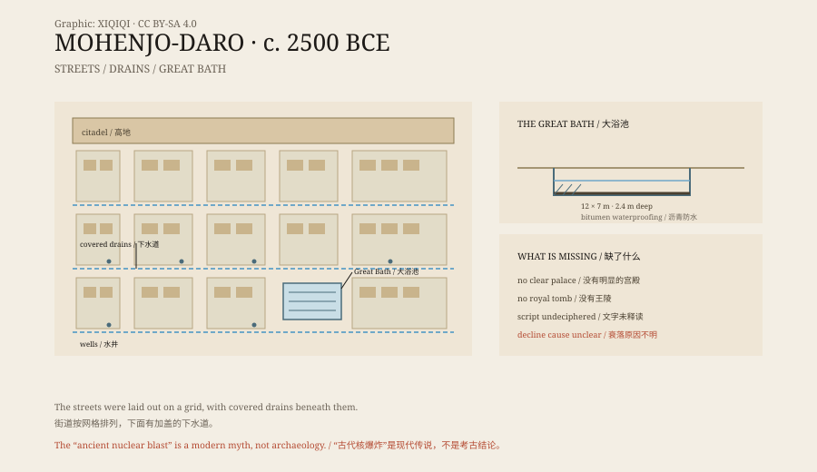

## 一、死者之丘

摩亨佐达罗在巴基斯坦的信德省，离印度河不远。

这个名字来自信德语，意思是“死者之丘”。当地人早就知道这片土丘下面有东西，但直到 1922 年，考古学家才开始系统发掘。

挖出来的是一座城市。它建于大约公元前 2500 年，是印度河流域文明最大的城市之一。和黄河流域、两河流域、尼罗河流域的城市相比，它出现得不晚，规模也不小。

## 二、网格城市

这座城市的街道是直的。

主要街道大致呈南北、东西走向，把城区切成一块块街区。房子用烧过的砖砌成，砖的尺寸很统一。不同人家的房子大小不一，但墙的厚度、砖的比例都差不多。

更奇怪的是排水。街道下面有砖砌的下水道，上面盖着石板，每隔一段有一个检查口。很多房子里有浴室，废水通过管道流到街上的下水道里。城里还有七百多口井，供人取水。

在五千年前，这样的城市设施非常罕见。

*原创示意图：摩亨佐达罗的街区布局、街道排水与大浴池结构。不是考古测绘图。稀奇奇编辑部，CC BY-SA 4.0。*

## 三、大浴池

城中最有名的建筑，是一个大浴池。

池子长约十二米，宽约七米，深约二点四米。池底和池壁铺着砖，砖缝里填了沥青，用来防水。池边有台阶，可以走下去。旁边有水井和排水口。

这个池子不像普通的洗澡池。它更像一个仪式场所：人们可能在这里沐浴、净化，然后进入旁边的建筑。池子的位置在城区的高处，周围有走廊和房间。

## 四、谁在管

这座城市有一个谜：没有明显的统治者。

考古学家没有找到巨大的宫殿，也没有找到国王的陵墓。城里有一些较大的建筑，可能是粮仓、集会厅或祭司的住所，但没有哪一座像法老的宫殿那样压倒一切。

人们留下了印章。印章上刻着动物、符号和人形，有的还带着短小的文字。这种文字至今没有被读通。没有文字记录，就不知道谁在发号施令，也不知道这座城市属于哪个王国。

## 五、消失

大约在公元前 1900 年，这座城市被放弃了。

原因没有定论。有人说是印度河改道，有人说是季风减弱、连年干旱，有人说是贸易路线改变，还有人说是外来入侵。大多数研究者认为，是几种因素叠加在一起。

城市没有被一场灾难瞬间掩埋。它慢慢空了，房子塌了，泥土盖上来，最后变成一座土丘。

## 六、核弹传说

后来，有人给这座城编了一个更刺激的故事。

他们说，摩亨佐达罗是被一场古代核爆炸摧毁的。证据是“玻璃化的石头”“高辐射的骨架”和“焦黑的街道”。

这些说法没有可靠依据。所谓的“玻璃化”是陶器、砖块在高温下形成的渣块，可能来自窑炉或大火；“放射性骨架”的说法没有原始检测报告；街道的破损来自洪水和盐碱侵蚀，不是爆炸。

真正的威胁来自自然。地下水上升、盐结晶、洪水，一直在侵蚀土砖。1980 年，摩亨佐达罗被列入世界遗产，保护工作至今没有停。

---

**来源与许可**：本文的事实来源见条目底部来源台账 S1–S3。文字与原创示意图采用 CC BY-SA 4.0。文中把城市布局、大浴池、政治结构、废弃原因与“核爆炸”传说分开叙述；印度河文字尚未释读，城市衰落的原因仍有不同解释。
