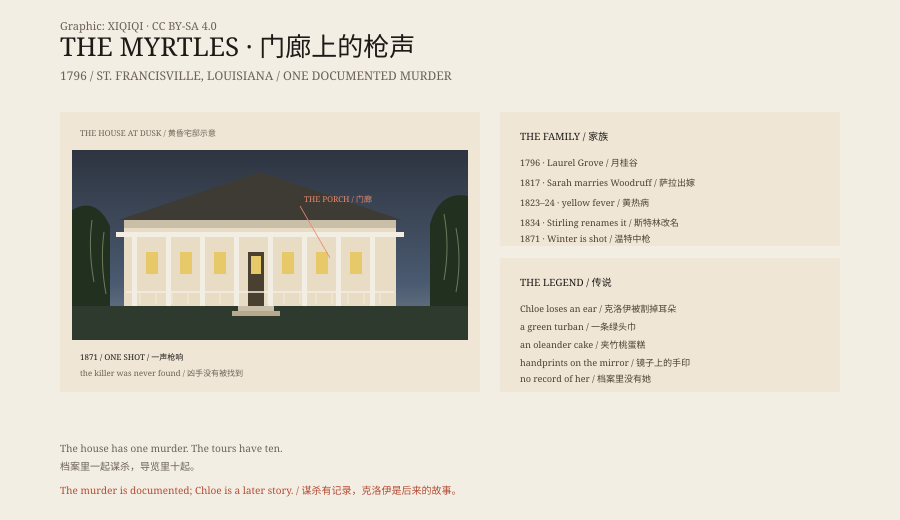

## 1. 1796

In 1796, in Spanish West Florida near St. Francisville, David Bradford bought six hundred acres and built an eight-room house. He called it Laurel Grove. He had fled Pennsylvania after taking the wrong side in the Whiskey Rebellion. In 1799 President John Adams pardoned him, and he brought his wife and five children south.

## 2. Yellow Fever

Bradford's daughter Sarah Mathilda married his law student, Clark Woodruff, in 1817.

In 1823 Sarah died of yellow fever. The next year two of their children, James and Cornelia, died of the same disease. Within a year, a family was gone.

In 1834 Woodruff sold the house to Ruffin Grey Stirling.

## 3. A New Name

Stirling doubled the house. He added a front gallery a hundred and seven feet long, with iron posts, railings and plaster cornices. The crape myrtles around it were in bloom. He renamed the place the Myrtles.

Stirling died of tuberculosis in 1854. His wife, Mary Cobb, ran the plantation. Their daughter Sarah had married William Drew Winter in 1852.

## 4. January 1871

On 26 January 1871, Winter was teaching a Sunday school lesson in the house.

A man rode up and called out that he had business to discuss. Winter stepped onto the side gallery. A shot was fired. He fell on the porch and died the same day.

The killer was never found.

This is the only murder in the house's records. Most of the "ten murders" told on tours have no matching file.

## 5. Chloe

In the legend, Chloe was an enslaved woman in the Woodruff household.

She eavesdropped on her owners and was punished by having an ear cut off. She wore a green turban to hide the wound. To win back the family's trust, she baked a birthday cake laced with oleander leaves, meaning only to make them ill and then nurse them back. She used too much. Sarah and two children died.

Other enslaved people hanged Chloe and threw her body into the Mississippi. Her ghost stayed in the house. Her handprints, and the children's, appear on a mirror.

It is a complete and very popular story. The problem is that the records contain no Chloe. Sarah and her two children died of yellow fever, a year apart, not at one dinner.

## 6. The Mirror and the Photograph

One of the Myrtles' most famous objects is a large mirror in the hallway.

Guests say children's handprints appear on the glass and come back after cleaning. Skeptics say the old mirror's backing leaches residue in Louisiana's humid air, and the marks look like hands.

In 1992 Frances Kermeen published *The Myrtles Plantation: The True Story of America's Most Haunted House*, and the house became a national attraction. That same year, according to the plantation's own timeline, Mrs. Moss took the famous photograph of "Chloe". It shows a woman in a green turban standing between two buildings. There is no negative and no record of the shot. It has often been called a double exposure or a staged photograph.

## 7. The House

Today the Myrtles has twenty guest rooms, a restaurant and a garden. By day it sells history tours. By night it sells ghost stories.

The real house held enslaved people, lost children to disease and saw one unsolved shooting. None of that needs a ghost to make it heavier.

The ghosts were added later. The house was already heavy enough.

*Original schematic: the 1796–1992 timeline, the 1871 shooting on the porch and the spread of the Chloe legend. Not a photograph of the site. Oddity Archive, CC BY-SA 4.0.*

---

**Sources and licenses**: the factual sources are listed in the source ledger S1–S4 at the bottom of this entry. Text and original diagrams are licensed under CC BY-SA 4.0. This article separates the plantation records, the yellow fever deaths, the 1871 murder and the Chloe legend; there is no documentary record of Chloe, and no verifiable evidence for the handprints. The illustration is a scene reconstruction, not a photograph of the site.
