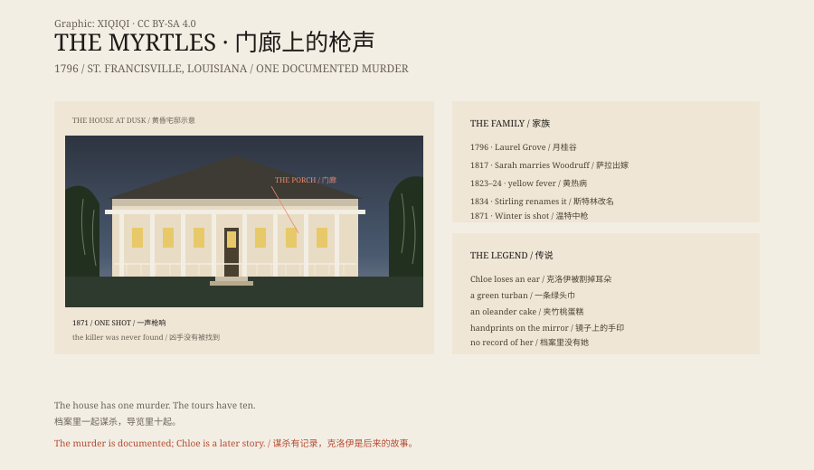

## 一、1796 年

1796 年，西班牙属西佛罗里达，圣弗朗西斯维尔附近。

大卫·布拉德福德买下六百英亩土地，建了一栋八间房的宅子，取名“月桂谷”。他刚从宾夕法尼亚逃出来，因为在威士忌叛乱里站错了队。1799 年，新总统约翰·亚当斯赦免了他，他才把妻子和五个孩子接来。

## 二、黄热病

布拉德福德的女儿萨拉·马蒂尔达，1817 年嫁给了他的学生克拉克·伍德拉夫。

1823 年，萨拉死于黄热病。第二年，他们的两个孩子詹姆斯和科妮莉亚也死了。一年之内，一个家空了。

1834 年，伍德拉夫把宅子卖给了鲁芬·格雷·斯特林。

## 三、改名字

斯特林把房子扩大了一倍，加了一条一百零七英尺长的前廊，铁柱、栏杆、灰泥檐口。房子周围的紫薇开得正好，他把它改名叫“默特尔”。

1852 年，他们的女儿萨拉嫁给了威廉·德鲁·温特。1854 年，斯特林死于肺结核，妻子玛丽·科布继续经营种植园。

## 四、1871 年 1 月

1871 年 1 月 26 日，温特在宅子里教主日学。

一个骑马的男人来到门口，说有生意要谈。温特走到侧廊。枪响了。他倒在门廊上，当天死亡。

凶手没有被找到。

这是这栋房子档案里唯一一起谋杀。旅游解说里说的“十起谋杀”，大多没有对应的记录。

## 五、克洛伊

传说里，克洛伊是伍德拉夫家的女奴。

她偷听了主人的谈话，被罚割掉一只耳朵，从此戴绿头巾遮住伤口。为了重新得到信任，她烤了一个生日蛋糕，在里面加了夹竹桃叶，想让家里人生病，再由她照顾。结果剂量过了，萨拉和两个孩子死了。

其他奴隶把克洛伊吊死，尸体扔进密西西比河。她的鬼魂留在宅子里，镜子上有她和孩子的手印。

这个故事很完整，也很流行。问题是，档案里没有克洛伊这个人。萨拉和两个孩子死于黄热病，时间隔了一年，不是一顿晚餐。

## 六、镜子和照片

默特尔最有名的物件之一，是走廊里的一面大镜子。

客人说，镜子上会出现小孩的手印，擦掉以后还会回来。怀疑的人说，旧镜面的密封层在路易斯安那的潮湿天气里会析出残留，看起来像手印。

1992 年，弗朗西斯·柯尔敏出版了《默特尔种植园：美国最闹鬼房子的真实故事》，把这栋房子推成了全国名景。同一年的庄园年表里，莫斯家的女主人拍下了一张“克洛伊”的照片。照片里是一个戴绿头巾的女人，站在两栋房子之间。没有底片，也没有拍摄记录，后来常被当作双重曝光或摆拍。

## 七、房子

今天，默特尔有二十间客房、一间餐厅、一座花园，白天卖历史导览，晚上卖鬼故事。

真实的房子里，住过奴隶，死过孩子，发生过一场没有破的枪杀。这些事不需要鬼来加重。

鬼故事是后来的装修。房子本身，已经够重了。

*原创示意图：1796–1992 年的庄园时间线、1871 年门廊枪击与克洛伊传说的流传。不是现场照片。稀奇奇编辑部，CC BY-SA 4.0。*

---

**来源与许可**：本文的事实来源见条目底部来源台账 S1–S4。文字与原创示意图采用 CC BY-SA 4.0。文中把庄园档案、黄热病死亡、1871 年谋杀与克洛伊传说分开叙述；克洛伊没有史料记录，镜子手印没有可验证的证据。插图是场景复原，不是现场照片。
