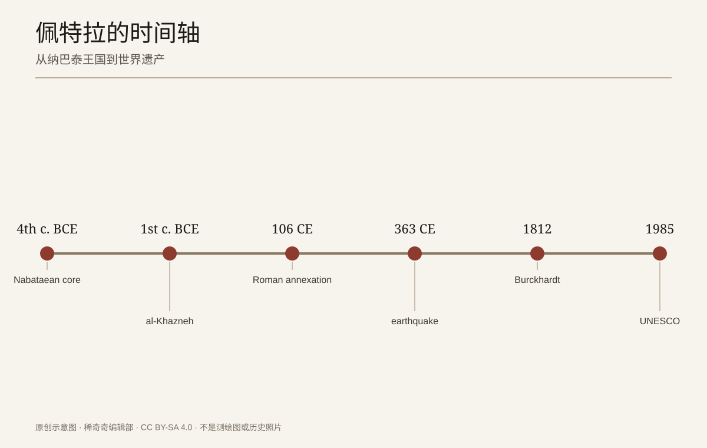
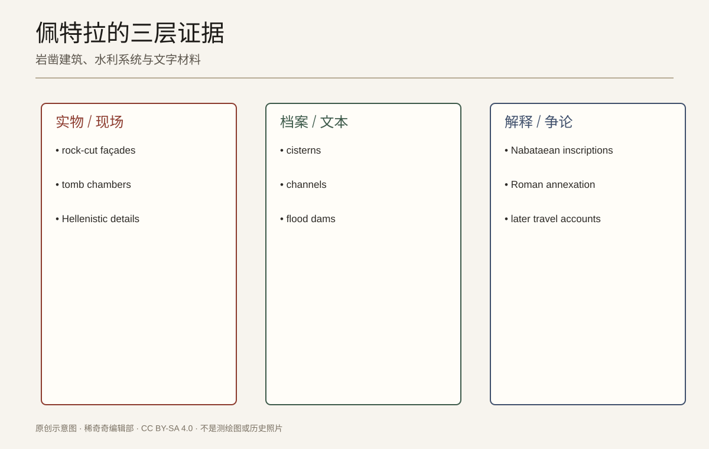

## 1. Through the Siq

Entering Petra usually means walking through a narrow gorge called the Siq. Its walls rise tens of metres, the floor is only a few metres wide, and sunlight reaches the bottom only briefly around noon. At the end, the façade of al-Khazneh appears suddenly on the rock wall. The entrance is not decoration but part of the city's defence and water system: the narrow passage controls movement, while channels and terracotta pipes on the walls direct flash floods into cisterns. Petra was not a 'secret city hidden in a valley' but a capital that used the gorge itself as infrastructure.

## 2. Water matters more than stone

Petra receives little annual rain, and what falls often comes in short, violent storms. The Nabataeans built cisterns, channels, dams, and underground conduits to collect and distribute water to the city and its fields. Traces of channels running along the cliffs are still visible, as are repairs after flood damage. Without this water system, the city could not have sustained its population in the gorge. To understand Petra, one must look not only at façades but at where water came from, where it went, and who maintained it.

*Original diagram: Petra from the Nabataean period to modern conservation. Not a survey drawing. XIQIQI Editorial, CC BY-SA 4.0.*

## 3. Rock-cut façades and tombs

Most of Petra's famous buildings were not built up from the ground but carved out of sandstone cliffs. al-Khazneh, the Monastery, the Roman theatre, and many tomb façades share a technique of cutting a flat face first and then carving inward. The façades combine Nabataean, Hellenistic, Egyptian, and Roman elements, showing that the city stood at a crossing of trade and cultural exchange. Many façades are actually tombs with chambers behind them; part of the 'city front' visitors see is the front door of the dead.

## 4. Caravans, incense, and Rome

Petra stood on the caravan routes from the Arabian Peninsula to the eastern Mediterranean, and frankincense, myrrh, spices, and textiles passed through it. The Nabataeans developed from a nomadic group into a kingdom controlling trade nodes and grew stronger from the fourth century BCE onward. In 106 CE the Roman Empire annexed the Nabataean kingdom; Petra continued as a regional city, but trade routes and power structures changed. Its prosperity was not produced by a single road but by water, location, political alliances, and taxation together.

*Original diagram: rock-cut architecture, water system, and textual evidence at Petra. Not a survey drawing. XIQIQI Editorial, CC BY-SA 4.0.*

## 5. Earthquake, abandonment, and 'rediscovery'

A major earthquake in 363 CE damaged much of Petra, and the city declined thereafter. Shifting trade routes, changes in political centres, and the decay of the water system meant that it was no longer a major city after the early Islamic period. In 1812 the Swiss explorer Johann Ludwig Burckhardt heard locals in Wadi Musa mention the site in the gorge and then entered Petra; European travellers described the visit as a 'rediscovery'. But local Bedouin communities had always known and lived there, and the 'discovery' is an outside narrative.

## 6. Conservation and tourism pressure

Petra was inscribed as a World Heritage Site in 1985. Today it faces rock weathering, salt erosion, flash floods, earthquake risk, and heavy visitation. Paths, steps, and tomb chambers are repeatedly trampled, and some areas have had to restrict access. Relations between local communities and site managers are also complex: tourism income, relocation, grazing rights, and heritage protection often conflict. Conservation is not a matter of sealing the site off but of finding a sustainable balance between rock stability, flood management, and local livelihoods.

## Sources and evidence

For “Petra: A Caravan Capital in the Canyon”, the factual trail runs mainly through S1–S3: S1 is “Petra” and S2 is “Petra”. Dates, places, and names in the text follow the lowest common denominator of those sources; image credits and licences are listed at the foot of the entry.

The cover is an AI-assisted reconstruction of “Petra: A Caravan Capital in the Canyon”, not a site photograph; the two inline figures are original diagrams, not survey drawings. Image types and licences are recorded row by row in research/image-audit.csv.

## Archive location

Petra's archive is made up of records from Jordan's Department of Antiquities, the Petra Archaeological Park administration, and the UNESCO nomination. Early European travel accounts, nineteenth-century drawings, and twentieth-century excavation reports provide first-hand descriptions of façades and city layout; hydrological and geological surveys record springs, channels, cisterns, and rock stability. Place-name transliteration across languages often makes searching difficult: the same façade may carry different names in Arabic, French, and English sources. This entry uses concordant numbers and common names wherever possible; finer tomb numbers and inscription readings still require the park's own archives and publications.

## Limits of the record

Many buildings at Petra carry no inscriptions, so their dates must be inferred from style, structural relationships, and a few texts. The Nabataeans' religious practice, social stratification, and daily life left few traces in written sources, and depend more on the site itself and comparisons with neighbouring regions. The function of the Treasury, the monument visitors know best, remains disputed; treating 'Treasury' as a settled name is a misunderstanding left by tourism. This entry layers measurable architecture, readable inscriptions, and later legend separately.

---

**Sources and licenses**: the factual claims above are traced to S1 and S2 in the source ledger; S3 covers the AI-assisted cover and the two original diagrams. Text and original diagrams are licensed CC BY-SA 4.0. This entry separates the documented record from reconstruction and marks remaining uncertainty under 'Limits of the record'. Where the archive is silent, the text says so rather than filling the gap with narrative. Dates and figures follow the cited pages; interpretations are identified as interpretations, and no hypothesis is presented as a settled fact.
