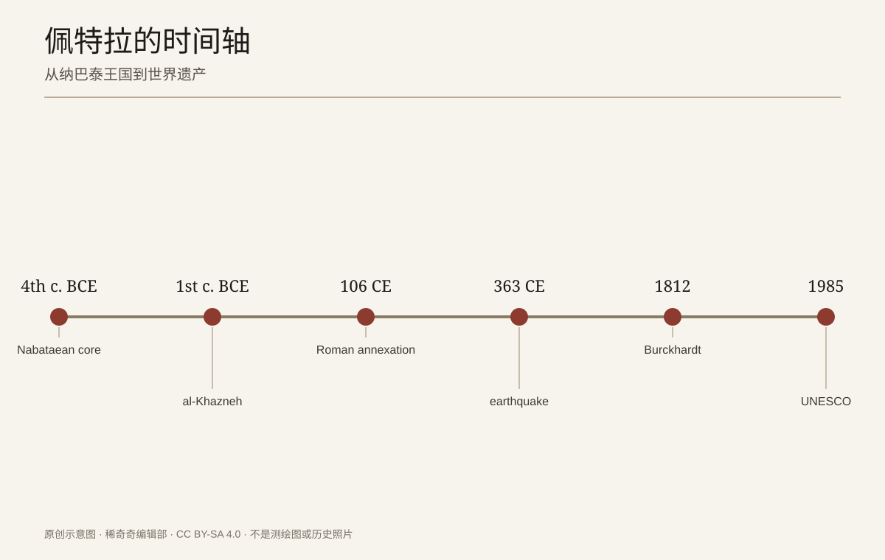
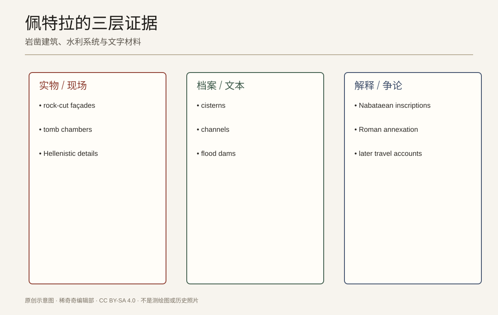

## 一、穿过蛇道

进入佩特拉，通常要先穿过一条狭窄的峡谷，阿拉伯语叫“西克”。两侧岩壁高几十米，底部只有几米宽，阳光只在正午短暂照入。峡谷尽头，卡兹尼神殿的立面突然出现在岩壁上。这个入口不是装饰，而是城市防御与水利系统的一部分：狭窄的通道可以控制人流，岩壁上的水槽和陶管则把山洪引向蓄水池。佩特拉不是一座“藏在山谷里的秘密城市”，而是一座把峡谷本身当作基础设施的都城。

## 二、水比石头更关键

佩特拉年降雨量很低，而且常以短时暴雨出现。纳巴泰人修建了蓄水池、引水槽、水坝和地下管道，把雨水收集起来，分配到城市和农田。遗址里能看到渠道沿着岩壁延伸，也能看到被洪水冲毁后重修的痕迹。没有这套水利系统，这座在峡谷中扩张的城市无法维持人口。理解佩特拉，不能只看立面，还要看水从哪里来、往哪里去、由谁维护。

*原创示意图：佩特拉从纳巴泰时期到现代保护的时间轴。不是测绘图。稀奇奇编辑部，CC BY-SA 4.0。*

## 三、岩凿的立面与墓葬

佩特拉最著名的建筑大多不是独立建造的，而是从砂岩崖壁上凿出来的。卡兹尼神殿、修道院、罗马式剧场和大量墓葬立面，共享一套“先凿出平面、再向下雕刻”的工艺。立面融合了纳巴泰、希腊化、埃及和罗马的元素，说明这里长期处在贸易与文化交流的交叉点。很多立面其实是墓葬，后面连着墓室；游客看到的“城市立面”，有一部分是死者世界的门面。

## 四、商队、香料与罗马

佩特拉位于从阿拉伯半岛向北通往地中海东岸的商路上，乳香、没药、香料和布匹经过这里。纳巴泰人从游牧群体发展为控制贸易节点的王国，公元前 4 世纪以后逐渐强盛。公元 106 年，罗马帝国吞并纳巴泰王国，佩特拉继续作为区域城市存在，但贸易路线和权力结构发生变化。它的繁荣不是一条商路单独带来的，而是水源、地理位置、政治联盟和税收共同作用的结果。

*原创示意图：佩特拉的岩凿建筑、水利系统与文字材料三层证据。不是测绘图。稀奇奇编辑部，CC BY-SA 4.0。*

## 五、地震、废弃与“重新发现”

公元 363 年的一次大地震损坏了佩特拉的大量建筑，此后城市逐渐衰落。贸易路线转移、政治中心的变动和水利系统的失修，使它在伊斯兰早期以后不再是主要城市。1812 年，瑞士探险家约翰·路德维希·布克哈特在瓦迪穆萨听到当地人提到峡谷中的遗址，随后进入佩特拉；欧洲旅行者把这次访问写成“重新发现”。但当地贝都因人一直知道并居住在这里，所谓“发现”是外部视角的叙事。

## 六、保护与旅游的压力

佩特拉在 1985 年列入世界遗产。今天它面对的是岩体风化、盐蚀、洪水、地震风险和大量游客。遗址内的步道、台阶和墓室被反复踩踏，部分区域不得不限制进入。当地社区与遗址管理方的关系也很复杂：旅游收入、迁居、放牧权和遗产保护经常冲突。保护不是把遗址封起来，而是要在岩体稳定、洪水管理和社区生计之间找到可持续的平衡。

封面是「佩特拉：峡谷里的商队首都」的 AI 辅助场景复原，不是现场照片；两张插图为原创示意图，不是测绘图。图片类型与许可逐行记录在 research/image-audit.csv。

## 档案位置

佩特拉的档案由约旦文物部门、佩特拉考古公园管理方和联合国教科文组织的申报文本共同构成。早期欧洲旅行者的游记、十九世纪的绘图和二十世纪的发掘报告，提供了建筑立面与城市布局的第一手描述；水文与地质调查则记录泉眼、渠道、蓄水池和岩体稳定性。不同语言的地名转写常造成检索困难：同一座立面在阿拉伯语、法语和英语文献中可能有不同名字。本文尽量使用可对应的编号与通用名称；更细的墓葬编号和铭文释读，仍要回到考古公园的档案与出版物。

## 档案空白

佩特拉的许多建筑没有铭文，建造年代只能靠风格、结构关系和少量文字推断。纳巴泰人的宗教仪式、社会分层和日常生活在文献中留下的痕迹很少，更多依赖遗址本身与邻近地区的比较。游客最熟悉的卡兹尼神殿，其功能仍有多种解释；把“宝库”当成确定名称，是旅游叙事留下的误会。本文把可测的建筑、可读的铭文与后来的传说分层处理。

---

**来源与许可**：本文的事实来源见条目底部来源台账 S1–S3。文字与原创示意图采用 CC BY-SA 4.0。
