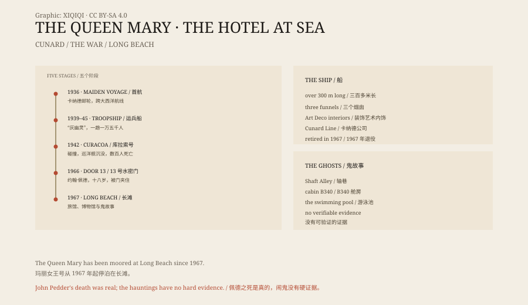

## 1. 1936

The Queen Mary was built for the British Cunard Line.

She was constructed at Clydebank in Scotland, launched in 1934 and made her maiden voyage on 27 May 1936. She was over three hundred metres long, with first-class cabins, dining rooms, ballrooms, a swimming pool and Art Deco corridors.

Before air travel became common, the transatlantic liner was a symbol of status. The Queen Mary and her sister ship, the Queen Elizabeth, were among the largest passenger ships in the world.

## 2. The war

In 1939 the Second World War began.

The Queen Mary was requisitioned and converted into a troopship. Her luxurious interiors were stripped out, anti-aircraft guns were fitted, and she was painted grey. Her nickname was the “Grey Ghost”.

She carried Australian, Canadian and American troops, up to fifteen thousand at a time. Churchill also travelled on her to conferences.

## 3. The Curacoa

On 2 October 1942 the Queen Mary was sailing near Ireland.

She collided with a British cruiser, HMS Curacoa. The cruiser was cut in two and sank quickly. Hundreds of her crew were aboard, and only some were rescued.

The Queen Mary did not stop to pick up survivors. She had orders not to stop, because German submarines were in the area. She continued to port with the injured.

The decision was debated for years after the war. Some said the captain should have stopped; others said he could not.

## 4. Long Beach

In 1967 the Queen Mary was retired.

She was sold to the United States and towed to Long Beach, California, where she was permanently moored. The ship became a hotel, restaurant and museum. Visitors can stay in former first-class cabins and walk the decks.

She no longer goes to sea, but she is still on the water.

## 5. John Pedder

On 10 July 1966, while the ship was still in service, a young crewman died.

John Pedder, eighteen years old, was passing through watertight door 13 during a routine drill. The door closed on him and he was killed.

The accident happened in a narrow passage deep in the ship called Shaft Alley. The passage is still there, and so is the door.

## 6. Other stories

Guides in Long Beach tell several stories.

Someone has seen a young man in work overalls in Shaft Alley. Someone has heard children laughing in a first-class corridor. Someone has seen a woman in white by the swimming pool.

The most famous is cabin B340. Strange things are said to have happened there, and it was later marketed as a “haunted room” that guests can book.

## 7. Explanations

There is no hard evidence for these stories.

A ship is a huge metal structure with engines, pipes, valves and wind. Knocking, creaking and footsteps at night are easily heard as something else. Guides need stories, visitors want stories, and the ship needs stories to sell tickets.

John Pedder's death was real. Most of the rest was added later.

## 8. Now

The Queen Mary is still in Long Beach.

She has been a luxury liner, a troopship, a hotel and an attraction. Her dining rooms, corridors and engine rooms preserve traces of different eras.

Guests sleep on board, lie in bed and hear the ship making sounds. Some say it is the sea, some say the wind, and some say it is John Pedder.

*Original schematic: the maiden voyage in 1936, the 1942 collision, the move to Long Beach in 1967 and the ghost stories. Not a photograph of the ship. Oddity Archive, CC BY-SA 4.0.*

---

**Sources and licenses**: the factual sources are listed in the source ledger S1–S3 at the bottom of this entry. Text and original diagrams are licensed under CC BY-SA 4.0. This article separates the ship's history, the Curacoa collision, John Pedder's death and the ghost stories; there is no verifiable evidence for the hauntings. The illustration is a scene reconstruction, not a photograph of the ship.
