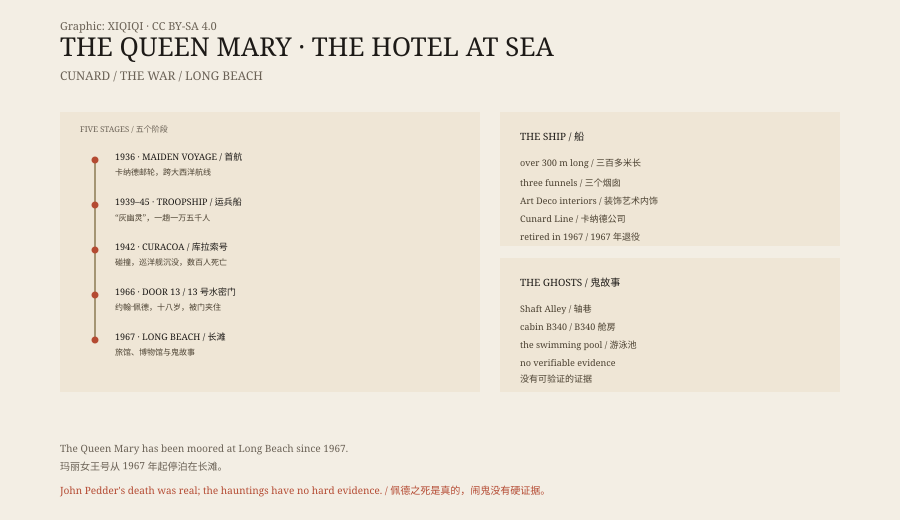

## 1. 1936

The Queen Mary was built for the British Cunard Line.

She was constructed at Clydebank in Scotland, launched in 1934 and made her maiden voyage on 27 May 1936. She was over three hundred metres long, with first-class cabins, dining rooms, ballrooms, a swimming pool and Art Deco corridors.

Before air travel became common, the transatlantic liner was a symbol of status. The Queen Mary and her sister ship, the Queen Elizabeth, were among the largest passenger ships in the world.

## 2. The war

In 1939 the Second World War began.

The Queen Mary was requisitioned and converted into a troopship. Her luxurious interiors were stripped out, anti-aircraft guns were fitted, and she was painted grey. Her nickname was the “Grey Ghost”.

She carried Australian, Canadian and American troops, up to fifteen thousand at a time. Churchill also travelled on her to conferences.

## 3. The Curacoa

On 2 October 1942 the Queen Mary was sailing near Ireland.

She collided with a British cruiser, HMS Curacoa. The cruiser was cut in two and sank quickly. Hundreds of her crew were aboard, and only some were rescued.

The Queen Mary did not stop to pick up survivors. She had orders not to stop, because German submarines were in the area. She continued to port with the injured.

The decision was debated for years after the war. Some said the captain should have stopped; others said he could not.

## 4. Long Beach

In 1967 the Queen Mary was retired.

She was sold to the United States and towed to Long Beach, California, where she was permanently moored. The ship became a hotel, restaurant and museum. Visitors can stay in former first-class cabins and walk the decks.

She no longer goes to sea, but she is still on the water.

## 5. John Pedder

On 10 July 1966, while the ship was still in service, a young crewman died.

John Pedder, eighteen years old, was passing through watertight door 13 during a routine drill. The door closed on him and he was killed.

The accident happened in a narrow passage deep in the ship called Shaft Alley. The passage is still there, and so is the door.

## 6. Other stories

Guides in Long Beach tell several stories.

Someone has seen a young man in work overalls in Shaft Alley. Someone has heard children laughing in a first-class corridor. Someone has seen a woman in white by the swimming pool.

The most famous is cabin B340. Strange things are said to have happened there, and it was later marketed as a “haunted room” that guests can book.

## 7. Explanations

There is no hard evidence for these stories.

A ship is a huge metal structure with engines, pipes, valves and wind. Knocking, creaking and footsteps at night are easily heard as something else. Guides need stories, visitors want stories, and the ship needs stories to sell tickets.

John Pedder's death was real. Most of the rest was added later.

## 8. Now

The Queen Mary is still in Long Beach.

She has been a luxury liner, a troopship, a hotel and an attraction. Her dining rooms, corridors and engine rooms preserve traces of different eras.

Guests sleep on board, lie in bed and hear the ship making sounds. Some say it is the sea, some say the wind, and some say it is John Pedder.

*Original schematic: the maiden voyage in 1936, the 1942 collision, the move to Long Beach in 1967 and the ghost stories. Not a photograph of the ship. Oddity Archive, CC BY-SA 4.0.*

## Boat

The Queen Mary is a British ocean passenger ship.

It started in 1936 with the Canard Shipping Company. It's a long ship, with over 30,000 tons, carrying thousands of people. It runs the North Atlantic route from Southampton to New York.

The ship was designed to be luxurious, with restaurants, dance halls, swimming pools and first class. It was also one of the fastest passenger ships at the time, once holding the Blue Ribbon Award.

## War

During World War II, the Queen Mary was requisitioned as a carrier.

It was painted gray, disassembled luxury facilities, equipped with bunks and medical equipment. It transported soldiers, wounded and prisoners of war across the Atlantic and Indian Ocean.

In 1942, it crashed with another ship at sea, and it nearly sank. It did not sink, but the hull was damaged and later repaired.

## Long Beach

In 1967, the Queen Mary retired and was sold to Long Beach.

It is converted into a hotel, museum, and tourist destination.

The space on board is divided into restaurants, banquet halls, exhibition rooms and guest rooms.

The Queen Mary stopped at Long Beach.

Long Beach is a port city with docks, docks, and museums.

## John Peder

The most famous ghost on board, John Peder.

It is reported that he was a crew member who died in the pool or cabin of the ship. His ghost appeared in the hallway, knocking on the door, opening the light, leaving wet footprints.

There's no original record of this story. There's a lot of deaths on the ship, but the name John Peder was later.

## Other stories

There are other legends on board: a woman crying in the first-class corridor, a girl playing by the pool and a crew smoking in the cabin.

These stories were presented to visitors by guides, and were filmed on television as “spirits of wonders.” They made ships more famous and obscured history.

## Explanation

The “spirit phenomenon” on board can be explained by ordinary reasons.

The old ship's metals will swell and cool and make noise; the water in the pipeline will flow, producing footsteps; lights and ventilation will suddenly start. In dark corridors, tourists can easily sound ordinary.

But the explanation doesn't make the story disappear. The boat is big, the rooms are big, the hallways are long. People walk in it, they get lost, they're easy to imagine.

## The hull

The Queen Mary's hull is made of steel.

It has more than 20 boilers, a few steam turbines. It's more than 300 metres long and 30 metres wide. It's powered by tens of thousands of tons of ships across the Atlantic Ocean.

The hull needs to be maintained.

Steel rusts, paints fall, seawater corroses. Maintenance requires dry docks, workers and money.

## Museums

Part of the ship was transformed into a museum.

Visitors can see engine rooms, platforms, first class and immigration cabins.

The museum on the boat, it's about the history of the sea.

Tourists can see the stories of engines, platforms, cabins and immigrants. Ships are not just ships; they are times.

## The story

The ghost stories on the ship are mostly about death.

Some people died of illness on a ship, others fell by accident, and others died in war. These deaths were made up as ghost stories by subsequent guides.

The ghost story on the boat is part of the tour.

Tours talk, tourists listen, TV shoots. The story makes the ship more famous and the history more blurred.

## Protection

The ship is parked on Long Beach and the hull has been corrosive.

Maintenance requires money, manpower, and dry docks.

A boat, parked in the port, slowly ageing.

---

**Sources and licenses**: the factual sources are listed in the source ledger S1–S3 at the bottom of this entry. Text and original diagrams are licensed under CC BY-SA 4.0. This article separates the ship's history, the Curacoa collision, John Pedder's death and the ghost stories; there is no verifiable evidence for the hauntings. The illustration is a scene reconstruction, not a photograph of the ship.
