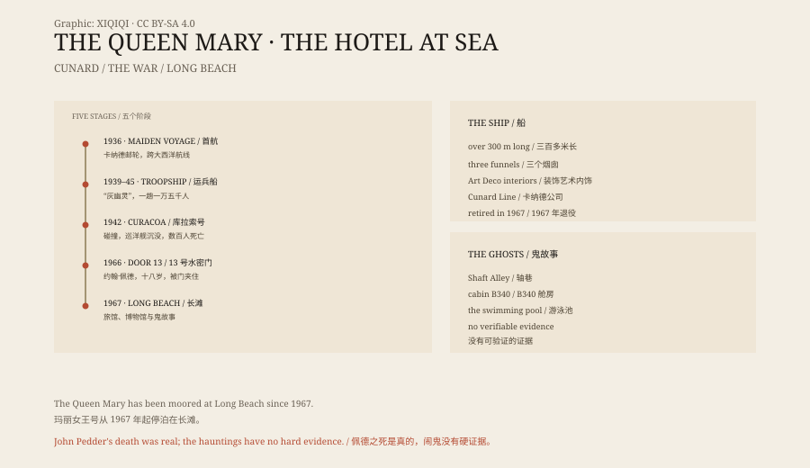

## 一、1936 年

玛丽女王号是英国卡纳德公司建的。

船在苏格兰克莱德班克建造，1934 年下水，1936 年 5 月 27 日首航。它长三百多米，有头等舱、餐厅、舞厅、游泳池和装饰艺术风格的走廊。

在飞机还没有普及的年代，跨大西洋的邮轮是身份的象征。玛丽女王号和它的姊妹船伊丽莎白女王号，是当时最大的客船之一。

## 二、战争

1939 年，第二次世界大战爆发。

玛丽女王号被征用，改成运兵船。它拆掉豪华内饰，装上高射炮，涂成灰色，绰号“灰幽灵”。

它运送过澳大利亚、加拿大和美国的士兵，一趟能装一万多人。丘吉尔也坐过它去开会。

## 三、库拉索号

1942 年 10 月 2 日，玛丽女王号在爱尔兰附近海域航行。

它和一艘英国巡洋舰库拉索号发生了碰撞。库拉索号被切成两半，很快沉没。船上有几百名船员，只有一部分获救。

玛丽女王号没有停下来救人。它接到命令，不能停船，因为附近有德国潜艇。它继续航行，把伤者送到港口。

这件事在战后一直被讨论。有人说舰长应该停，有人说他不能停。

## 四、长滩

1967 年，玛丽女王号退役。

它被卖到美国，拖到加州长滩，永久停靠。船上改成了旅馆、餐厅和博物馆。游客可以住进原来的头等舱，也可以在甲板上走一圈。

船不再出海，但它还在水面上。

## 五、约翰·佩德

1966 年 7 月 10 日，船还在服役。

一名十八岁的船员约翰·佩德，在例行演习中穿过水密门 13 号。门突然关闭，他被夹住，当场死亡。

事故发生在船底的一条窄通道里，叫“轴巷”。那里现在还在，门也还在。

## 六、其他故事

长滩的导游会讲几个故事。

有人在轴巷看见一个穿工装的年轻人。有人在头等舱的走廊听见孩子的笑声。有人在游泳池边看见一个穿白衣服的女人。

最出名的是 B340 舱房。据说有人在这间房里经历过怪事，后来它被改成“闹鬼房”，可以预订。

## 七、解释

这些故事没有硬证据。

船是一个巨大的金属结构，有发动机、管道、阀门和风声。夜里的敲击、吱嘎和脚步，很容易被听成别的东西。导游需要故事，游客想要故事，船也需要故事来卖票。

约翰·佩德的死是真的。其他的，大多是后来加上去的。

## 八、现在

玛丽女王号还在长滩。

它做过豪华邮轮、运兵船、旅馆和景点。船上的餐厅、走廊和引擎室，保留着不同时代的痕迹。

游客晚上住在船上，躺在床上，听见船体发出声音。有人说是海，有人说是风，有人说是约翰·佩德。

*原创示意图：1936 年首航、1942 年碰撞、1967 年长滩与灵异传说。不是现场照片。稀奇奇编辑部，CC BY-SA 4.0。*

---

**来源与许可**：本文的事实来源见条目底部来源台账 S1–S3。文字与原创示意图采用 CC BY-SA 4.0。文中把船舶历史、库拉索号碰撞、约翰·佩德之死与灵异传说分开叙述；船上的“鬼故事”没有可验证的证据。插图是场景复原，不是现场照片。
