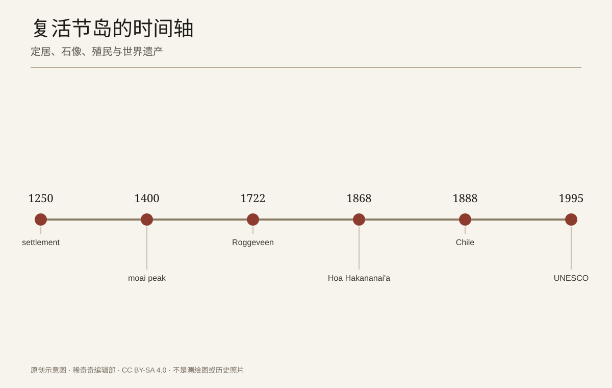
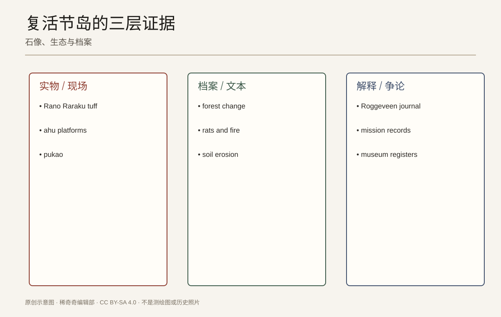

## 1. An island of stone figures

Easter Island lies in the south-eastern Pacific, about 163 square kilometres in area and some 3,500 kilometres from mainland Chile, making it one of the most remote inhabited islands on Earth. Nearly a thousand moai have been recorded, most carved from volcanic tuff and concentrated around the Rano Raraku quarry; some were erected on stone platforms called ahu, while others remain half-buried on the slope. The figures are not uniform 'heads': some show only a face, some include a body, and some wear a red pukao topknot.

## 2. Quarry, transport, and the 'walking' debate

The moai were carved mainly from the tuff cliffs of Rano Raraku and then moved by teams toward the coast. Transport has been argued for more than a century: sledges and rollers, rope hauling, canoe-like sliding, and the 'vertical rocking walk' tested in 2012. Each method can move a replica over a short course, but none easily explains all routes, slopes, and figure sizes. The island lacked enough large trees for rollers, which puts the roller hypothesis under resource pressure; the walking model also needs prepared surfaces and many hands.

*Original diagram: Rapa Nui from Polynesian settlement to World Heritage inscription. Not a survey drawing. XIQIQI Editorial, CC BY-SA 4.0.*

## 3. Ahu platforms and ancestor cult

Erected moai usually face inland toward the village, with their backs to the sea, standing on ahu platforms. The platform was both tomb and ritual centre: the figure represented an ancestor, faced the living, and carried protective and fertility functions. The island also had a Birdman cult centred on the cliff village of Orongo; each year competitors collected sooty tern eggs, and the winner became tangata manu. Ancestor veneration and Birdman ritual were not contradictory; together they formed a society organised around lineage, season, and resources.

## 4. Ecology, population, and the collapse story

The island's forests shrank sharply after human arrival, with rats, fire, farming, and timber use all likely contributing. One popular narrative says islanders cut down the last trees to erect figures and then fell into famine and war; another line of research stresses natural soil erosion and drought, and links population decline to diseases, slave raids, and colonial pressure brought by Europeans. The explanations do not cancel each other. That forests declined and society changed dramatically in the nineteenth century is confirmable; that a single cause explains all of it on one timescale is not.

*Original diagram: stone figures, ecology, and archival evidence on Rapa Nui. Not a survey drawing. XIQIQI Editorial, CC BY-SA 4.0.*

## 5. Colonial contact and dispersal

In 1722 the Dutch navigator Roggeveen's ships reached the island, and Europeans began to record it. In the nineteenth century missionaries, traders, and Chilean warships followed; in the 1860s the population fell sharply through disease and armed raids. In 1868 the British warship Topaze removed a moai that later entered the British Museum as Hoa Hakananai'a. In 1888 Chile formally annexed the island. Figures, wood carvings, and bones were dispersed to museums in Europe and the Americas, while mission work, land leases, and colonial administration reshaped island society.

## 6. National park, community, and return requests

Rapa Nui was inscribed as a World Heritage Site in 1995, with the national park covering much of the island. Today it faces tourism pressure, invasive species, coastal erosion, and limited water; site protection is intertwined with the Rapa Nui community's claims to land, employment, and self-government. Since 2018, islanders and Chilean authorities have repeatedly asked the British Museum to return Hoa Hakananai'a, a debate that touches colonial acquisition, legal title, and the idea of a 'universal museum'. Whether the figure belongs to all humanity and whether islanders can see their ancestor on their own land are questions that need answering together.

## Timeline

- **c. 1250**: Polynesian settlement begins (date still debated)
- **c. 1400–1600**: main period of moai carving and ahu construction
- **1722**: Roggeveen's ships arrive
- **1868**: British warship removes Hoa Hakananai'a
- **1888**: Chile formally annexes the island
- **1995**: inscribed as a World Heritage Site

## Sources and evidence

The checkable material in this entry rests mainly on S1 and S2: S1 supplies the official site or object record and basic chronology, while S2 supplies independent research or archival context. S3 covers the editorial cover and diagrams; it is visual explanation, not historical evidence. Dates, quantities, places, and attributions in the text are traced back to specific S1/S2 pages wherever possible. Claims that cannot be tied to a page are flagged under 'Limits of the record'.

The cover is an AI-assisted reconstruction, not a site photograph. The two inline figures are original diagrams, not survey drawings. Image types and licences are recorded row by row in `research/image-audit.csv`.

## Archive location

The Rapa Nui archive runs in three directions: Chile's National Monuments Council and national park administration hold site registers, restoration files, and visitor-management records; the island's anthropological museum, the Museo Antropológico Padre Sebastián Englert, holds figures, wood carvings, and oral records; European museums hold accession files for objects removed in the nineteenth century. Survey numbers, platform names, and village affiliations are not uniform across catalogues, and early explorers' diaries often misplace sites. The dates and counts used here come from the World Heritage text and published archaeological overviews; finer quarry numbers, transport-experiment data, and land tenure still require those archives.

## Limits of the record

The chronology, population size, and ecological history of Rapa Nui remain debated. No transport method for the moai has been fully demonstrated, and the 'ecological suicide' and 'disease and raiding collapse' narratives each select different evidence. The number of figures, which were erected, and which remained at the quarry also change with survey methods. This entry puts measurable stone, platforms, and archival records first, treats 'lost civilisation' summaries as interpretation, and flags what remains hypothesis.

---

**Sources and licenses**: the factual claims above are traced to S1 and S2 in the source ledger; S3 covers the AI-assisted cover and the two original diagrams. Text and original diagrams are licensed CC BY-SA 4.0. This entry separates the documented record from reconstruction and marks remaining uncertainty under 'Limits of the record'. Where the archive is silent, the text says so rather than filling the gap with narrative. Dates and figures follow the cited pages; interpretations are identified as interpretations, and no hypothesis is presented as a settled fact.
