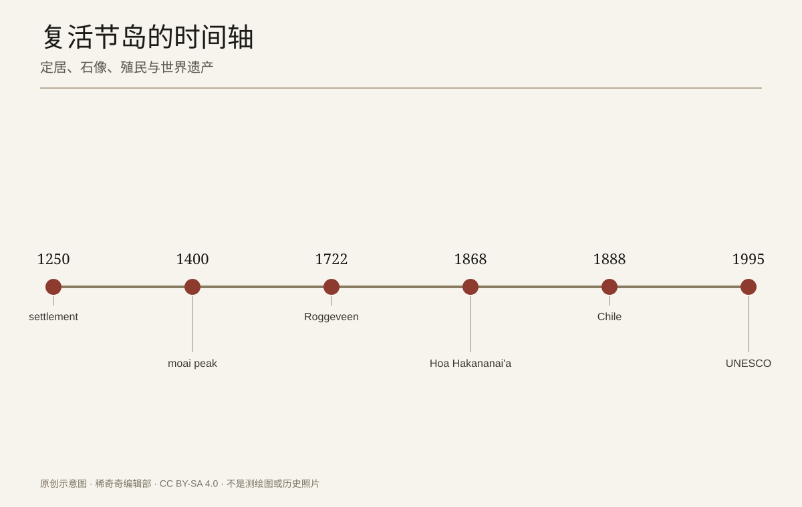
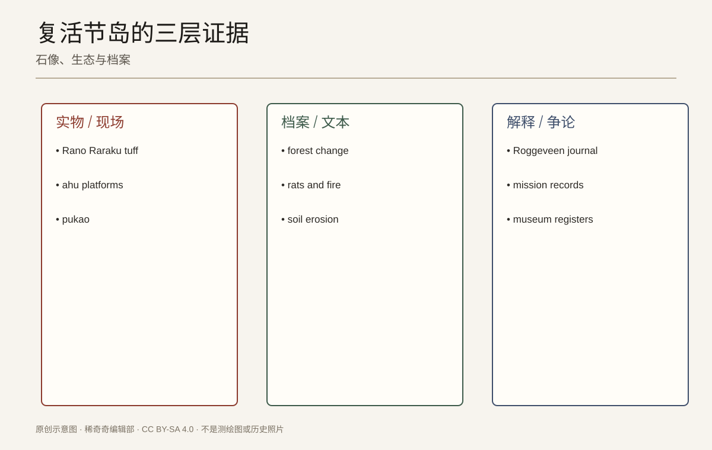

## 一、石像之岛

复活节岛在太平洋东南部，面积约 163 平方公里，距智利本土约 3500 公里，是地球上最偏远的有人居住岛屿之一。岛上已记录的摩艾石像接近千尊，多数用火山凝灰岩雕刻，集中在拉诺拉拉库采石场附近；一部分被竖立在称为“阿胡”的石台上，另一部分仍半埋在山坡。石像不是统一的“头像”：有的只有头部，有的连身体，有的头上还顶着红色的普卡奥发髻。

## 二、采石、运输与“走路”之争

摩艾主要在拉诺拉拉库的凝灰岩崖壁上雕刻，再由 teams 运往海岸。运输方式争论了一个多世纪：木橇与滚木、绳索牵引、独木舟式滑运，以及 2012 年实验提出的“直立摇晃行走”模型。每种方案都能在局部试验中移动复制品，却难以解释全部路线、坡度和石像尺寸。岛上没有足够的大树制造滚木，这使“滚木运输”假说必须面对资源约束；但“走路”模型也需要平坦路面和大量人力。

*原创示意图：复活节岛从波利尼西亚定居到世界遗产登录的时间轴。不是测绘图。稀奇奇编辑部，CC BY-SA 4.0。*

## 三、阿胡、祖先与鸟人

竖立的摩艾通常背对海洋、面向村落，立在阿胡平台上。平台既是墓室，也是仪式中心：石像代表祖先，面向生者，承担保护与丰产的功能。岛上另有“鸟人”崇拜，集中在奥龙戈的悬崖村落；每年比赛收集乌燕鸥蛋，胜者获得“ tangata manu ”称号。祖先崇拜与鸟人仪式并不矛盾，它们共同构成一个以血缘、季节和资源为中心的社会。

## 四、生态、人口与崩溃叙事

岛上的森林在人类到来后大幅减少，老鼠、火灾、农耕和木材使用都可能参与其中。一种流行叙事说，岛民为了竖立石像砍光森林，最终陷入饥荒和内战；另一种研究强调，土壤侵蚀和干旱有自然因素，人口下降也与欧洲人带来的疾病、奴隶 raid 和殖民压力有关。两种解释并不互相取消。可以确认的是，森林确实减少，社会确实在 19 世纪经历剧变；不能确认的是，单一原因能在什么时间尺度上解释全部变化。

*原创示意图：复活节岛的石像、生态与档案三层证据。不是测绘图。稀奇奇编辑部，CC BY-SA 4.0。*

## 五、殖民接触与文物流散

1722 年，荷兰航海家罗赫芬的船队到达，欧洲人开始记录这座岛。19 世纪，传教士、商人和智利军舰相继到来；1860 年代，岛上人口因疾病和武装 raid 急剧下降。1868 年，英国军舰 Topaze 带走一尊摩艾，后来以“ Hoa Hakananai'a ”之名入藏大英博物馆。1888 年，智利正式兼并该岛。石像、木刻板和骨骸由此分散到欧洲与美洲的博物馆，岛上的社会结构也被传教、租地和殖民行政重塑。

## 六、国家公园、社区与归还请求

复活节岛在 1995 年列入世界遗产，国家公园覆盖大部分遗址。今天岛上面临旅游压力、外来物种、海岸侵蚀和有限的水资源；遗址保护与拉帕努伊社区的土地、就业和自治诉求交织在一起。2018 年以来，岛民与智利政府多次要求大英博物馆归还 Hoa Hakananai'a，讨论涉及殖民取得、法律所有权和“世界博物馆”理念。石像是否“属于全人类”，与岛民是否能在自己的土地上看到祖先，是两个需要同时回答的问题。

## 来源与证据

本文的可核对材料主要来自 S1《Rapa Nui National Park》与 S2《Monumentos Nacionales》；S3 及后续编号为编辑部制作的封面、示意图或补充说明，只用于视觉与背景，不作为史实依据。正文中的年代、数量、地点与归属判断，尽量回到 S1/S2 的具体页面。

封面是「复活节岛：石像、祖先与一座岛的账」的 AI 辅助场景复原，不是现场照片；两张插图为原创示意图，不是测绘图。图片类型与许可逐行记录在 research/image-audit.csv。

## 档案位置

复活节岛的档案分散在三个方向：智利国家纪念物委员会与国家公园管理方保存遗址登记、修复和游客管理文件；岛上的人类学博物馆（Museo Antropológico Padre Sebastián Englert）收藏摩艾、木刻板与口述记录；欧洲博物馆则保存 19 世纪带走器物的入藏档案。石像的测绘编号、平台名称和村落归属在不同目录中并不统一，早期探险者的日记还常把地点记错。本文使用的年代与数量来自世界遗产文本和公开考古综述；更细的采石场编号、运输实验数据与土地权属，仍要回到上述档案。

## 档案空白

复活节岛的年代框架、人口规模与生态变化仍有争论。摩艾的运输方式没有一种被完全证实；所谓“生态自杀”与“外来疾病和奴役导致崩溃”两种叙事，各自选择不同的证据。石像的数量、哪些曾被竖立、哪些留在采石场，也随调查方法变化。本文把可测的石材、平台和档案记录放在前面，把“消失的文明”式概括放在解释层，并明确标注仍属假说的部分。

---

**来源与许可**：本文的事实来源见条目底部来源台账 S1–S3。文字与原创示意图采用 CC BY-SA 4.0。
