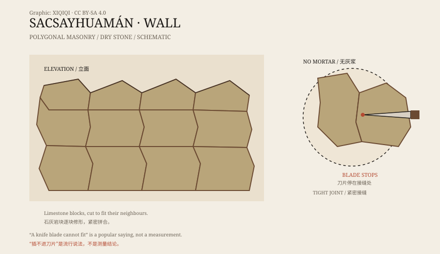

## 1. Above Cusco

Cusco was the old capital of the Inca Empire, more than three thousand metres above sea level and surrounded by mountains.

On a hillside north of the city stands a complex of massive stone structures called Sacsayhuamán. It rises above Cusco and looks over the valley. What visitors see today is mainly three parallel zigzag walls and the platforms between them.

The Inca called the place a “House of the Sun” or a fortress. Both descriptions fit: it had a religious role and a military one.

## 2. The stones

The stones at Sacsayhuamán are large.

The outer walls are made of polygonal limestone blocks, fitted without mortar, shaped and polished to sit against one another. The wall line zigzags: one block projects, the next recesses, like a puzzle.

The largest blocks are estimated at more than a hundred tonnes. They are not regular cubes. Each was cut to match the shape of its neighbours.

“So tight a knife blade cannot fit” is a popular description. In reality the joints vary in width, but the overall fit is extraordinarily close. Without mortar, that precision allows the walls to shift slightly in an earthquake instead of simply collapsing.

*Original schematic: the zigzag arrangement and polygonal block fit at Sacsayhuamán. Not a precise survey. Oddity Archive, CC BY-SA 4.0.*

## 3. How they were fitted

The Inca had no iron tools and no wheeled vehicles.

They used harder stones as hammers and chisels, repeatedly striking and grinding the limestone into the required shape. Blocks were test-fitted on the ground and then raised into the wall. Some stones still show protruding “handles,” used for ropes or levers and knocked off after construction.

The method took enormous time and labour, but it is not mysterious. What astonishes people is the scale: not one or two blocks, but whole walls, and several of them.

## 4. How they were moved

Transport is another problem.

The quarry was nearby, but moving blocks of tens or hundreds of tonnes up a slope was still difficult. Proposed methods include wooden sledges and ropes, earthen ramps and rubble ramps, levers, and rolling logs under the stone.

No construction drawings or written instructions survive. We can only infer what they might have done from tool marks, the terrain, and other Inca engineering.

## 5. Who built it

The main construction at Sacsayhuamán dates to the fifteenth century and is usually credited to the Inca emperor Pachacuti and his successors.

In 1536, Inca forces fought the Spanish here. Afterward, the Spanish removed large quantities of stone for churches and houses in Cusco. What remains today is only part of the original complex.

Sacsayhuamán is therefore not just a wall but a ruined and quarried site. Its complete appearance cannot be fully reconstructed.

## 6. Now

Sacsayhuamán is one of Cusco's best-known archaeological sites and the setting for the annual Sun Festival.

Visitors climb the steps and see the walls, the platforms, and the city below. The blocks still lock together, without mortar, without steel, and without modern machinery.

It does not need an alien explanation. It needs a great many people, a very long time, and the patience to treat stone as a puzzle.

---

**Sources and licenses**: the factual sources are listed in the source ledger S1–S3 at the bottom of this entry. Text and original diagrams are licensed under CC BY-SA 4.0. This article separates the physical site, Inca stoneworking, and hypotheses about transport; “a knife blade cannot fit” is a popular saying, not a precise measurement.
