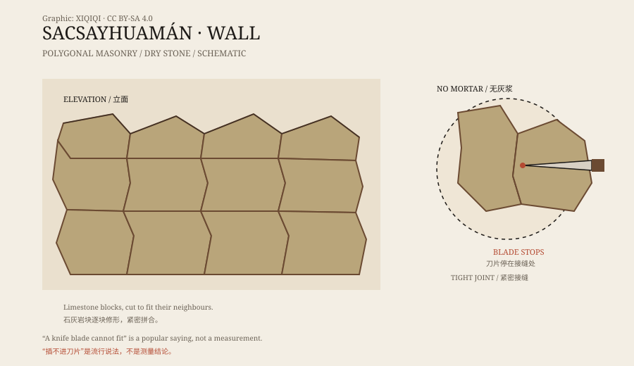

## 一、库斯科的上面

库斯科是印加帝国的旧都，海拔三千多米，四周是山。

城北的山坡上，有一组巨大的石构建筑，叫萨克塞瓦曼。它高出城市，能俯瞰整个谷地。今天看到的，主要是三道平行的锯齿状外墙和它们之间的平台。

印加人称这里为“太阳的房子”或“堡垒”，两种说法都成立：它既有宗教功能，也有军事功能。

## 二、石头

萨克塞瓦曼的石头很大。

外墙由多边形的石灰岩块拼成，石块之间没有灰浆，直接靠切割和打磨贴合。墙面呈锯齿状，一块石头凸出，下一块凹进去，像拼图。

最大的一批石块，估计超过一百吨。它们不是规则的方块，而是根据相邻石头的形状，一块一块修出来的。

“连刀片都插不进去”是一个流传很广的说法。实际上，石缝有宽有窄，但整体贴合程度确实非常高。在没有灰浆的情况下，这种精度足以让墙体在地震中轻微移动，而不是直接倒塌。

*原创示意图：萨克塞瓦曼墙体的锯齿排列与多边形石块拼合。不是精确测绘图。稀奇奇编辑部，CC BY-SA 4.0。*

## 三、怎么拼

印加人没有铁制工具，也没有带轮子的运输车。

他们用更硬的石头做成锤子和凿子，靠反复敲击和打磨，把石灰岩修成需要的形状。石块先在地面上试拼，合适了再抬到墙上。有的石面上还留着凸起的“把手”，用来穿绳或撬动，完工后再敲掉。

这种工法需要大量时间和人力，但不神秘。真正让人惊讶的，是规模：不是一块两块，而是整面墙、整组墙。

## 四、怎么搬

搬运是另一个问题。

采石场在附近，但要把几十吨、上百吨的石头运上山坡，仍然不容易。研究者提出的方法包括：用木橇和绳索拖拽，用土坡和碎石坡做斜坡，用杠杆撬动，或者在石头下面垫圆木。

没有留下施工图，也没有留下文字说明。我们只能从石头的痕迹、现场的地形和印加人的其他工程中，推断他们可能用了什么办法。

## 五、谁建的

萨克塞瓦曼的主要建造时间在十五世纪，通常归功于印加皇帝帕查库特克，以及他的继任者。

1536 年，印加人在这里与西班牙人交战。此后，西班牙人拆走了大量石块，用于修建库斯科的教堂和房屋。今天看到的墙体，只是原来建筑群的一部分。

所以，萨克塞瓦曼不只是一道墙，也是一个被拆散过的遗址。它的完整样子，已经无法完全复原。

## 六、现在

萨克塞瓦曼是库斯科最著名的考古遗址之一，也是每年太阳节庆典的举办地。

游客沿着台阶走上去，可以看到石墙、平台和远处的城市。墙上的石块仍然紧密地咬在一起，没有灰浆，没有钢筋，也没有现代机械。

它不需要“外星人”的解释。它需要的是大量的人、很长的时间，以及一种把石头当成拼图来对待的耐心。

---

**来源与许可**：本文的事实来源见条目底部来源台账 S1–S3。文字与原创示意图采用 CC BY-SA 4.0。文中把遗址的实物、印加石工技术和搬运假说分开叙述；“刀片插不进去”是流行说法，不是精确测量结论。
