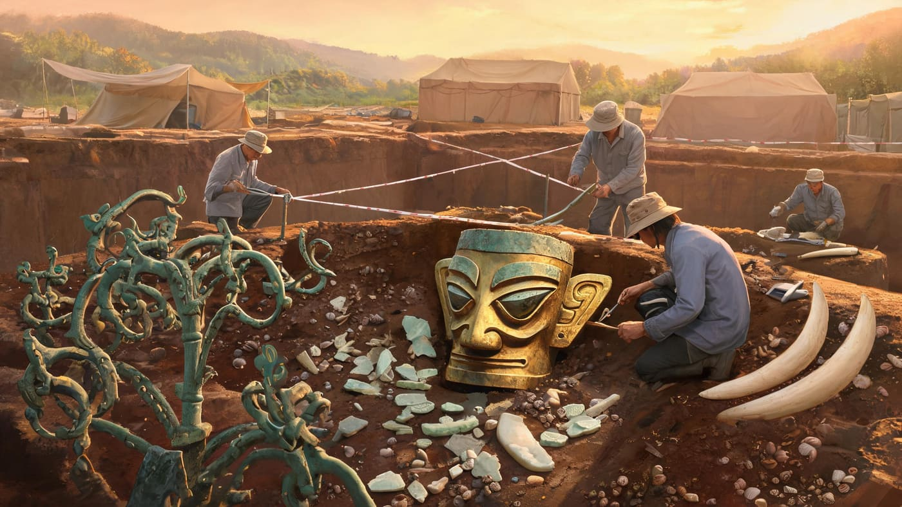
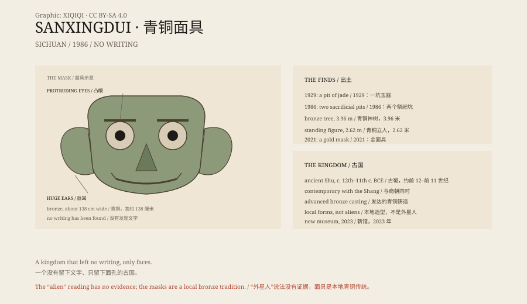

## 1. 1929

In 1929 a farmer near Guanghan, Sichuan, was digging a ditch by his yard when he unearthed a pit of jade objects.

He took them home. Local soldiers and scholars eventually learned of the find, and the name Sanxingdui began to appear in archaeological records.

## 2. 1986

In 1986 two sacrificial pits were discovered.

The pits were not large, and the objects were packed together. Bronze masks, ivory, jade and sea shells lay as if a whole ceremony had been buried at once. Archaeologists crouched at the edge, cleaning the earth with bamboo picks and brushes.

They were filled with bronzes, gold, jade, ivory and sea shells. The most striking objects were the bronze masks: bulging eyes, enormous ears, mouths stretching almost to the edge of the face.

The eyes projected forward, and the ears opened to the sides. They did not seem to be looking at you, but at something behind you.

*Reconstruction: the excavation of a Sanxingdui sacrificial pit in 1986. Not a historical photograph. Oddity Archive, CC BY-SA 4.0.*

There was also a bronze tree nearly four metres tall, a bronze standing figure more than two metres high, and a gold staff.

## 3. Ancient Shu

Sanxingdui belongs to the ancient Shu civilisation, dated to roughly the twelfth to eleventh century BCE.

The Shu kingdom lay on the Chengdu Plain, contemporary with the Shang dynasty to the north. It had advanced bronze casting but left no writing.

Without writing, we do not know what they called themselves, or whether the masks represented gods, ancestors or priests.

## 4. The Gold Mask

In 2021 a gold mask was found in one of the new pits.

It weighs about 280 grams and is roughly 84 percent gold, close in size to the bronze masks. It may originally have covered a bronze head.

The same excavations found traces of silk, ivory and objects never seen before.

## 5. Aliens

The bronze masks do not look like the people of the Central Plains, and so some people have said they were left by aliens.

That is an internet-age fantasy. Archaeologists point out that Sanxingdui's bronzes and jades show contact with the Central Plains and the Yangtze region, but its forms are a local tradition.

It was not an alien civilisation. It was a kingdom that left no writing and that we still do not fully understand.

## 6. Now

The Sanxingdui Museum is in Guanghan. A new building opened in 2023, displaying the bronze masks, the tree and the gold mask.

The bulging eyes are still looking at us.

We do not know what they are looking at.

*Original schematic: the features of the Sanxingdui bronze masks, the layout of the pits and the 1929–2023 timeline. Not a photograph of an artefact. Oddity Archive, CC BY-SA 4.0.*

---

**Sources and licenses**: the factual sources are listed in the source ledger S1–S4 at the bottom of this entry. Text and original diagrams are licensed under CC BY-SA 4.0. This article separates the 1929 discovery, the 1986 and 2021 pits, the ancient Shu civilisation and the "alien" claims; the site and its objects are archaeological evidence, while the alien claims have none. The illustration is a scene reconstruction, not a photograph of an artefact.
