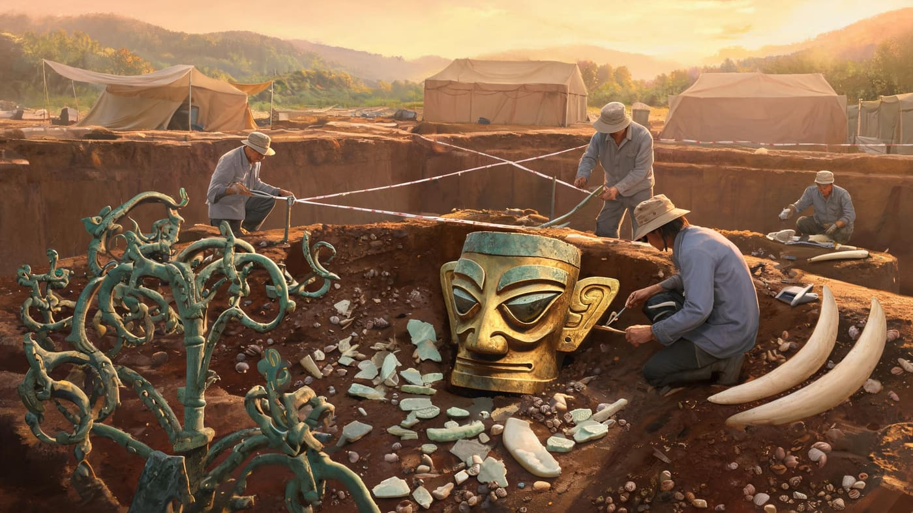
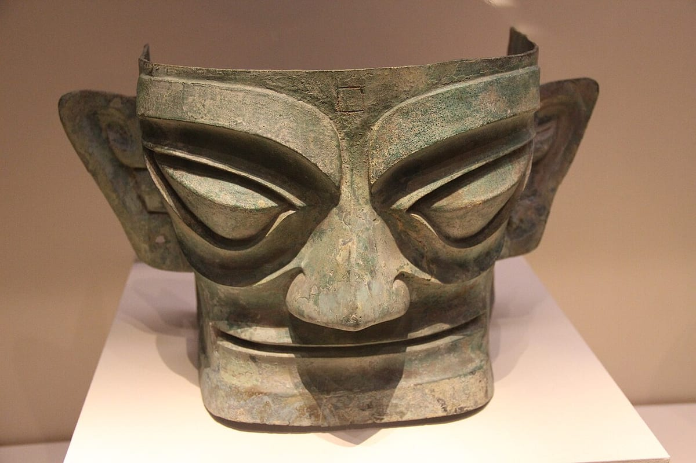
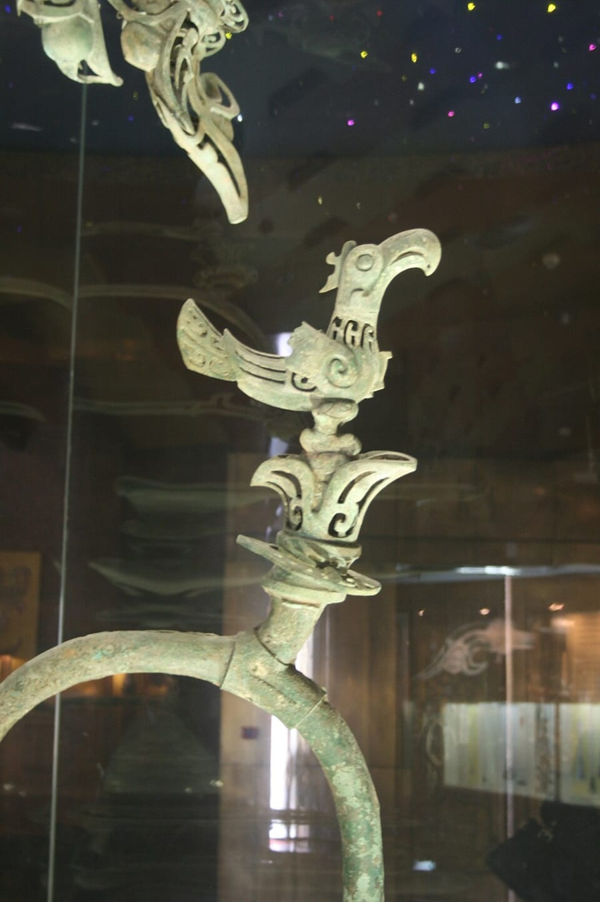
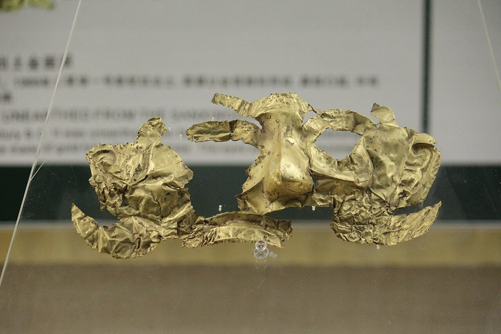
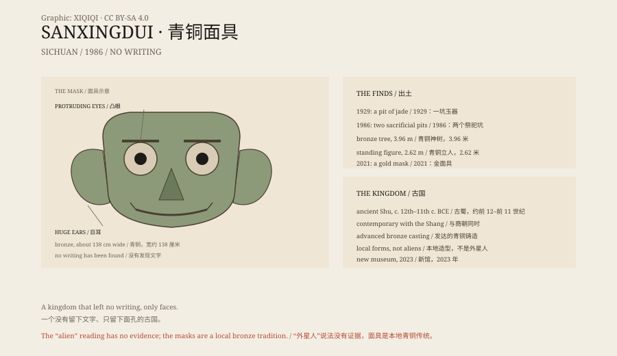

## 1. 1929

Spring 1929, Guanghan, Sichuan. A farmer, Yan Daocheng, was digging an irrigation ditch near his yard when his tool struck something hard. He uncovered a pit of jade and stone.

There were more than three hundred pieces. He took them home. Word reached the local garrison and then scholars; dealers, missionaries and university teachers came to look. In 1934 a team from West China Union University made the first trial excavation.

The name Sanxingdui began to appear in archaeological records.

## 2. 1986

In July 1986 local workers digging on the site uncovered a sacrificial pit.

The pit was not large. The objects were packed together: bronze masks, ivory, jade, cowrie shells, as if someone had buried an entire ritual in the ground. The archaeologists knelt at the edge and cleaned the earth away with bamboo sticks and brushes.

Less than a month later, on 14 August 1986, a second pit was found about thirty metres away. It held roughly eight hundred objects: bronze heads, animal masks, bells, dragons, snakes, birds, axes; gold masks, a gold staff and a gold belt; jade tablets, discs, rings, knives; ivory and cowries.

Most of the objects had been smashed and burned before they were carefully buried. This was not rubbish disposal. It looks like a ritual destruction.

*Reconstruction: the excavation of a sacrificial pit at Sanxingdui in 1986. Not a historical photograph. XIQIQI Editorial, CC BY-SA 4.0.*

## 3. The Objects

The bronze masks and heads draw the eye first.

The eyes bulge outward, the ears flare to both sides, the mouth runs almost to the jaw. Some heads still carry black paint on the eyes, and vermilion in the lips, nostrils and ear holes. At least six heads were originally covered with gold foil masks. They do not seem to be looking at you. They seem to be looking at something behind you.

There is also a bronze tree 396 centimetres tall, with birds, flowers and ornaments, its branches in three tiers of three. There is a bronze standing figure 2.62 metres tall, both hands raised in front of the chest, fingers curled around a ring. There is a gold staff engraved with human heads, fish and birds. There is a jade zhang blade 54 centimetres long.

Task Rosen, chief archaeological expert at the British Museum, considered these bronzes more outstanding than the Terracotta Army in Xi'an. Parts of the find were exhibited in Beijing in 1987 and 1990, and at the Olympic Museum in Lausanne in 1993.

*Site photograph: a bronze mask from Sanxingdui, 2011. Gary Todd, CC0 (Wikimedia Commons). The eyes, ears and mouth are exaggerated far beyond human scale.*

*Site photograph: a detail of the bronze tree at Sanxingdui, 2008. Gary Todd, CC0 (Wikimedia Commons). A bird stands on a branch above a flower-like cluster.*

## 4. Shu and Writing

Sanxingdui belongs to the ancient culture of Shu. Radiocarbon dating places the artefacts in the twelfth to eleventh centuries BCE; the wider Sanxingdui culture runs from about 1700 to 1150 BCE.

It was contemporary with the Shang dynasty of the Central Plain, and it developed a bronze art completely unlike the Shang. It had a walled city, founded around 1600 BCE: trapezoidal, with canals outside the walls and residential, workshop and religious districts inside, arranged along a central axis. It was a society under a strong central theocracy, trading for bronze material with the Yin and for ivory with South Asia.

It left no writing. Without writing we do not know what they called themselves, or whether the masks were gods, ancestors or priests. We know only that a kingdom lasted here long before Qin conquered Shu in 316 BCE.

The Chronicles of Huayang record that the first king of Shu, Cancong, had protruding eyes. Many of the Sanxingdui masks and heads have exactly that. Some scholars therefore read the great masks as portraits of Cancong; others read the protruding eyes as a cult of the eye, and there are eye-shaped objects that support this.

## 5. How the Masks Were Used

The masks were not wall decorations.

Their size and structure suggest they were fixed to wooden supports or totems, or worn over clothing. The eyes, ears and mouth are enormous, covering the wearer's face. Liu Yang and other scholars argue that such masks may have been worn by a shi, the "personator" in a sacrifice: usually a young close relative of the dead, dressed and masked to represent the ancestor and receive the offerings in their place.

The French sinologist Corinne Debaine-Francfort noticed the colours on the masks: black on the over-large eyes and eyebrows, vermilion in the lips, nostrils and ear holes. She reads them not as decoration but as ritual offering, something for the mask to taste, smell and hear, or something that gave it the power to breathe, hear and speak.

Birds, dragons, snakes and tigers recur in the bronze work. These four animals correspond to the four quadrants of the Chinese sky. Without writing we cannot say whether the bronzes encode a cosmology. We can say they were not cast at random.

## 6. The New Pits

Between 2020 and 2022 the archaeologists found six more sacrificial pits on the site.

In March 2021 they announced more than five hundred new objects, including a gold mask three thousand years old. The mask is about 84 per cent gold and weighs around 280 grams, close in size to the bronze masks; it may originally have covered a bronze head. The same excavation produced traces of silk, ivory and bronze vessels of kinds never seen before.

In December 2021 the first open conservation and restoration hall in China opened at Sanxingdui, where visitors can watch conservators work through glass. On 28 July 2023 the new Sanxingdui Museum building opened, several times the size of the old one.

*Site photograph: a fragment of a gold mask from Sanxingdui, 2010. Gary Todd, CC0 (Wikimedia Commons). The gold foil was pressed into a mask shape; the edges are torn and crumpled.*

## 7. The Alien Story

The bronze masks do not look like people from the Central Plain. So some people say aliens made them.

That is an internet-age idea. Archaeologists point out that Sanxingdui's bronzes and jades share materials and forms with the Central Plain and the Yangtze region, while the faces belong to a local tradition: bulging eyes, huge ears, wide mouths, matching the Shu legend of Cancong and the cult of the eye. The casting technique and the ritual assemblage also have parallels along the Yangtze.

It was not an alien civilisation. It was a kingdom without writing, which we still do not fully understand. Its strangeness comes partly from the habit of looking at it from the Central Plain.

## 8. Now

The Sanxingdui Museum stands near Guanghan. The old building opened in 1997; the new one in 2023. In the gallery the bronze masks stand in a row, lit from below, the bulging eyes throwing shadows on the wall.

Those eyes are still looking at us.

We do not know at what.

*Original schematic: the features of the Sanxingdui bronze masks, the layout of the pits and the timeline from 1929 to 2023. Not a photograph of the objects. XIQIQI Editorial, CC BY-SA 4.0.*

---

**Sources and licenses**: sources are listed in the ledger S1–S5 at the foot of this entry. Text and original diagrams are CC BY-SA 4.0. The article keeps apart the 1929 discovery, the 1986 and 2021 pits, the Shu culture and the "alien" claim; the site and the objects rest on archaeology, the alien claim has no evidence. The illustrations are a reconstruction, site photographs and a schematic, not conservation images.
