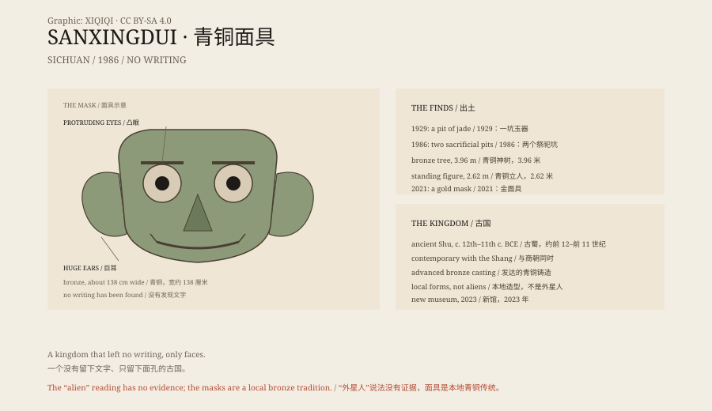

## 一、1929 年

1929 年，四川广汉，一个农民在自家院子附近挖水沟，挖出一坑玉器。

他把玉器拿回家，后来被当地驻军和学者知道。三星堆的名字，开始出现在考古记录里。

## 二、1986 年

1986 年，两个祭祀坑被发现。

坑里堆满了青铜器、金器、玉器、象牙和海贝。最引人注目的是青铜面具：眼睛凸出，耳朵巨大，嘴角咧到耳根。

还有一棵青铜神树，高近四米；一个两米多高的青铜立人；一根金杖。

## 三、古蜀

三星堆属于古蜀文明，年代大约在公元前 12 世纪到前 11 世纪。

古蜀国在成都平原上，和中原的商朝同时。它有发达的青铜铸造技术，却没有留下文字。

没有文字，意味着我们不知道他们怎么称呼自己，也不知道那些面具是神、是祖先，还是祭司。

## 四、金面具

2021 年，新的祭祀坑里出土了一张金面具。

它重约 280 克，含金量约 84%，大小和青铜面具差不多。它可能原本覆盖在青铜人头像上。

同年，还发现了丝绸痕迹、象牙和一些从未见过的器物。

## 五、外星人

三星堆的青铜面具长得不像中原人，于是有人说它是外星人留下的。

这是网络时代的想象。考古学家指出，三星堆的青铜器、玉器和中原、长江流域的文明有交流，但它的造型是本地传统。

它不是外星文明。它是一个没有留下文字的、我们还不完全了解的古国。

## 六、现在

三星堆博物馆在广汉。新馆在 2023 年开放，展出青铜面具、神树和金面具。

那些凸出的眼睛，仍然看着我们。

我们不知道它们在看的什么。

*原创示意图：三星堆青铜面具的特征、祭祀坑布局与 1929–2023 年时间线。不是文物照片。稀奇奇编辑部，CC BY-SA 4.0。*

---

**来源与许可**：本文的事实来源见条目底部来源台账 S1–S4。文字与原创示意图采用 CC BY-SA 4.0。文中把 1929 年发现、1986 年与 2021 年祭祀坑、古蜀文明与“外星人”说法分开叙述；三星堆遗址与器物有考古依据，“外星人”说法没有证据。插图是场景复原，不是文物照片。
