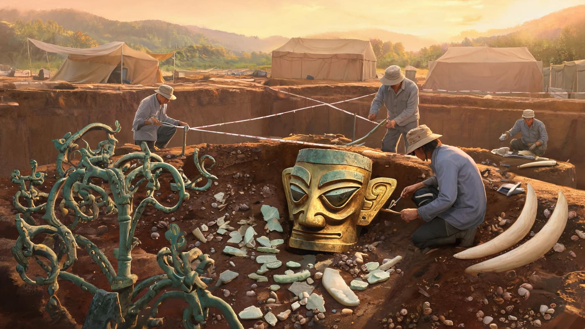
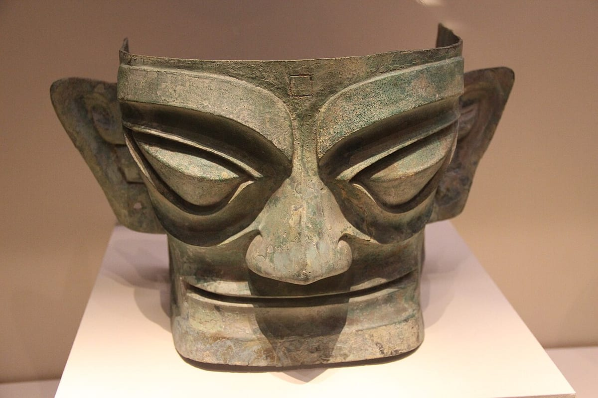
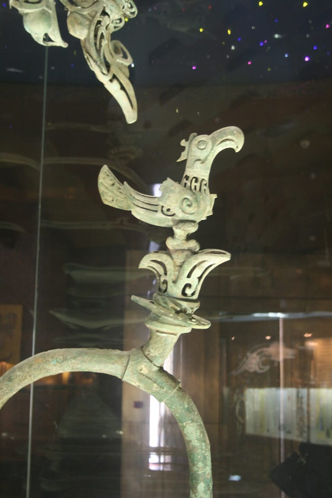
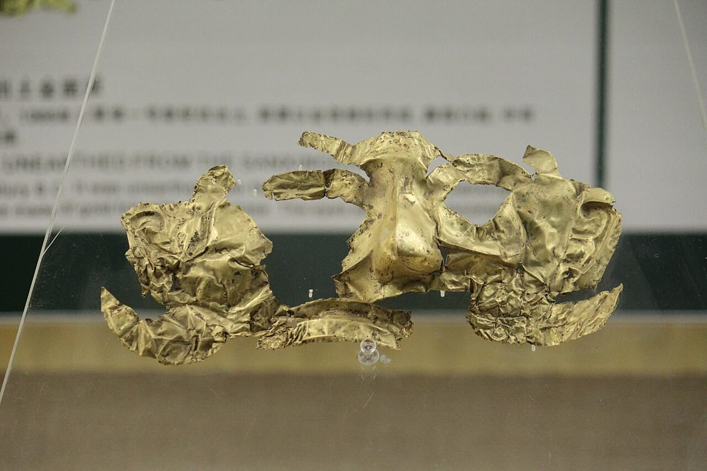
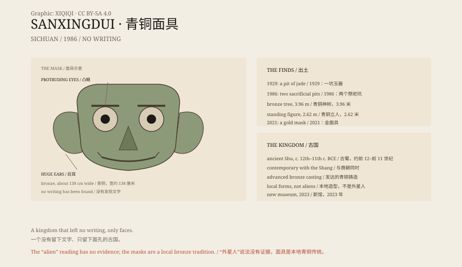

## 一、1929 年

1929 年春，四川广汉。农民燕道诚在自家院子附近挖水沟，铁器碰到硬物，挖出一坑玉石器。

坑里有三百多件玉器。他把东西拿回家，后来被当地驻军和学者知道。消息传出去，成都的古董商、传教士、大学教师陆续来看。1934 年，华西协合大学的人在这里做了第一次试探性发掘。

三星堆的名字，开始出现在考古记录里。

## 二、1986 年

1986 年 7 月，当地工人在遗址上挖土，挖出了一个祭祀坑。

坑不大，东西挤在一起。青铜面具、象牙、玉器、海贝，像有人把一场仪式整个埋进了土里。考古队员蹲在坑边，用竹签和刷子一点点清土。

不到一个月，8 月 14 日，第二个坑在三十米外被发现。坑里约有八百件器物：青铜人头像、兽面、铃、龙蛇鸟兽、斧；金面罩、金杖、金带；玉璋、玉璧、玉环、玉刀；还有象牙和海贝。

这些器物大多被砸碎、烧过，再有序地埋好。不是丢弃，更像一场仪式性的毁坏。

*场景复原：1986 年三星堆祭祀坑的发掘现场。不是历史照片。稀奇奇编辑部，CC BY-SA 4.0。*

## 三、器物

最引人注目的是青铜面具和头像。

眼睛向外凸，耳朵向两边张开，嘴咧到耳根。有的头像眼睛上还留着黑色的颜料，嘴唇、鼻孔和耳孔里有朱砂。至少六件头像原本贴着金箔面罩。它们不像在看你，更像在看你身后的什么东西。

还有一棵青铜神树，高 396 厘米。树上有鸟、花和装饰，树枝分三层，每层三枝。一个两米六二的青铜立人像，双手举在胸前，握成环状。一根金杖，上面刻着人头、鱼和鸟的图案。一把五十四厘米长的玉璋。

英国博物馆的考古专家 Task Rosen 看过这批青铜器，认为它们比西安的兵马俑更出色。1987 年和 1990 年，部分器物在北京展出；1993 年，在洛桑的奥林匹克博物馆展出。

*现场照片：三星堆出土的青铜面具，2011 年。Gary Todd，CC0（Wikimedia Commons）。面具的眼睛、耳朵和嘴被夸张放大。*

*现场照片：三星堆青铜神树的局部，2008 年。Gary Todd，CC0（Wikimedia Commons）。树枝上立着一只鸟，下面是花果。*

## 四、古蜀与文字

三星堆属于古蜀文明。碳十四测年把它的年代定在公元前 12 到前 11 世纪；整个三星堆文化的时间跨度，大约从公元前 1700 年到前 1150 年。

它和中原的商朝同时，却有一套完全不同的青铜艺术。它有城墙：城址约在公元前 1600 年建成，梯形，墙外有运河，城里有居住区、作坊区和宗教区，沿着一条中轴线分布。它是一个有强势中央神权的社会，和殷地有青铜料的贸易，象牙则来自南亚。

它没有留下文字。没有文字，我们不知道他们怎么称呼自己，也不知道那些面具是神、是祖先，还是祭司。我们只知道，公元前 316 年秦国灭蜀之前，这里已经有一个持续了很久的王国。

《华阳国志》记载，古蜀的开国之王叫蚕丛，眼睛是凸出的。三星堆的许多面具和头像，眼睛正好凸出。有人据此认为，大面具就是蚕丛的形象；也有人认为，凸眼代表的是对眼睛的崇拜，另有一些眼形器物支持这个说法。

## 五、面具怎么用

这些面具不是挂在墙上的装饰。

它们的尺寸和结构说明，它们可能被固定在木制支架或图腾上，也可能被穿在衣服上。面具的眼睛、耳朵和嘴都做得极大，遮住佩戴者的脸。刘洋等学者认为，这类面具可能由“尸”（祭祀时代表死者的替身）佩戴；尸通常是死者的年轻近亲，穿戴上模仿死者的衣饰和面具，在仪式里代替死者接受祭祀。

法国汉学家柯琳娜·德拜纳-弗朗克福（Corinne Debaine-Francfort）注意到面具上的颜色：黑色涂在过大的眼睛和眉毛上，朱砂涂在嘴唇、鼻孔和耳孔里。她认为，这些颜色不是装饰，而是仪式性的供奉——让面具“尝到、闻到、听到”，或者给它呼吸、说话的能力。

三星堆的青铜器里，鸟、龙、蛇、虎反复出现。这四种动物，正好对应中国古代四方星宿的四种象征。没有文字，我们无法确定它们是不是在讲一个宇宙模型；但可以确定，这些东西不是随便铸的。

## 六、2021 年的新坑

2020 年到 2022 年，考古队又在遗址上发现了六个祭祀坑。

2021 年 3 月，考古队公布了五百多件新器物，包括一张三千年前的金面具。这张面具含金量约 84%，重约 280 克，大小和青铜面具差不多；它可能原本覆盖在青铜人头像上。同一批器物里，还有丝绸的痕迹、象牙、以及一些从未见过的青铜器。

2021 年 12 月，全国首个开放式文物保护与修复馆在三星堆开馆，游客可以隔着玻璃看修复师工作。2023 年 7 月 28 日，三星堆博物馆新馆（陈列馆）正式开放，建筑面积比老馆大好几倍。

*现场照片：三星堆出土的金面具残片，2010 年。Gary Todd，CC0（Wikimedia Commons）。金箔被压成面具形状，边缘有撕裂和褶皱。*

## 七、外星人

三星堆的青铜面具长得不像中原人，于是有人说它是外星人留下的。

这是网络时代的想象。考古学家指出，三星堆的青铜器、玉器和中原、长江流域的文明有交流，但它的造型是本地传统：凸眼、大耳、咧口，和古蜀的蚕丛传说、眼睛崇拜对得上。它的冶铸技术、礼器组合，也能在长江流域找到同类。

它不是外星文明。它是一个没有留下文字的、我们还不完全了解的古国。它的“怪”，是因为我们习惯了中原中心的视角。

## 八、现在

三星堆博物馆在广汉。老馆 1997 年开馆，新馆 2023 年开放。展厅里，青铜面具排成一排，灯光从下面打上来，眼睛的凸起在墙上投出阴影。

那些凸出的眼睛，仍然看着我们。

我们不知道它们在看的什么。

*原创示意图：三星堆青铜面具的特征、祭祀坑布局与 1929–2023 年时间线。不是文物照片。稀奇奇编辑部，CC BY-SA 4.0。*

---

**来源与许可**：事实来源见条目底部来源台账 S1–S5。文字与原创示意图采用 CC BY-SA 4.0。文中把 1929 年发现、1986 年与 2021 年祭祀坑、古蜀文明与“外星人”说法分开叙述；三星堆遗址与器物有考古依据，“外星人”说法没有证据。插图是场景复原、现场照片与示意图，不是文物修复图。
