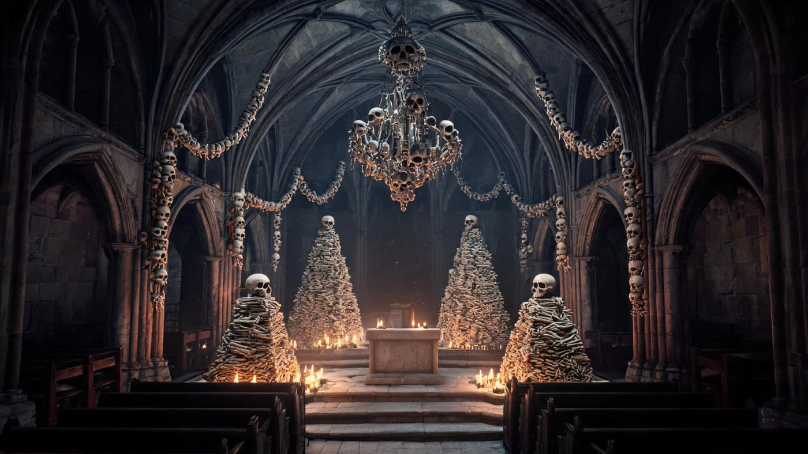
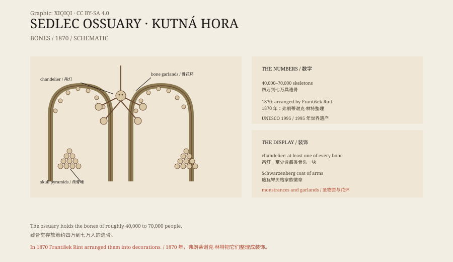

## 1. Sedlec

Sedlec is a village outside Kutná Hora.

In the thirteenth century there was a Cistercian monastery here. According to tradition, the abbot travelled to Jerusalem and brought back soil from Golgotha, which he scattered over the monastery cemetery. After that, the cemetery was considered holy ground, and people from the region wanted to be buried there.

Then came the Black Death, and then the Hussite wars. There were too many dead, and the cemetery was enlarged again and again, but it was never enough.

## 2. The bones

In the fifteenth century, a Gothic church was built beside the cemetery, with a crypt to hold the bones dug up from older graves.

The bones kept accumulating. By the nineteenth century, the crypt held the remains of roughly 40,000 to 70,000 people. They were stacked in pyramids or piled against the walls, waiting for someone to deal with them.

In 1870, the Schwarzenberg family hired a woodcarver, František Rint, to put the bones in order.

The stairs down are narrow, and the temperature drops as you descend. The crypt is low, the vault close, the light warm. Look up: the chandelier hangs in the centre, skulls facing four directions, femurs running through it. The gaps between the bones are wide, and light leaks down the walls in a net.

*Reconstruction: the bone chandelier, garlands, and corner pyramids inside the Sedlec Ossuary. Not a photograph of the site. XIQIQI Editorial, CC BY-SA 4.0.*

## 3. Rint's work

Rint did not bury the bones or lock them away.

He turned them into decoration.

In the centre of the chapel hangs a chandelier made of femurs, pelvises, skulls, and jawbones. In the corners are pyramids of bone; garlands of bone hang between the arches; near the altar are monstrances made of bone. The most striking piece is a wall display of the Schwarzenberg coat of arms, built from bone: a shield, a helmet, and a raven.

The chandelier is said to contain at least one of every type of bone in the human body.

*Original schematic: the main types of decoration in the ossuary, the origin of the bones, and the 1870 arrangement. Not a photograph. XIQIQI Editorial, CC BY-SA 4.0.*

## 4. What to see

Walking in, the first thing you see is the chandelier.

It hangs from the vault, with skulls on four sides and femurs and pelvises in the middle. Light passes between the bones, and the walls are covered with shadows.

Then come the bone pyramids in the corners. They look like small stacks, with a skull on top and bones crossed on each face. Further in are the altar, the monstrances, and the family coat of arms.

The chapel is not large, but every wall has something to look at. The bones are arranged with care, like an extreme form of architectural ornament.

## 5. The controversy

The chapel has always been controversial.

Some see it as disrespectful, treating human remains as material. Others see it as a tradition of remembering death: in medieval Europe, ossuaries were common, and arranging bones neatly was a way to remind the living that death comes to everyone.

The church says the bones belong to people who can no longer be identified, and that they were arranged for preservation, not for spectacle.

## 6. Now

Kutná Hora became a World Heritage Site in 1995, and the Sedlec Ossuary is part of it.

Large numbers of visitors come every year. The chapel limits the route, forbids touching the bones, and does not allow flash photography. The crypt is cold, and the air smells of stone and old wood.

A basement built to hold the dead has become one of the strangest tourist sites in the Czech Republic.

## Sedlec

Sedlec, near Kutna Hora, Czech Republic.

There is a Cistercian monastery here, built in the twelfth century. Next to the monastery is a cemetery.

## The Cemetery
The cemetery became famous in the fourteenth century.

In 1348, the Black Death reached Bohemia. There were not enough cemeteries and bodies were buried in mass graves. Later, the Hussite Wars brought more deaths.

Around the church is a cemetery.

The cemetery has tombstones, crosses and flowers. Some tombs are very old and some are very new.

## Bone

The bones from the cemetery were moved into a chapel.

There are tens of thousands of skeletons piled in the church. The bones are arranged into pyramids, chandeliers, crosses and family crests.

Tens of thousands of bones, piled together.

They have no names, no tombstones. They only have one room in common.

## Lint

In 1870, carpenter Franzišek Lint was hired to sort the bones.

He bleached, sorted, arranged and made decorations out of the bones. He didn't do it to scare people, but to honor the dead.

## What to See

The most famous thing in the ossuary is the bone chandelier.

A chandelier made from skulls, leg bones and pelvises hangs in the center of the church. There are also bone crosses and bone pyramids on the walls.

## Dispute

The decoration of the ossuary is controversial.

Some people say that this is disrespectful to the deceased; some people say that this is a medieval way of commemorating. A church is a religious place, not a horror attraction.

## Now

The Ossuary is a tourist attraction.

Visitors can visit but cannot touch the bones. Income from the church is used for its upkeep.

## Cistercian

Sedlec Abbey, belonging to the Cistercian Order.

The Cistercians were a strict religious order that advocated simplicity, labor and prayer. The monastery had fields, workshops and a church.

## Black Death

In the fourteenth century, the Black Death spread to Europe.

There were not enough cemeteries and bodies were buried on top of each other. Later, the bones were moved into the church and piled into a pyramid.

## Decorate

Lint arranged the bones into decorations.

He used skulls for chandeliers, leg bones for crosses, and pelvises for coats of arms. He did it not for terror, but for remembrance.

## Travel

The Ossuary is one of the most popular attractions in the Czech Republic.

Tourists come to see the bones and also to see the church. Ticket revenue is used for maintenance.

Bones are not horror decoration. They are all the leftovers of many people, placed in the same room.

The bones in the ossuary come from different eras and different families. They left no names, only bones. The bones are arranged as decoration and as a reminder that death is a common end.

Bones were piled together without names. They only remind the living: there won’t be too many left in the end.

## Church

The Ossuary is a small church.

It has vaults, windows and an altar. Bones adorn the walls, ceilings and chandeliers.

## File

Sedlec Ossuary in Kutna Hora, Czech Republic. The Black Death in the 14th century and the Hussite Wars in the 15th century left behind a large number of bones. In 1870, woodcutters arranged them into decorative arrangements.

---

**Sources and licenses**: the factual sources are listed in the source ledger S1–S3 at the bottom of this entry. Text and original diagrams are licensed under CC BY-SA 4.0. This article separates the cemetery's history, the storage of bones, the 1870 arrangement, and the controversy; estimates of the number of skeletons range from 40,000 to 70,000, and the church's religious interpretation differs from the curiosity of visitors.
