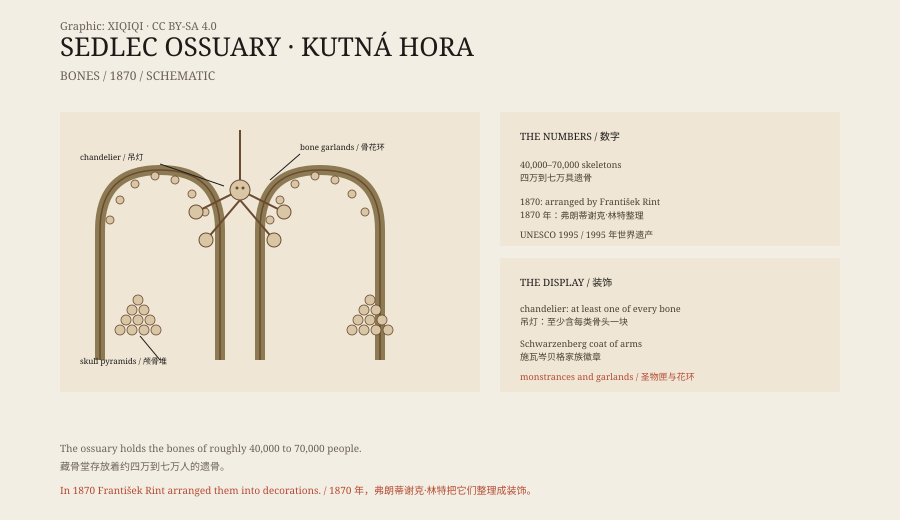

## 1. Sedlec

Sedlec is a village outside Kutná Hora.

In the thirteenth century there was a Cistercian monastery here. According to tradition, the abbot travelled to Jerusalem and brought back soil from Golgotha, which he scattered over the monastery cemetery. After that, the cemetery was considered holy ground, and people from the region wanted to be buried there.

Then came the Black Death, and then the Hussite wars. There were too many dead, and the cemetery was enlarged again and again, but it was never enough.

## 2. The bones

In the fifteenth century, a Gothic church was built beside the cemetery, with a crypt to hold the bones dug up from older graves.

The bones kept accumulating. By the nineteenth century, the crypt held the remains of roughly 40,000 to 70,000 people. They were stacked in pyramids or piled against the walls, waiting for someone to deal with them.

In 1870, the Schwarzenberg family hired a woodcarver, František Rint, to put the bones in order.

## 3. Rint's work

Rint did not bury the bones or lock them away.

He turned them into decoration.

In the centre of the chapel hangs a chandelier made of femurs, pelvises, skulls, and jawbones. In the corners are pyramids of bone; garlands of bone hang between the arches; near the altar are monstrances made of bone. The most striking piece is a wall display of the Schwarzenberg coat of arms, built from bone: a shield, a helmet, and a raven.

The chandelier is said to contain at least one of every type of bone in the human body.

*Original schematic: the main types of decoration in the ossuary, the origin of the bones, and the 1870 arrangement. Not a photograph. Oddity Archive, CC BY-SA 4.0.*

## 4. What to see

Walking in, the first thing you see is the chandelier.

It hangs from the vault, with skulls on four sides and femurs and pelvises in the middle. Light passes between the bones, and the walls are covered with shadows.

Then come the bone pyramids in the corners. They look like small stacks, with a skull on top and bones crossed on each face. Further in are the altar, the monstrances, and the family coat of arms.

The chapel is not large, but every wall has something to look at. The bones are arranged with care, like an extreme form of architectural ornament.

## 5. The controversy

The chapel has always been controversial.

Some see it as disrespectful, treating human remains as material. Others see it as a tradition of remembering death: in medieval Europe, ossuaries were common, and arranging bones neatly was a way to remind the living that death comes to everyone.

The church says the bones belong to people who can no longer be identified, and that they were arranged for preservation, not for spectacle.

## 6. Now

Kutná Hora became a World Heritage Site in 1995, and the Sedlec Ossuary is part of it.

Large numbers of visitors come every year. The chapel limits the route, forbids touching the bones, and does not allow flash photography. The crypt is cold, and the air smells of stone and old wood.

A basement built to hold the dead has become one of the strangest tourist sites in the Czech Republic.

---

**Sources and licenses**: the factual sources are listed in the source ledger S1–S3 at the bottom of this entry. Text and original diagrams are licensed under CC BY-SA 4.0. This article separates the cemetery's history, the storage of bones, the 1870 arrangement, and the controversy; estimates of the number of skeletons range from 40,000 to 70,000, and the church's religious interpretation differs from the curiosity of visitors.
