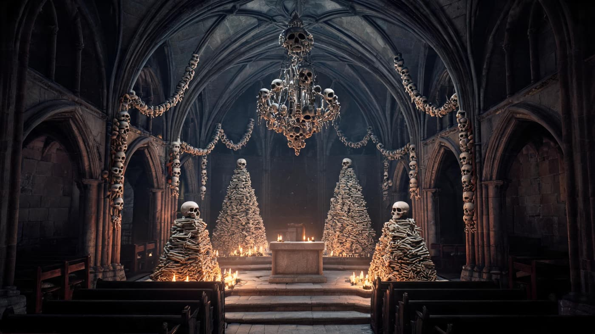
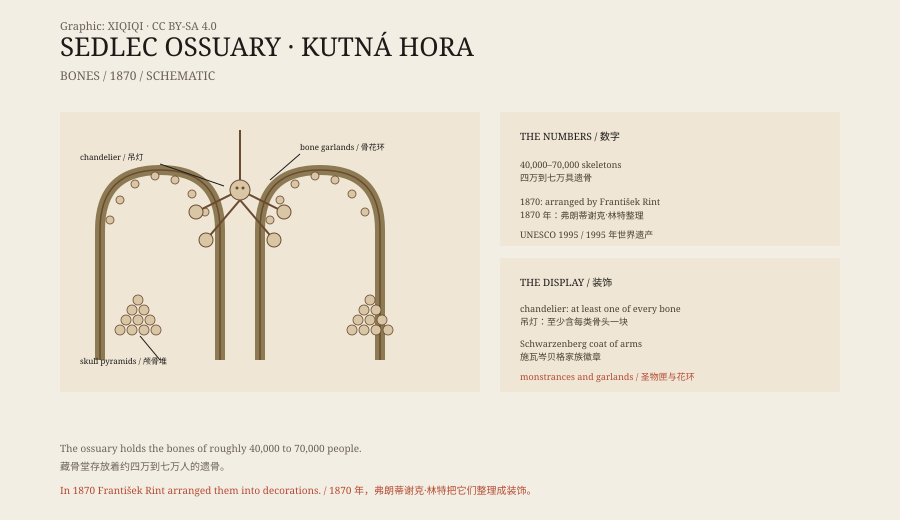

## 一、塞德莱茨

塞德莱茨是库特纳霍拉城外的一个村子。

十三世纪，这里有一座西多会修道院。传说修道院的院长去过耶路撒冷，带回来一把各各他山的土，撒在修道院的墓地里。从那以后，这片墓地就被认为是“圣地”，附近的人争着葬在这里。

黑死病来了，胡斯战争也来了。死人太多，墓地一再扩大，还是不够。

## 二、骨头

十五世纪，墓地旁边建了一座哥特式教堂，地下室用来存放从旧墓里挖出来的骨头。

骨头越堆越多。到了十九世纪，地下室里已经有大约四万到七万人的遗骨。它们被堆成金字塔，或者靠在墙边，等着有人来处理。

1870 年，施瓦岑贝格家族请来木雕师弗朗蒂谢克·林特，让他把这些骨头整理一下。

顺着石阶往下走，温度会先降下来。地下室不高，拱顶压得很低，灯是暖黄色的。抬头，吊灯就挂在正中，四只颅骨朝着四个方向，股骨从中间穿过去。骨头之间的缝隙很宽，光从上面漏下来，落在墙上，像一张网。

*场景复原：塞德莱茨藏骨堂内部的骨骸吊灯、骨环与四角的骨堆。不是现场照片。稀奇奇编辑部，CC BY-SA 4.0。*

## 三、林特的作品

林特没有把骨头埋掉，也没有把骨头锁起来。

他把它们变成了装饰。

教堂中央挂着一盏吊灯，用股骨、骨盆、颅骨和下颌骨拼成。墙角有骨头堆成的金字塔，拱门上有骨头串成的花环，祭坛旁有骨头做的圣物匣。最醒目的是一面墙上的施瓦岑贝格家族徽章，用骨头拼出盾牌、头盔和一只乌鸦。

据说，那盏吊灯至少包含了人体每一类骨头中的一块。

*原创示意图：藏骨堂的主要装饰类型、骨骼来源与 1870 年的整理。不是现场照片。稀奇奇编辑部，CC BY-SA 4.0。*

## 四、看什么

走进教堂，先看到的是吊灯。

它从拱顶垂下来，四边挂着颅骨，中间是股骨和骨盆。灯光从骨头之间穿过去，墙上全是影子。

然后是四角的骨头堆。它们像小金字塔，顶端放着颅骨，四面用交叉的骨头固定。再往里，是祭坛、圣物匣和那面家族徽章。

教堂不大，但每一面墙都有东西可看。骨头被排列得很整齐，像是某种极端的建筑装饰。

## 五、争议

这座教堂一直有争议。

有人认为它是对死者的不敬，把遗骨当成材料。也有人认为，它是一种“记住死亡”的传统：在中世纪的欧洲，藏骨堂很常见，把骨头整齐存放，是为了提醒活人，死亡是所有人的归宿。

教堂方面说，这些骨头来自无法辨认的死者，整理它们是为了保存，而不是为了猎奇。

## 六、现在

库特纳霍拉在 1995 年被列入世界遗产，塞德莱茨藏骨堂是其中的一部分。

每年有大量游客来这里。教堂限制参观路线，禁止触摸骨头，也不允许使用闪光灯。地下室很冷，空气里有石头和旧木头的味道。

一座为存放死者而建的地下室，最后成了捷克最奇怪的景点之一。

---

**来源与许可**：本文的事实来源见条目底部来源台账 S1–S3。文字与原创示意图采用 CC BY-SA 4.0。文中把墓地历史、骨骼存放、1870 年整理与争议分开叙述；骨骼数量在不同资料中记为四万到七万，教堂的宗教解释与游客的猎奇视角并不相同。
