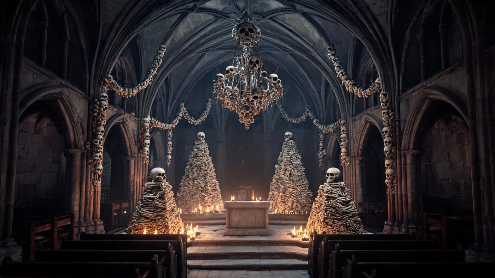
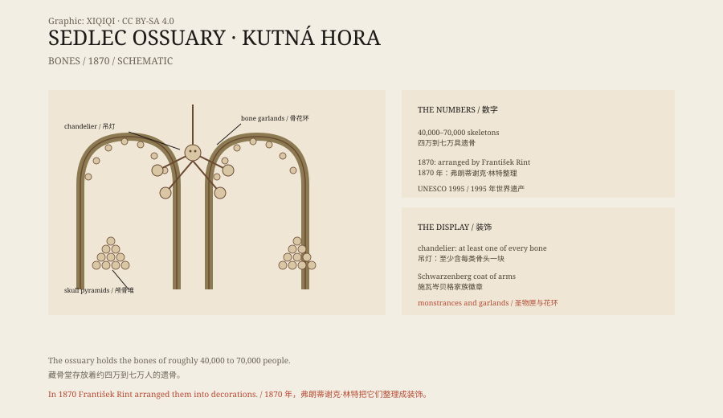

## 一、塞德莱茨

塞德莱茨是库特纳霍拉城外的一个村子。

十三世纪，这里有一座西多会修道院。传说修道院的院长去过耶路撒冷，带回来一把各各他山的土，撒在修道院的墓地里。从那以后，这片墓地就被认为是“圣地”，附近的人争着葬在这里。

黑死病来了，胡斯战争也来了。死人太多，墓地一再扩大，还是不够。

## 二、骨头

十五世纪，墓地旁边建了一座哥特式教堂，地下室用来存放从旧墓里挖出来的骨头。

骨头越堆越多。到了十九世纪，地下室里已经有大约四万到七万人的遗骨。它们被堆成金字塔，或者靠在墙边，等着有人来处理。

1870 年，施瓦岑贝格家族请来木雕师弗朗蒂谢克·林特，让他把这些骨头整理一下。

顺着石阶往下走，温度会先降下来。地下室不高，拱顶压得很低，灯是暖黄色的。抬头，吊灯就挂在正中，四只颅骨朝着四个方向，股骨从中间穿过去。骨头之间的缝隙很宽，光从上面漏下来，落在墙上，像一张网。

*场景复原：塞德莱茨藏骨堂内部的骨骸吊灯、骨环与四角的骨堆。不是现场照片。稀奇奇编辑部，CC BY-SA 4.0。*

## 三、林特的作品

林特没有把骨头埋掉，也没有把骨头锁起来。

他把它们变成了装饰。

教堂中央挂着一盏吊灯，用股骨、骨盆、颅骨和下颌骨拼成。墙角有骨头堆成的金字塔，拱门上有骨头串成的花环，祭坛旁有骨头做的圣物匣。最醒目的是一面墙上的施瓦岑贝格家族徽章，用骨头拼出盾牌、头盔和一只乌鸦。

据说，那盏吊灯至少包含了人体每一类骨头中的一块。

*原创示意图：藏骨堂的主要装饰类型、骨骼来源与 1870 年的整理。不是现场照片。稀奇奇编辑部，CC BY-SA 4.0。*

## 四、看什么

走进教堂，先看到的是吊灯。

它从拱顶垂下来，四边挂着颅骨，中间是股骨和骨盆。灯光从骨头之间穿过去，墙上全是影子。

然后是四角的骨头堆。它们像小金字塔，顶端放着颅骨，四面用交叉的骨头固定。再往里，是祭坛、圣物匣和那面家族徽章。

教堂不大，但每一面墙都有东西可看。骨头被排列得很整齐，像是某种极端的建筑装饰。

## 五、争议

这座教堂一直有争议。

有人认为它是对死者的不敬，把遗骨当成材料。也有人认为，它是一种“记住死亡”的传统：在中世纪的欧洲，藏骨堂很常见，把骨头整齐存放，是为了提醒活人，死亡是所有人的归宿。

教堂方面说，这些骨头来自无法辨认的死者，整理它们是为了保存，而不是为了猎奇。

## 六、现在

库特纳霍拉在 1995 年被列入世界遗产，塞德莱茨藏骨堂是其中的一部分。

每年有大量游客来这里。教堂限制参观路线，禁止触摸骨头，也不允许使用闪光灯。地下室很冷，空气里有石头和旧木头的味道。

一座为存放死者而建的地下室，最后成了捷克最奇怪的景点之一。

## 塞德莱茨

塞德莱茨，在捷克库特纳霍拉附近。

这里有一座西多会修道院，建于十二世纪。修道院旁边，是一个墓地。

## 墓地

墓地在十四世纪变得有名。

1348 年，黑死病传到波希米亚。墓地不够用，尸体被埋进乱葬坑。后来，胡斯战争又带来更多死亡。

教堂周围，是墓地。

墓地里有墓碑、十字架和花。有的墓很老，有的很新。

## 骨头

墓地的骨头，被搬进一座小教堂。

教堂里堆着几万具骨架。骨头被排列成金字塔、吊灯、十字架和家族纹章。

几万具骨头，堆在一起。

它们没有名字，没有墓碑。它们只有一个共同的房间。

## 林特

1870 年，木匠弗朗齐歇克·林特，受雇整理骨头。

他把骨头漂白、分类、排列，做成装饰。他不是为了吓人，而是为了纪念死者。

## 看什么

藏骨堂里，最著名的是骨头吊灯。

吊灯用头骨、腿骨和骨盆做成，挂在教堂中央。墙上还有骨头十字架和骨头金字塔。

## 争议

藏骨堂的装饰，有争议。

有人说，这是对死者的不尊重；有人说，这是中世纪的纪念方式。教堂是宗教场所，不是恐怖景点。

## 现在

藏骨堂是旅游点。

游客可以参观，但不能触摸骨头。教堂的收入，用于维护。

## 西多会

塞德莱茨修道院，属于西多会。

西多会是一个严格的修会，主张简朴、劳动和祈祷。修道院有田地、作坊和教堂。

## 黑死病

十四世纪，黑死病传到欧洲。

墓地不够用，尸体被叠埋。后来，骨头被搬进教堂，堆成金字塔。

## 装饰

林特把骨头排列成装饰。

他用头骨做吊灯，用腿骨做十字架，用骨盆做纹章。他不是为了恐怖，而是为了纪念。

## 旅游

藏骨堂是捷克最受欢迎的景点之一。

游客来看骨头，也来看教堂。门票收入，用于维护。

骨头不是恐怖的装饰。它们是很多人的全部剩余，被放在同一个房间里。

藏骨堂的骨头，来自不同的年代、不同的家庭。他们没有留下名字，只留下骨头。骨头被排列成装饰，也提醒人：死亡是共同的终点。

骨头堆在一起，没有名字。它们只提醒活着的人：最后剩下的，不会太多。

## 教堂

藏骨堂是一座小教堂。

它有拱顶、窗户和祭坛。骨头装饰在墙上、天花板上和吊灯上。

## 档案

塞德莱茨藏骨堂在捷克库特纳霍拉。14 世纪的黑死病和 15 世纪的胡斯战争，留下了大量骨骸。1870 年，木刻家把它们排成装饰。

---

**来源与许可**：本文的事实来源见条目底部来源台账 S1–S3。文字与原创示意图采用 CC BY-SA 4.0。文中把墓地历史、骨骼存放、1870 年整理与争议分开叙述；骨骼数量在不同资料中记为四万到七万，教堂的宗教解释与游客的猎奇视角并不相同。
