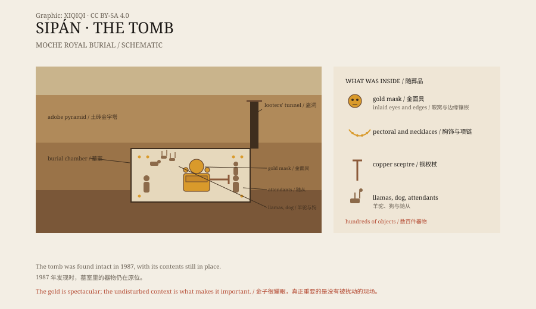

## 1. The looters of 1987

In February 1987, police in northern Peru stopped a car.

The men inside were carrying gold ornaments. The work was too fine for ordinary stolen goods. The police called the archaeologist Walter Alva.

By the time Alva reached the site, the looters had already dug a hole into an adobe pyramid. They had found a burial chamber and taken what they could carry.

Alva did something unusual for the time: he had the police guard the site and began to clear the looters' tunnel. He knew that if he did not dig immediately, the rest would be stripped.

## 2. A pyramid of mud bricks

The site is called Huaca Rajada, in the Lambayeque Valley not far from Chiclayo.

It is an adobe pyramid built by the Moche, a culture that flourished on the north coast of Peru from about 100 to 700 CE. The Moche left behind huge platforms, murals, pottery, and metalwork, but no writing.

Weather had worn the pyramid down to a mound. The looters knew there was something inside, because Moche nobles were often buried in pyramids.

*Original schematic: the layers of the Sipán tomb, the position of the Lord, and the main grave goods. Not an archaeological survey drawing. Oddity Archive, CC BY-SA 4.0.*

## 3. Opening the chamber

Alva's team dug down through layers of adobe and fill.

In the centre of the chamber they found a wooden coffin. Inside lay the body, its face covered by a gold mask, a gold pectoral on the chest, and gold ear ornaments. A gold plate had been placed under the head. Around the body were necklaces, a nose ornament, a rattle, and a copper sceptre.

Hundreds of objects came out of the tomb. Gold, silver, copper, turquoise, shell, and pottery filled the chamber.

The Lord was not buried alone. Sacrificed attendants, a dog, and two llamas were placed in different parts of the chamber and sealed in with him.

## 4. Who was he

Archaeologists call him the Lord of Sipán.

He died around 300 CE and was a Moche ruler of the Lambayeque Valley. Moche pottery often shows such a figure: a lord with a crescent headdress, a tunic, and a high seat, receiving tribute and prisoners.

Before this tomb was found, scholars could only infer the power of Moche lords from pottery and murals. Sipán turned the image into physical fact: a real ruler, with real gold, real attendants, and a real funeral.

## 5. Afterwards

The discovery did not stop the looting.

Alva kept digging nearby and found more tombs, including those of a “Priest” and an “Old Lord”. The burials were earlier and contained different objects, suggesting that a ruling family had been buried at the site over generations.

In 2002, the Royal Tombs of Sipán Museum opened in Lambayeque. Its exterior resembles a Moche pyramid, and visitors enter down a ramp into dark galleries where the gold is lit separately.

## 6. Now

The mask of the Lord of Sipán sits in the central case of the museum.

It is gold, with other materials set into the edges and the eye sockets. The light comes from the side; the gold looks deep rather than bright.

What makes the tomb important is not only the gold. It is that the tomb was not emptied: the positions of the objects, the posture of the body, and the placement of the attendants and animals all survived.

The looters took the gold. The archaeologists kept the funeral.

---

**Sources and licenses**: the factual sources are listed in the source ledger S1–S3 at the bottom of this entry. Text and original diagrams are licensed under CC BY-SA 4.0. This article separates the discovery, the tomb structure, the identity of the Lord, and the later excavations; estimates of his age and cause of death vary.
