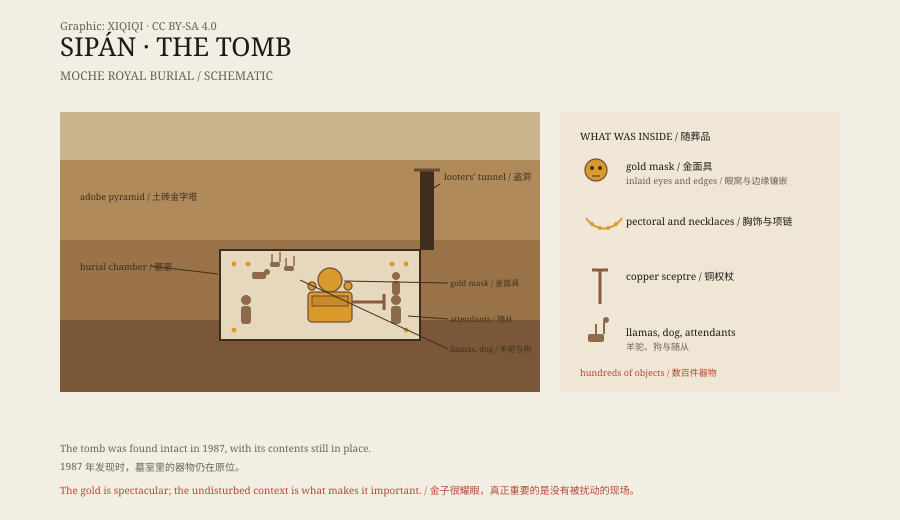

## 一、1987 年的盗墓案

1987 年 2 月，秘鲁北部的警察拦下了一辆车。

车里的人带着一批金饰。东西做得太精细了，不像普通的赃物。警察叫来了考古学家瓦尔特·阿尔瓦。

阿尔瓦赶到现场时，盗墓贼已经在土砖金字塔上挖了一个洞。他们在洞里找到了一间墓室，把能拿的东西拿走了一部分。

阿尔瓦做了一件当时很少见的事：他让警察守住遗址，自己开始清理盗洞。他知道，如果不马上挖，剩下的东西会被抢光。

## 二、土砖金字塔

遗址叫华卡拉哈达，在兰巴耶克河谷，离奇克拉约不远。

它是一座莫切人修建的土砖金字塔。莫切文化大约存在于公元 100 年到 700 年之间，住在秘鲁北海岸。他们留下了巨大的平台、壁画、陶器和金属器，但没有留下文字。

金字塔被风雨侵蚀成了一座土丘。盗墓贼知道下面有东西，因为莫切的贵族常被埋在金字塔里。

*原创示意图：西潘王墓室的分层、墓主人位置与主要随葬品。不是考古测绘图。稀奇奇编辑部，CC BY-SA 4.0。*

## 三、打开墓室

阿尔瓦的团队往下挖，先碰到了一层层的土砖和填充物。

在墓室中央，他们看到了一副木棺。棺里是墓主人的遗体，脸上盖着金面具，胸口有金片，耳朵上戴着金耳饰。他的头下垫着金盘，身边放着项链、鼻饰、拨浪鼓和一根铜权杖。

墓里出土了数百件器物。金、银、铜、绿松石、贝壳、陶器，摆满了墓室。

墓主人不是一个人下葬的。墓里还有被献祭的随从、一只狗和两头羊驼。他们被放在墓室的不同位置，陪着墓主人一起被封进去。

## 四、他是谁

考古学家叫他“西潘王”。

他大约死于公元 300 年，是兰巴耶克河谷的莫切统治者。莫切的陶器上常画着这样的角色：戴月牙形头饰，穿束腰外衣，坐在高台上，接受贡品和战俘。

在这座墓被发现之前，学者只能从陶器和壁画上推测莫切贵族的权力。西潘王陵把这个形象变成了实物：一个真实的统治者，有真实的黄金、真实的随从、真实的葬礼。

## 五、之后

西潘王陵出土后，盗墓并没有停止。

阿尔瓦继续在附近发掘，又找到了几座墓，包括“祭司”和“老领主”。这些墓葬的年代更早，随葬品不同，说明这里埋着一个统治家族。

2002 年，兰巴耶克建起了西潘王皇家陵墓博物馆。博物馆的外观像一座莫切金字塔，展厅从一条斜坡走进去，灯光很暗，金器被单独照亮。

## 六、现在

西潘王的面具现在放在博物馆的中央展柜里。

面具是金的，边缘和眼窝镶着不同颜色的材料。灯光从侧面打过来，金子的颜色很沉，不像新金子那样亮。

这座墓之所以重要，不只是因为金子。而是因为它没有被偷空：器物的位置、尸体的姿势、随从和动物的摆放，都留了下来。

盗墓贼拿走的是金子，考古学家保住的是整个葬礼。

## 七、墓葬里的信息

西潘王陵的重要性，不在于金子的重量，而在于器物的位置。盗墓者通常只拿走金器，留下被翻乱的土；考古学家记录的是整个墓室：谁躺在哪里，面具朝哪个方向，随从和动物摆在什么位置，陶器和织物怎样分布。正是这些位置关系，让一场葬礼可以被重新读出来。

墓里出土的金面具、耳饰、胸饰和权杖，说明墓主人拥有动员稀有材料和工匠的权力。陪葬者的存在，则说明这种权力也延伸到人的生命。把这些放在一起看，西潘王陵不只是一座宝库，也是一份关于莫切社会秩序的证据。

西潘王陵还改变了对莫切权力的理解。此前，学者多半从陶器图像推测贵族的样子；陵墓出土后，图像里的人物、服饰和仪式，第一次能和真实的器物、真实的尸体对上。这种对应关系，比任何单件金器都更有价值。它让一个消失的社会，从图案变成了可以测量的生活。

## 八、博物馆之后

2002 年，西潘王皇家陵墓博物馆在兰巴耶克开放。博物馆的外观像一座莫切金字塔，展厅从斜坡进入，灯光集中在金器上。对当地来说，这座博物馆不只是旅游景点，也是一个把被盗走的过去重新收回来的地方。

西潘王的面具仍然放在中央展柜里。金子不耀眼，颜色很沉。它提醒参观者：这座墓之所以重要，是因为它没有被偷空；考古学家保住的是整个葬礼，而不只是金子。
从保护的角度看，西潘王陵也提出了一个难题：出土文物应该留在原地，还是送进博物馆？墓室一旦打开，湿度、温度和微生物都会改变。把器物移进可控的展柜，能延长保存时间，却也切断了它们与墓葬空间的联系。西潘的选择是前者，这也让后来的研究必须依赖详细的发掘记录。
西潘王陵的发现也提醒人们，考古不是寻宝。真正的信息往往藏在最不起眼的地方：一层土、一根线、一副骨架的位置。
西潘王陵还留下一个关于“价值”的问题。金器当然珍贵，但真正让学者兴奋的，是器物之间的关系。单独一枚胸饰只能说明工艺，放回墓室，它才说明身份、信仰和葬礼。这也是考古记录比单件展品更重要的原因：器物的位置，本身就是证据。
---

**来源与许可**：文字与原创示意图采用 CC BY-SA 4.0；第三方图片与资料的许可见文末来源台账。
