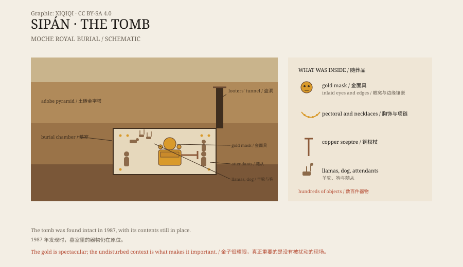

## 一、1987 年的盗墓案

1987 年 2 月，秘鲁北部的警察拦下了一辆车。

车里的人带着一批金饰。东西做得太精细了，不像普通的赃物。警察叫来了考古学家瓦尔特·阿尔瓦。

阿尔瓦赶到现场时，盗墓贼已经在土砖金字塔上挖了一个洞。他们在洞里找到了一间墓室，把能拿的东西拿走了一部分。

阿尔瓦做了一件当时很少见的事：他让警察守住遗址，自己开始清理盗洞。他知道，如果不马上挖，剩下的东西会被抢光。

## 二、土砖金字塔

遗址叫华卡拉哈达，在兰巴耶克河谷，离奇克拉约不远。

它是一座莫切人修建的土砖金字塔。莫切文化大约存在于公元 100 年到 700 年之间，住在秘鲁北海岸。他们留下了巨大的平台、壁画、陶器和金属器，但没有留下文字。

金字塔被风雨侵蚀成了一座土丘。盗墓贼知道下面有东西，因为莫切的贵族常被埋在金字塔里。

*原创示意图：西潘王墓室的分层、墓主人位置与主要随葬品。不是考古测绘图。稀奇奇编辑部，CC BY-SA 4.0。*

## 三、打开墓室

阿尔瓦的团队往下挖，先碰到了一层层的土砖和填充物。

在墓室中央，他们看到了一副木棺。棺里是墓主人的遗体，脸上盖着金面具，胸口有金片，耳朵上戴着金耳饰。他的头下垫着金盘，身边放着项链、鼻饰、拨浪鼓和一根铜权杖。

墓里出土了数百件器物。金、银、铜、绿松石、贝壳、陶器，摆满了墓室。

墓主人不是一个人下葬的。墓里还有被献祭的随从、一只狗和两头羊驼。他们被放在墓室的不同位置，陪着墓主人一起被封进去。

## 四、他是谁

考古学家叫他“西潘王”。

他大约死于公元 300 年，是兰巴耶克河谷的莫切统治者。莫切的陶器上常画着这样的角色：戴月牙形头饰，穿束腰外衣，坐在高台上，接受贡品和战俘。

在这座墓被发现之前，学者只能从陶器和壁画上推测莫切贵族的权力。西潘王陵把这个形象变成了实物：一个真实的统治者，有真实的黄金、真实的随从、真实的葬礼。

## 五、之后

西潘王陵出土后，盗墓并没有停止。

阿尔瓦继续在附近发掘，又找到了几座墓，包括“祭司”和“老领主”。这些墓葬的年代更早，随葬品不同，说明这里埋着一个统治家族。

2002 年，兰巴耶克建起了西潘王皇家陵墓博物馆。博物馆的外观像一座莫切金字塔，展厅从一条斜坡走进去，灯光很暗，金器被单独照亮。

## 六、现在

西潘王的面具现在放在博物馆的中央展柜里。

面具是金的，边缘和眼窝镶着不同颜色的材料。灯光从侧面打过来，金子的颜色很沉，不像新金子那样亮。

这座墓之所以重要，不只是因为金子。而是因为它没有被偷空：器物的位置、尸体的姿势、随从和动物的摆放，都留了下来。

盗墓贼拿走的是金子，考古学家保住的是整个葬礼。

---

**来源与许可**：本文的事实来源见条目底部来源台账 S1–S3。文字与原创示意图采用 CC BY-SA 4.0。文中把发现经过、墓葬结构、墓主人身份与后续发掘分开叙述；墓主人的具体年龄和死因仍有不同估计。
