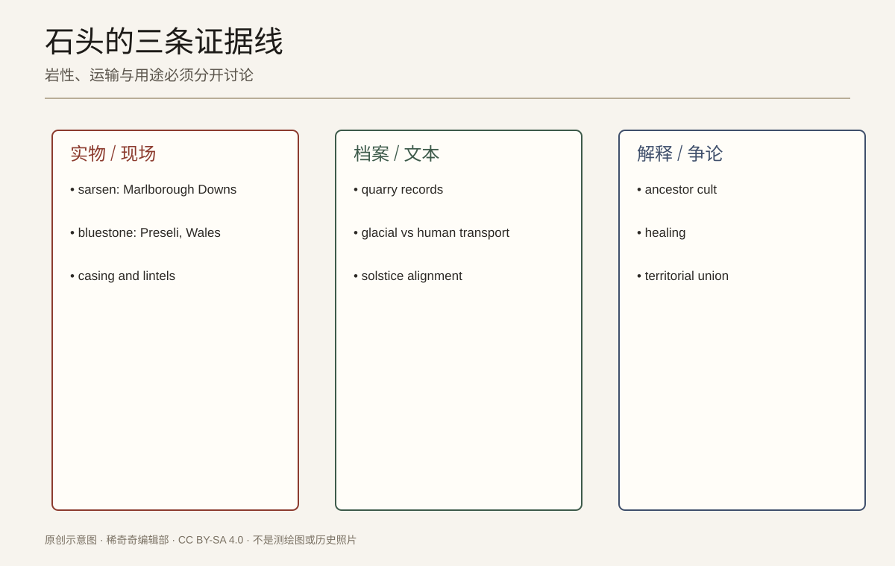

## 1. The stone setting

The site stands on Salisbury Plain in Wiltshire, England, at roughly 51°10'N, 1°49'W. It is not an isolated stone circle but a whole landscape of ditches, banks, pits, avenues, and burials. The ring of sarsens, the trilithons, and the surrounding earthwork that visitors see today are the result of different phases layered on top of one another; over more than three thousand years the place was repeatedly rebuilt, extended, and abandoned. In 1986 it was inscribed as a World Heritage Site together with its surrounding landscape, and in 2013 a new visitor centre opened west of the stones. Treating Stonehenge as a single finished 'work' is the first obstacle to understanding it.

## 2. Three building phases

The earliest works date to about 3000 BCE: a circular ditch and bank, with dozens of pits known as the Aubrey Holes, some of which later received cremated human remains. Around 2600–2400 BCE, huge sarsen stones were set up in an outer circle and five trilithons were raised. Around 2400–2200 BCE, smaller bluestones were brought in and rearranged several times, producing the inner setting seen today. Later burials and repairs continued, but the main construction was over. The phases are separated by centuries, and the people, participants, and ritual content may have changed between them.

*Original diagram: the main construction phases at Stonehenge in chronological order. Not a survey drawing. XIQIQI Editorial, CC BY-SA 4.0.*

## 3. Where the stones came from

The largest sarsens came from the Marlborough Downs about 25 kilometres away, each weighing more than twenty tonnes; the bluestones came from the Preseli Hills in Wales, roughly 250 kilometres distant. How the bluestones travelled has been argued for a long time: one view has people dragging them on sledges, rollers, and ropes, another has glaciers carrying them to the plain in an earlier ice age. Each account explains some stones but not the whole assemblage. The source of the rock can be confirmed by petrological comparison; the route still has to be inferred from indirect evidence.

## 4. Bones, cremation, and solstice

The pits at Stonehenge contain many cremated remains, perhaps involving more than a hundred people over a long period. The monument's main axis aligns with the midsummer sunrise and the midwinter sunset, and that much is clear from survey; but claims that it was a precise calendar or could predict eclipses go beyond what the stones themselves can support. The midwinter sunset through the trilithon gap is still observable each year, while crowds gather inside the circle at midsummer dawn. Ritual and sky are connected, but connection is not the same as sole function.

*Original diagram: three evidence lines at Stonehenge—petrology, transport hypotheses, and interpretations of purpose. Not a survey drawing. XIQIQI Editorial, CC BY-SA 4.0.*

## 5. Who built it, and why

Building on this scale took many hands: transport, shaping, raising, and repeated rearrangement all required hundreds or thousands of labour days. Archaeologists have found contemporary settlements such as Durrington Walls nearby, which shows that this was not an isolated temple in empty country but a regional centre where people lived, kept cattle, and held feasts. Proposed purposes include ancestor cult, healing, a symbol of territorial union, and a stage for the seasonal cycle. They are not mutually exclusive, but no single one explains every phase. Calling Stonehenge a 'Druid temple' or 'Merlin's magic' belongs to later invention, not archaeological conclusion.

## 6. Management and argument today

The roads around Stonehenge have long been a problem. The A303 runs close to the monument, and traffic and noise affect the landscape; a tunnel scheme has been discussed for years, with supporters stressing transport and landscape and opponents fearing damage to buried remains. The public is still allowed into the stone circle at specific times around midwinter and midsummer, but ordinary visits follow an outer path. Conservation, visitor access, and road demand remain in tension.

The cover is an AI-assisted reconstruction of “Stonehenge: Stones, Bones, and the Turning Year”, not a site photograph; the two inline figures are original diagrams, not survey drawings. Image types and licences are recorded in the source ledger below.

## Archive location

The paper record for Stonehenge is held in several places: English Heritage manages the site and keeps files on excavation, repair, and visitor facilities; the World Heritage nomination sets out outstanding universal value and boundaries; the Salisbury Museum and the Devizes Museum hold excavated objects; and Historic England's survey and listing records document changes to the stones, earthworks, and surrounding landscape. To assemble a complete sequence, a researcher normally has to compare these archives with field survey. What this entry can check directly is the published chronological framework and management record; the finer excavation diaries and stone-by-stone registers still require the collections and archive catalogues themselves.

## Limits of the record

Three questions about Stonehenge still lack agreed answers: how the bluestones were moved from Wales, who directed each stage of the building sequence, and what the monument's central function was while it was in use. Stratigraphy can establish order but not motive; there are no written records, and later legends cannot be treated as testimony from the builders. This entry therefore separates 'the stones were raised' from 'why they were raised': the first can be described, the second can only be set out as competing hypotheses.

---

**Sources and licenses**: Text and original diagrams are licensed CC BY-SA 4.0; third-party image and source licences are listed in the source ledger below.
