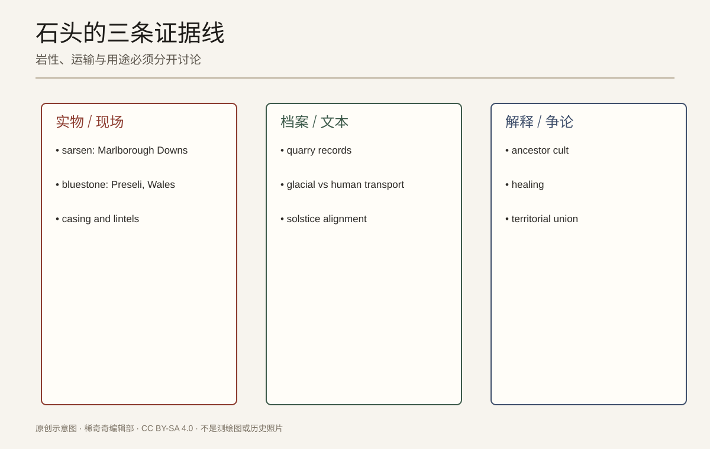

## 一、石头的现场

巨石阵在英格兰威尔特郡的索尔兹伯里平原上，坐标大约是北纬 51 度 10 分、西经 1 度 49 分。它不是一个孤立的石圈，而是一整片被土沟、土堤、坑洞、道路和墓葬包围的遗址。今天游客看到的环形石列、三石塔和外围的沟渠，是不同时代叠加后的结果；在三千多年的使用期里，这里被反复改建、增补和废弃。1986 年，它与周边景观一起列入世界遗产；2013 年，新的游客中心在遗址以西开馆。把巨石阵当成一件一次性完成的“作品”，是理解它的第一道障碍。

## 二、三个建造阶段

最早的工程大约在公元前 3000 年：一圈土沟和土堤，内侧有几十个被称为“奥布里洞”的坑，坑里后来埋入火葬遗骸。约公元前 2600 至前 2400 年，巨大的砂岩被立成外圈，并出现五组三石塔。约公元前 2400 至前 2200 年，较小的蓝石被运来并多次重排，形成今天看到的内圈结构。此后仍有墓葬和修缮，但主体工程已经结束。三个阶段之间隔了几百年，主持者、参与者和仪式内容都可能发生变化。

*原创示意图：巨石阵主要建造阶段与时间顺序。不是测绘图。稀奇奇编辑部，CC BY-SA 4.0。*

## 三、石头从哪里来

最大的砂岩块来自约 25 公里外的马尔伯勒丘陵，每块重达二十多吨；蓝石则来自约 250 公里外的威尔士普雷塞利山区。蓝石的运输方式争论了很久：一种意见认为是人类用木橇、滚木和绳索拖运，另一种意见认为是冰川在更早的冰期把它们带到平原。两种说法都能解释部分石块，却不能解释全部组合。石头的来源可以通过岩性比对确认，运输路线却仍要靠间接证据推断。

## 四、尸骨、火葬与至点

巨石阵的坑洞里埋着大量火葬遗骨，估计涉及一百多人，时间跨度很长。遗址的主轴指向夏至日出与冬至日落的方向，这一点在测量上很清楚；但“它是一个精确的日历”或“它能预测日月食”的说法，超出了石料本身能提供的证据。冬至的日落穿过三石塔之间的视线，是每年仍可观察的现象；夏至早晨，人群则聚在石圈中央等待日出。仪式与天象有关，但相关不等于唯一功能。

*原创示意图：巨石阵的岩性来源、运输假说与用途解释三条证据线。不是测绘图。稀奇奇编辑部，CC BY-SA 4.0。*

## 五、谁建、为什么建

参与建造的人数不会少：运输、雕刻、竖立和反复重排都需要成百上千的劳动日。考古学家在附近发现了杜灵顿墙等同期聚落，说明这里不是荒野中的孤立神庙，而是有人居住、饲养牲畜、举行宴饮的区域中心。关于目的，常见假说包括祖先崇拜、治疗、领地联合的象征、季节循环的舞台。它们彼此并不完全排斥，但也没有一个能单独解释全部阶段。把巨石阵说成“德鲁伊的神庙”或“梅林的魔法”，属于后来附会，不是考古结论。

## 六、今天的管理与争论

巨石阵周围的公路一直是个难题。A303 公路紧贴遗址，车流和噪声影响景观；修隧道的方案讨论了多年，支持者看重交通与景观，反对者担心施工破坏地下遗存。每年冬至和夏至，公众仍被允许在特定时段进入石圈，但日常参观只能沿外围步道行走。遗址的保护、游客体验和道路需求，至今仍在拉扯。

## 时间线

- **约前 3000 年**：土沟、土堤与奥布里洞；早期火葬
- **约前 2600–前 2400 年**：砂岩圈与五组三石塔
- **约前 2400–前 2200 年**：蓝石运来并多次重排
- **约前 1500 年**：主体工程结束，周边继续有墓葬
- **1986 年**：列入世界遗产
- **2013 年**：新游客中心开馆

## 来源与证据

本文的可核对材料以 S1、S2 为主：S1 提供遗址/器物的基本信息与官方记录，S2 提供独立的研究或档案背景。S3 是编辑部制作的封面与示意图，只用于视觉说明，不作为史实依据。凡正文出现年代、数量、地点与归属判断，尽量回到 S1/S2 的具体页面；无法回到页面的说法，在“档案空白”里标明。

封面为 AI 辅助场景复原，不是现场照片；两张插图为原创示意图，不是测绘图。图片类型与许可逐行记录在 `research/image-audit.csv`。

## 档案位置

巨石阵的纸面档案分在几个地方：英格兰遗产委员会管理遗址并保存历次发掘、修复与游客设施的文件；世界遗产申报文本给出突出普遍价值和边界；索尔兹伯里博物馆与德维齐博物馆收藏出土器物；历史英格兰的测绘与列表档案记录石列、土垒和周边景观的变化。研究者要拼出完整序列，通常需要把这些档案与现场测绘对照。本文能直接核对的，是公开页面上的年代框架和管理记录；更细的发掘日记与石器编号，仍要回到馆藏与档案目录。

## 档案空白

巨石阵最难的三个问题仍没有一致答案：蓝石究竟怎样从威尔士运来，整个建筑序列的每一阶段由谁主持，以及它在使用中的核心功能是什么。考古地层能给出先后关系，却给不出动机；文字材料不存在，后世传说又不能当作当时人的自述。因此本文把“石头被立起来”与“为什么立起来”分开，前者可以描述，后者只能并列假说。
