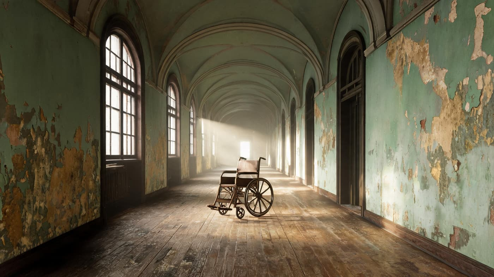
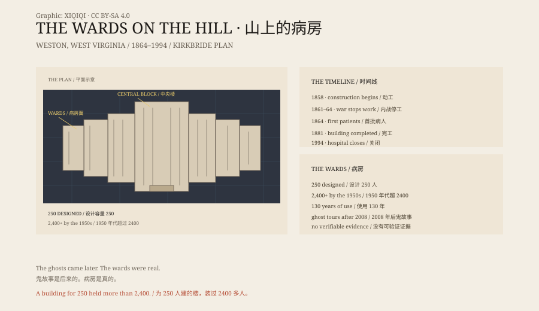

## 1. The Hill, 1858

In 1858 the Virginia General Assembly authorized a mental hospital at Weston, in what is now West Virginia.

The architect was Richard Snowden Andrews. He used the Kirkbride plan: long, staggered wings, every room with sunlight, fresh air and a view of the hills. The idea was that the setting itself was part of the treatment.

From the hill it looked like a city laid on its side: blue sandstone walls, rows of windows, wings stepping back one after another, every ward facing the light.

The building was made of local blue sandstone, cut by German and Irish stonemasons. Its designed capacity was 250 patients.

*Reconstruction: a long Kirkbride corridor with an abandoned wheelchair. Not a photograph of the site. Oddity Archive, CC BY-SA 4.0.*

## 2. The Civil War

In 1861 the war stopped construction.

The unfinished hospital and its grounds became Camp Tyler for the Union army. The completed south wing served as barracks; the main foundation became a stable. Confederate raids in 1862 and 1863 briefly pushed the Union troops out.

In October 1864 the hospital admitted its first patients. The building was not finished until 1881.

## 3. 1913

In 1913 the hospital was renamed Weston State Hospital.

It was the only mental institution in West Virginia. Tours often quote an early admission ledger: reading too many novels, laziness, disappointed love, family trouble, political excitement, being kicked by a horse.

The reasons look ridiculous now. They also show how little it took to be committed in that era, especially for women, the poor and anyone without someone to speak for them.

## 4. Overcrowding

The hospital was built for 250 people.

By the 1950s it held more than 2,400. Beds filled the corridors, wards became dormitories, and privacy and quiet disappeared.

Beds lined the corridors, and bowls and medicine bottles stood on the windowsills. Rooms designed for one person often held three or four.

Overcrowding was common in American state hospitals in the mid-twentieth century. The stone walls, long corridors and barred windows later made an ideal set for ghost stories.

## 5. 1994

In 1990 the building was designated a National Historic Landmark.

In May 1994 the hospital closed. The patients were transferred, and the building stood empty.

The lights went out one by one. The corridors were left with bed frames, wheelchairs and patient records on the floor.

In August 2007 the contractor Joe Jordan bought the complex at auction for $1.5 million. In March 2008 it reopened as a historic site. By day it tells the story of the building and its medicine; by night it sells ghosts.

## 6. The Ghosts

Tour guides and visitors report a woman in white, shadows in the corridors, Civil War soldiers, and the feeling of being touched by an unseen hand.

There is no photograph, no measurement and no repeatable evidence.

What is documented is different: how a building designed for humane care became a warehouse under pressure of numbers and money.

The ghosts came later. The wards were real.

*Original schematic: the 1858–2008 timeline, the Kirkbride plan and the overcrowding figures. Not a photograph of the site. Oddity Archive, CC BY-SA 4.0.*

---

**Sources and licenses**: the factual sources are listed in the source ledger S1–S4 at the bottom of this entry. Text and original diagrams are licensed under CC BY-SA 4.0. This article separates the architectural history, the Civil War use, the admission records and the ghost stories; the ghost stories have no verifiable evidence. The illustration is a scene reconstruction, not a photograph of the site.
