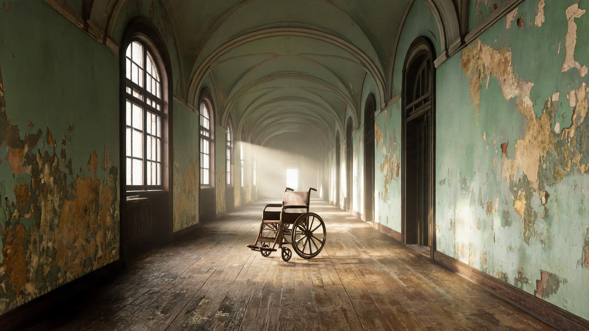
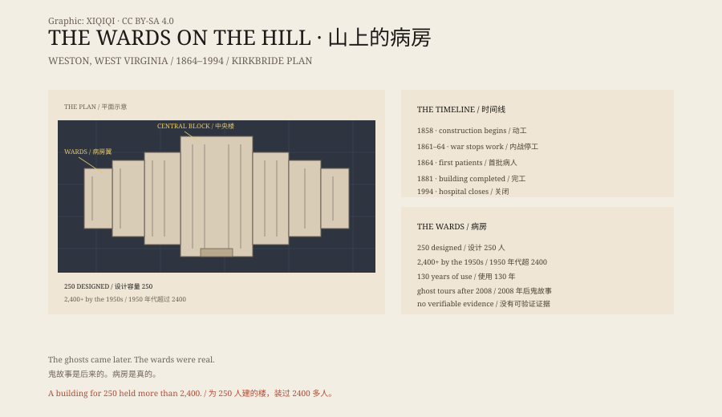

## 一、1858 年，山

1858 年，弗吉尼亚州议会批准，在西弗吉尼亚的韦斯顿建一座精神病院。

建筑师是理查德·斯诺登·安德鲁斯。他按柯克布莱德平面设计：长长的、错开的翼楼，每个房间都能见到阳光，能通风，能看见山。当时的想法是，环境本身也是治疗。

站在山上看，它像一座横着的城。蓝砂岩墙面、成排的窗、错开的翼楼，每一间病房都朝着阳光。

建筑用本地蓝砂岩，由德国和爱尔兰石匠手工切割。设计容量：250 人。

*场景复原：柯克布莱德式精神病院的长走廊与遗落的轮椅。不是现场照片。稀奇奇编辑部，CC BY-SA 4.0。*

## 二、内战

1861 年，内战爆发，工程停下。

未完工的医院和周围的土地变成联邦军的泰勒营。南翼做了兵营，主地基做了马厩。1862 年和 1863 年，南军两次袭扰，短暂赶走了联邦军。

1864 年 10 月，医院收治第一批病人。建筑到 1881 年才全部完工。

## 三、1913 年

1913 年，医院改名“韦斯顿州立医院”。

它是西弗吉尼亚唯一的精神病院。导览里常引用一份早期的入院登记：读太多小说、懒惰、失恋、家庭纠纷、政治兴奋、被马踢过。

这些理由今天看起来荒唐，但它们说明了一件事：在那个年代，一个人被送进来，不需要多严重的病。尤其是女人、穷人，和没有人替他们说话的人。

## 四、超员

医院按 250 人设计。

1950 年代，里面有两千四百多人。病床加在走廊里，病房改成宿舍，隐私和安静都没有了。

走廊里加床，窗台上放着碗和药瓶。原本设计给一个人的房间，常常住进三四个人。

20 世纪中叶，美国州立精神病院普遍超员。这里的石头墙、长走廊和铁窗，后来成了鬼故事最好的布景。

## 五、1994 年

1990 年，它被列为国家历史地标。

1994 年 5 月，医院关闭。病人被转走，大楼空下来。

灯一盏盏灭掉。走廊里只剩床架、轮椅和掉在地上的病历纸。

2007 年 8 月，承包商乔·乔丹在拍卖会上以一百五十万美元买下整组建筑。2008 年 3 月，它以历史景点的身份重新开放。白天讲建筑和医疗史，晚上讲鬼。

## 六、鬼

导览里有人说，看见穿白衣的女人、走廊里的影子、内战士兵；有人说，被看不见的手碰过。

没有照片，没有测量，没有可重复的证据。

真正有记录的是另一件事：一座按“人道治疗”设计的建筑，如何在人口压力和资金不足下，变成一座超员的仓库。

鬼故事是后来的。病房是真的。

*原创示意图：1858–2008 年的建筑与使用时间线、柯克布莱德平面与超员数字。不是现场照片。稀奇奇编辑部，CC BY-SA 4.0。*

## 建筑

特兰斯-阿勒格尼精神病院，是一座巨大的哥特式建筑。

它建在西弗吉尼亚州的韦斯顿，1858 年开工，内战期间停工，战后继续。建筑用灰石砌成，有塔楼、尖顶和长走廊。从远处看，它像一座城堡，不像医院。

这种设计，来自十九世纪的“柯克布莱德计划”。计划主张把病房排成一排，围绕中央管理区，让病人有阳光、空气和活动空间。它曾经是一种进步的建筑理念。

## 病人

医院最初收治的，是精神病患者、酗酒者、流浪汉和穷人。

十九世纪的医学，对精神疾病了解很少。治疗手段包括放血、冷水浴、约束衣和镇静剂。有些病人被长期关在病房里，缺少记录，也缺少探视。

医院的设计容量是几百人，但后来住进了上千人。走廊加床，病房拥挤，人员和资金都不够。它从一个“理想医院”，变成了一个“收容所”。

## 内战

内战期间，医院被军队接管。

联邦和邦联的军队都使用过它。有的建筑被改成兵营，有的被改成监狱。战争结束后，医院重新开放，但留下了军队的痕迹。

西弗吉尼亚在战争期间属于边界州，立场复杂。医院的位置，让它成了双方都需要的设施。

## 关闭

1994 年，医院关闭。

新的精神健康政策，主张社区治疗，不再把病人集中在大机构里。大医院被清空，设备被搬走，建筑被遗弃。

关闭之后，医院成了“鬼屋”。探险者、摄影师和电视节目进来，寻找“闹鬼”的证据。建筑本身，反而被忽略了。

## 保护

医院现在是一个历史地标。

有人组织参观，有人做修复，有人记录病人的名字。它不再是一家医院，而是一处关于精神健康历史的遗址。

参观者看到的，不只是鬼故事，还有一间间病房、一张张床和一条条走廊。那些东西比鬼更真实。

建筑的石墙在风化，屋顶在漏水。

保护者需要钱、时间和工匠。他们一边修复，一边开放。修复的速度，赶不上损坏的速度。

## 建筑细节

医院的走廊很长，病房在两侧。

每个病房有窗，有床，有桌子。窗户很高，病人能看到天空，但看不到外面的人。走廊的尽头是管理区，医生和护士在那里。

## 病人记录

医院的档案里，有病人的姓名、年龄、诊断和入院日期。

很多诊断今天已经不用了：癫狂、忧郁、痴呆、酒精狂。它们不是现代医学的类别，而是十九世纪的描述。

## 旅游

医院现在有“鬼屋” tours。

导游讲鬼故事，游客拍照。也有人在白天来，看建筑和历史。两种参观，两种叙事。

医院现在是历史遗址。

有人来拍鬼，有人来学建筑，有人来找家族的名字。同一个地方，不同的目的。

## 西弗吉尼亚

医院建在西弗吉尼亚的山区。

这里煤矿多，冬天冷，交通不便。医院收治的病人，来自周边的县和城镇。有的病人被家人送来，有的被警察送来，有的自己走来。

## 精神病学

十九世纪的精神病学，还在起步。

医生相信，环境、空气和规律的生活能治病。医院有花园、农场和作坊。病人可以劳动、读书、散步。

## 建筑保护

医院的建筑，是用当地的石头砌的。

石头很重，墙很厚。修复需要起重机、脚手架和石匠。钱从哪里来，一直是个问题。

---

**来源与许可**：本文的事实来源见条目底部来源台账 S1–S4。文字与原创示意图采用 CC BY-SA 4.0。文中把建筑史、内战用途、收治记录与鬼故事分开叙述；鬼故事没有可验证的证据。插图是场景复原，不是现场照片。
