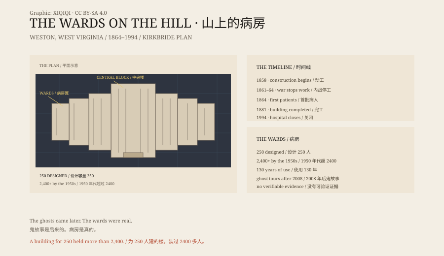

## 一、1858 年，山

1858 年，弗吉尼亚州议会批准，在西弗吉尼亚的韦斯顿建一座精神病院。

建筑师是理查德·斯诺登·安德鲁斯。他按柯克布莱德平面设计：长长的、错开的翼楼，每个房间都能见到阳光，能通风，能看见山。当时的想法是，环境本身也是治疗。

建筑用本地蓝砂岩，由德国和爱尔兰石匠手工切割。设计容量：250 人。

## 二、内战

1861 年，内战爆发，工程停下。

未完工的医院和周围的土地变成联邦军的泰勒营。南翼做了兵营，主地基做了马厩。1862 年和 1863 年，南军两次袭扰，短暂赶走了联邦军。

1864 年 10 月，医院收治第一批病人。建筑到 1881 年才全部完工。

## 三、1913 年

1913 年，医院改名“韦斯顿州立医院”。

它是西弗吉尼亚唯一的精神病院。导览里常引用一份早期的入院登记：读太多小说、懒惰、失恋、家庭纠纷、政治兴奋、被马踢过。

这些理由今天看起来荒唐，但它们说明了一件事：在那个年代，一个人被送进来，不需要多严重的病。尤其是女人、穷人，和没有人替他们说话的人。

## 四、超员

医院按 250 人设计。

1950 年代，里面有两千四百多人。病床加在走廊里，病房改成宿舍，隐私和安静都没有了。

20 世纪中叶，美国州立精神病院普遍超员。这里的石头墙、长走廊和铁窗，后来成了鬼故事最好的布景。

## 五、1994 年

1990 年，它被列为国家历史地标。

1994 年 5 月，医院关闭。病人被转走，大楼空下来。

2007 年 8 月，承包商乔·乔丹在拍卖会上以一百五十万美元买下整组建筑。2008 年 3 月，它以历史景点的身份重新开放。白天讲建筑和医疗史，晚上讲鬼。

## 六、鬼

导览里有人说，看见穿白衣的女人、走廊里的影子、内战士兵；有人说，被看不见的手碰过。

没有照片，没有测量，没有可重复的证据。

真正有记录的是另一件事：一座按“人道治疗”设计的建筑，如何在人口压力和资金不足下，变成一座超员的仓库。

鬼故事是后来的。病房是真的。

*原创示意图：1858–2008 年的建筑与使用时间线、柯克布莱德平面与超员数字。不是现场照片。稀奇奇编辑部，CC BY-SA 4.0。*

---

**来源与许可**：本文的事实来源见条目底部来源台账 S1–S4。文字与原创示意图采用 CC BY-SA 4.0。文中把建筑史、内战用途、收治记录与鬼故事分开叙述；鬼故事没有可验证的证据。插图是场景复原，不是现场照片。
