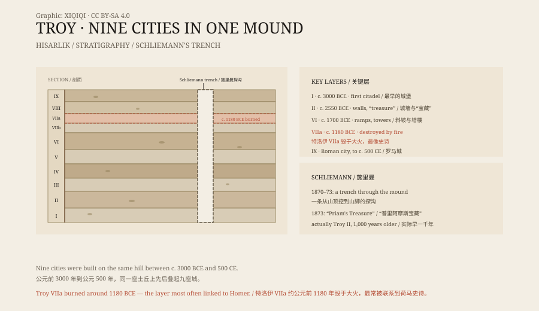

## 1. A mound

Hisarlik is in Çanakkale Province, Turkey, near the Dardanelles.

It is a mound about thirty metres high, covered in grass. From a distance it looks no different from the surrounding hills. But archaeologists know the mound is artificial: each generation built here, the houses collapsed, the mudbrick dissolved, and new houses were built on top of the old ones.

Layer upon layer, for more than three thousand years.

## 2. Schliemann

In 1870, the German businessman Heinrich Schliemann arrived.

He was not a professional archaeologist, but he believed that the Troy of Homer's epics was real. With money, workmen, and a copy of the Iliad, he dug a great trench through the mound, from the top to the bottom.

In 1873 he announced that he had found “Priam's Treasure”: a hoard of gold, silver, bronze, and jewellery. He smuggled it out of Turkey and later took it to Berlin.

*Original schematic: the chronological sequence of the nine cities, Schliemann's trench, and the destruction layer of Troy VIIa. Not a survey drawing. Oddity Archive, CC BY-SA 4.0.*

## 3. The nine layers

Archaeology now divides Hisarlik into nine layers, Troy I to Troy IX.

The earliest, Troy I, dates to about 3000 BCE and was a small citadel with stone walls and a gate. Troy II had larger walls and the “treasure”. Troy VI was a grand city with ramps, towers, and wide streets.

Troy VIIa was destroyed around 1180 BCE. The layer shows signs of fire, scattered weapons and bodies, and hasty burials.

This is the layer that most resembles Homer's Troy.

## 4. Homer

The Iliad tells the story of the tenth year of the Trojan War.

The Greek alliance besieges Troy to recover Helen. Achilles, Hector, and Odysseus all come from the poem. Homer's Troy has high walls, gates, and a palace.

But Homer lived in the eighth century BCE and wrote about events centuries earlier. Whether the Trojan War really happened has always been debated.

Most scholars think the destruction of Troy VIIa shows that a war did take place here, but no one can prove it was the war Homer described. There is no archaeological evidence for the wooden horse.

## 5. The treasure

Schliemann's “Priam's Treasure” actually belongs to Troy II, more than a thousand years earlier than Troy VIIa.

He took the treasure to Berlin. During the Second World War, the Red Army removed it, and it was later kept in the Pushkin Museum in Moscow. Germany and Russia still argue over who owns it.

The hoard included a gold diadem, earrings, necklaces, and cups. Schliemann once photographed his wife wearing the diadem, and the picture spread across Europe.

## 6. Now

In 1998, Troy became a World Heritage Site.

In 2018, the Troy Museum opened near the site, displaying pottery, bronze objects, bones, and architectural fragments. A modern wooden horse stands in front of the ruins for tourists to photograph.

Nine cities are stacked on top of one another: a Roman theatre at the top, a small Bronze Age citadel at the bottom. One mound holds three thousand years of war, trade, and daily life.

---

**Sources and licenses**: the factual sources are listed in the source ledger S1–S3 at the bottom of this entry. Text and original diagrams are licensed under CC BY-SA 4.0. This article separates the layers, Schliemann's excavation, Homer's epics, and the treasure's later history; whether Troy VIIa is Homer's Troy remains a scholarly debate, and there is no archaeological evidence for the wooden horse.
