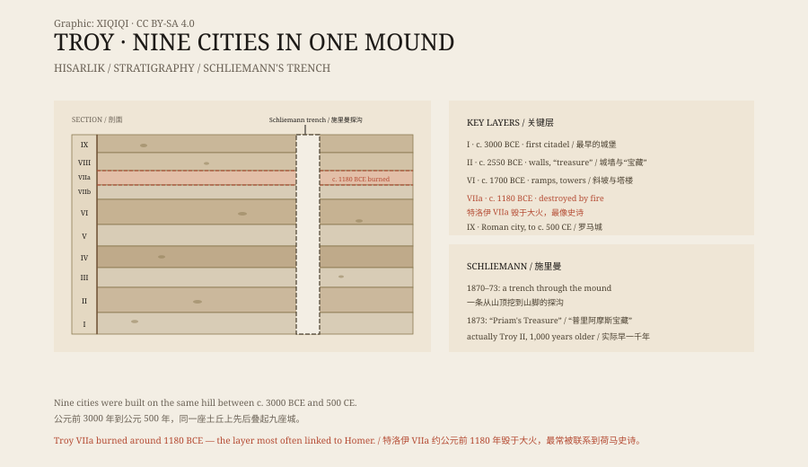

## 一、一座土丘

希沙利克在土耳其恰纳卡莱省，靠近达达尼尔海峡。

它是一座高约三十米的土丘，长满杂草。从远处看，它和周围的丘陵没有区别。但考古学家知道，这座土丘是人工堆起来的：每一代人在这里建城，房子塌了，泥砖化了，新房子就盖在旧房子上面。

一层叠一层，叠了三千多年。

## 二、施里曼

1870 年，德国商人海因里希·施里曼来到这里。

他不是专业考古学家，但他相信荷马史诗里的特洛伊是真的。他带着钱、工人和一本《伊利亚特》，在土丘上挖了一条大沟，从山顶一直挖到山脚。

1873 年，他宣布找到了“普里阿摩斯的宝藏”：一批金器、银器、铜器和首饰。他把东西偷偷运出土耳其，后来带到柏林。

*原创示意图：九层城址的时间顺序、施里曼的探沟与特洛伊 VIIa 的毁灭层。不是测绘图。稀奇奇编辑部，CC BY-SA 4.0。*

## 三、九层

今天的考古学把希沙利克分为九层，从特洛伊 I 到特洛伊 IX。

最早的特洛伊 I 大约在公元前 3000 年，是一个小城堡，有石墙和城门。特洛伊 II 有更大的城墙和“宝藏”。特洛伊 VI 是一座宏伟的城市，有斜坡、塔楼和宽阔的街道。

特洛伊 VIIa 毁于公元前 1180 年左右。城里有火烧的痕迹，有散落的武器和尸体，还有仓促掩埋的死者。

这一层，最像荷马史诗里的特洛伊。

## 四、荷马

《伊利亚特》讲的是特洛伊战争第十年的故事。

希腊联军围困特洛伊，为了夺回海伦。阿喀琉斯、赫克托耳、奥德修斯，这些名字都来自这首诗。诗里的特洛伊有高墙、有城门、有王宫。

但荷马是公元前八世纪的人，他写的是几百年前的事。特洛伊战争是否真的发生过，一直有争议。

多数学者认为，特洛伊 VIIa 的毁灭说明这里确实发生过战争，但是否就是荷马写的那一场，没有人能证明。木马更是没有考古证据。

## 五、宝藏

施里曼的“普里阿摩斯宝藏”其实属于比特洛伊 VIIa 早一千多年的特洛伊 II。

他把宝藏运到柏林，二战期间，这些东西被苏联红军带走，后来藏在莫斯科的普希金博物馆。德国和俄罗斯至今仍在争论这批文物的归属。

宝藏里有一顶金冠、耳环、项链和酒杯。施里曼曾让妻子戴上金冠拍照，照片传遍了欧洲。

## 六、现在

1998 年，特洛伊遗址被列入世界遗产。

2018 年，特洛伊博物馆在遗址附近开馆，展出出土的陶器、青铜器、骨骼和建筑构件。遗址前立着一座现代的木马，供游客拍照。

九座城叠在一起，最上面是罗马时代的剧场，最下面是青铜时代的小城堡。一座土丘，装下了三千年的战争、贸易和日常生活。

## 时间线

- **1870 年**：1870 年，德国商人海因里希·施里曼来到这里
- **1873 年**：1873 年，他宣布找到了“普里阿摩斯的宝藏”：一批金器、银器、铜器和首饰
- **3000 年**：最早的特洛伊 I 大约在公元前 3000 年，是一个小城堡，有石墙和城门
- **1180 年**：特洛伊 VIIa 毁于公元前 1180 年左右
- **1998 年**：1998 年，特洛伊遗址被列入世界遗产
- **2018 年**：2018 年，特洛伊博物馆在遗址附近开馆，展出出土的陶器、青铜器、骨骼和建筑构件

## 来源与证据

本条目的事实底座以 1 条独立来源为主。S1（UNESCO World Heritage Centre）覆盖世界遗产信息、遗址范围与历史地位。
原创插图只提供场景复原、结构示意或地图，不作为历史照片使用。正文把可核对记录、后来解释与传说分开叙述；同一件事在不同来源中的版本差异，保留在行文中，不强行合并。

## 档案位置

特洛伊的档案是层层叠压的发掘档案，从施里曼的探沟到现代地层学；荷马故事与土丘是两种记录，本文不把它们熔在一起。

## 档案空白

建筑年代、营造顺序与后续改动，需要考古报告和保护档案互证；单一的旅游说明或平面图，不足以定案。
这条档案把记录与未答的问题并排放置，不替读者做出超出证据的结论。
就可信度而言，本条目标为“verified”。这个标签描述的是当前证据状态，不是对传说真伪的终审；新档案出现时，标签应随之调整。

## 档案补记

以下补记保留正文没有展开的档案侧面：来源、技术细节与后续影响。
**土丘**。 特洛伊遗址，在土耳其西北部的希萨利克（Hisarlik）。

它是一座土丘，高几十米，下面叠着九层城市。每一层都属于不同的年代，从青铜时代早期到罗马时代。最早的聚落，大约在公元前三千多年。

土丘的形成，是因为人反复在同一个地点建房、拆房、重建。每一代人的废墟，成了下一代人的地基。
**荷马**。 荷马史诗《伊利亚特》，写的是特洛伊战争第十年的故事。

它不是历史记录，而是诗歌。它把神、英雄和战争混在一起，人物有名字、有性格、有命运。它流传了几千年，成了西方文学的源头之一。

施里曼相信荷马，考古学家不相信。后来的研究，介于两者之间：遗址是真的，战争可能是真的，但史诗不是新闻。
**九层**。 考古学家后来重新整理了地层。

特洛伊 I 到 IX，代表九个主要时期。特洛伊 VI 和 VII，可能是荷马史诗里的特洛伊。特洛伊 VII 有明显的破坏层，可能是战争或地震留下的。

“特洛伊战争”是否真的发生过，没有定论。遗址有破坏，有城墙，有塔，但没有文字记录能证明那场战争。

---

**来源与许可**：本文的事实来源见条目底部来源台账 S1–S3。文字与原创示意图采用 CC BY-SA 4.0。文中把城址分层、施里曼发掘、荷马史诗与宝藏流转分开叙述；特洛伊 VIIa 是否就是荷马笔下的特洛伊，仍是学术争论，木马没有考古证据。
