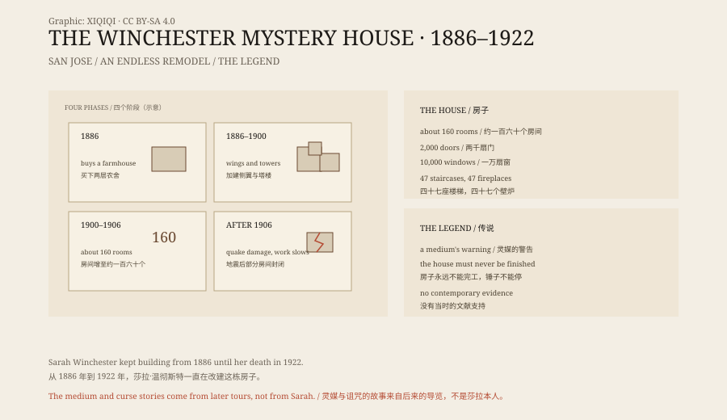

## 1. San Jose

San Jose lies south of San Francisco Bay. In the 1880s it was still a farming town.

In 1886 Sarah Winchester bought a two-storey farmhouse there, with an orchard and a meadow. She called it Llanada Villa.

Then she began to remodel. A floor was added, then a wing, then a tower. There were no plans and no completion date.

## 2. Sarah

Sarah Pardee married William Winchester. His family made guns, and the Winchester repeating rifle sold well during the American Civil War and the westward expansion.

In 1866 their daughter Annie died in infancy. In 1881 William died of tuberculosis. Sarah inherited a large fortune, and the name Winchester.

She was in her early forties. She never remarried.

## 3. The house

From 1886 to 1922 the house kept changing.

The figures usually quoted are 160 rooms, 2,000 doors, 10,000 windows, 47 staircases and 47 fireplaces. They come from tour counts, and different sources give slightly different numbers.

Inside, there are many strange things. A staircase climbs into a wall. A door opens onto another door, or onto empty air outside the house. Windows are set into floors. Some rooms have doors in odd places. Corridors turn suddenly into storerooms.

There were also practical innovations: double glazing, heating, indoor plumbing and gas lighting, all advanced for the period.

## 4. The legend

The most popular story about the house goes like this.

A medium told Sarah that the Winchester family was cursed by all the people killed by its rifles. She had to move west and build a house that could never be finished. As long as the hammering continued, the spirits would not come for her.

The story also says that she slept in a different room every night so that the ghosts could not find her, and that she kept a séance room where she spoke to them.

Most of this comes from later tours and popular books. Sarah never spoke publicly about ghosts and left no relevant letters. When her name appeared in the newspapers, it was usually because she had given money, built a hospital, or because her house was so large.

## 5. The earthquake of 1906

In 1906 the San Francisco earthquake struck.

Sarah was trapped in the Daisy Bedroom when the door frame jammed. Workmen pulled her out.

After the earthquake she moved to a smaller bedroom, and the construction slowed. Some rooms were closed off; some parts were never repaired. Many of the “strange” features visible today are partly the result of the earthquake and the makeshift repairs that followed.

## 6. 1922

On 5 September 1922 Sarah died in her sleep, aged eighty-three.

The work stopped at once. Hammers, saws and piles of timber were left where they were. The house was sold to a group of investors and opened to the public in 1923 as a tourist attraction.

Tour guides need stories. Ghosts, a curse and a house that can never be finished sell better than “a wealthy widow liked to remodel”.

## 7. Now

The Winchester Mystery House is a California historic landmark, visited by hundreds of thousands of people every year.

The house is still on its original site, surrounded now by freeways and commercial buildings. Visitors follow guides through narrow corridors, low doorways and staircases that stop in mid-air.

Sarah left no explanation. She spent her money on a house, and she spent thirty-six years doing it.

*Original schematic: the phases of construction, the 1906 earthquake and the opening in 1923. Not an architectural survey. Oddity Archive, CC BY-SA 4.0.*

---

**Sources and licenses**: the factual sources are listed in the source ledger S1–S3 at the bottom of this entry. Text and original diagrams are licensed under CC BY-SA 4.0. This article separates the size of the house, Sarah's life, the medium legend and the changes after the earthquake; the room and door counts come from tour statistics, and the medium and curse stories lack contemporary documentary support. The illustration is a scene reconstruction, not a photograph of the site.
