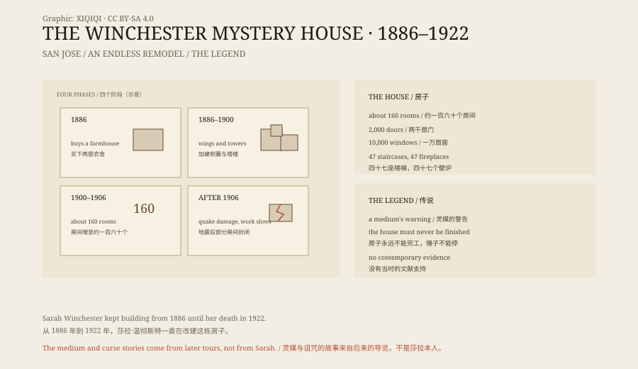

## 一、圣何塞

圣何塞在旧金山湾南边，1880 年代还是一个农业小镇。

1886 年，莎拉·温彻斯特在这里买下一栋两层农舍，带果园和草地。她给它取名“拉纳达别墅”。

然后她开始改建。先加一层，再加一翼，再加塔楼。工程没有图纸，也没有完工日期。

## 二、莎拉

莎拉·帕迪嫁给了威廉·温彻斯特。威廉的家族做枪，温彻斯特连发步枪在美国内战和西部扩张中卖得很好。

1866 年，他们的女儿安妮在婴儿期死去。1881 年，威廉死于肺结核。莎拉继承了很大一笔钱，也继承了“温彻斯特”这个姓。

她当时四十出头，之后没有再婚。

## 三、房子

从 1886 年到 1922 年，房子一直在变。

常被引用的数字是：一百六十个房间、两千扇门、一万扇窗、四十七座楼梯、四十七个壁炉。这些数字来自导览统计，不同资料略有出入。

房子内部有很多奇怪的东西：楼梯走上去是一堵墙；门打开是另一扇门，或者直接悬在屋外；窗户开在地板上；有些房间的门开在奇怪的位置；走廊会突然转个弯，通向一个储物间。

也有一些实用的设计：双层玻璃、暖气、室内管道、煤气灯，在当时都算先进。

## 四、传说

关于这栋房子，最流行的故事是这样的：

一位灵媒告诉莎拉，温彻斯特家族被那些死在步枪下的人诅咒了。她必须搬到西部，建一栋永远不能完工的房子。只要锤子还在响，鬼魂就不会来找她。

故事还说，她每天晚上换一个房间睡，免得鬼魂找到她；她在房子里设了一间降神室，和鬼魂说话。

这些说法大多来自后来的导览和通俗读物。莎拉生前没有公开谈过鬼魂，也没有留下相关的信件。她的名字在报纸上出现时，通常是因为她捐钱、建医院，或者因为她的房子太大。

## 五、1906 年地震

1906 年，旧金山大地震。

莎拉当时被困在“雏菊卧室”里，门框变形，打不开。工人把她救了出来。

地震之后，她搬到一间较小的卧室，工程明显放慢。有些房间被封闭，有些部分再也没有修好。今天看到的许多“奇怪结构”，有一部分就是地震后的临时状态。

## 六、1922 年

1922 年 9 月 5 日，莎拉在睡梦中去世，八十三岁。

工程在她死后立刻停止。锤子、锯子和成堆的木料留在原地。房子被卖给一个财团，1923 年对外开放，成了旅游景点。

导游需要故事。鬼魂、诅咒、永远建不完的房子，比“一个有钱的寡妇喜欢改建”更好卖。

## 七、现在

温彻斯特神秘屋现在是加州的历史地标，每年有几十万游客。

房子还在原地，被高速公路和商业区包围。游客跟着导游穿过狭窄的走廊、低矮的门洞和突然断掉的楼梯。

莎拉本人没有留下解释。她只是把钱花在了一栋房子上，花了三十六年。

*原创示意图：房屋扩建阶段、1906 年地震与 1923 年开放的时间线。不是建筑测绘图。稀奇奇编辑部，CC BY-SA 4.0。*

## 时间线

- **1880 年**：圣何塞在旧金山湾南边，1880 年代还是一个农业小镇
- **1886 年**：1886 年，莎拉·温彻斯特在这里买下一栋两层农舍，带果园和草地
- **1866 年**：1866 年，他们的女儿安妮在婴儿期死去
- **1881 年**：1881 年，威廉死于肺结核
- **1906 年**：1906 年，旧金山大地震
- **1922 年 9 月 5 日**：1922 年 9 月 5 日，莎拉在睡梦中去世，八十三岁
- **1923 年**：房子被卖给一个财团，1923 年对外开放，成了旅游景点

## 来源与证据

本条目的事实底座以 1 条独立来源为主。S2（Winchester Mystery House）覆盖官方历史、购买年份与开放信息。
原创插图只提供场景复原、结构示意或地图，不作为历史照片使用。正文把可核对记录、后来解释与传说分开叙述；同一件事在不同来源中的版本差异，保留在行文中，不强行合并。

## 档案位置

温彻斯特神秘屋的档案主要是房子本身、建筑许可和家族的宣传材料；“连续施工”是解释的一部分，不是独立记录。

## 档案空白

建筑年代、营造顺序与后续改动，需要考古报告和保护档案互证；单一的旅游说明或平面图，不足以定案。
这条档案把记录与未答的问题并排放置，不替读者做出超出证据的结论。
就可信度而言，本条目标为“folklore”。这个标签描述的是当前证据状态，不是对传说真伪的终审；新档案出现时，标签应随之调整。

## 档案补记

以下补记保留正文没有展开的档案侧面：来源、技术细节与后续影响。
**工人**。 工匠们住在附近，长期为莎拉工作。

他们知道她的习惯，也知道她的钱。房子越建越大，工人越请越多。

房子建了三十八年，工人换了一批又一批。

有的工人死了，有的走了，有的留下了。他们的名字，没有被记录。
**莎拉**。 莎拉·温彻斯特，是温彻斯特步枪公司的继承人。

她的丈夫威廉·温彻斯特，在 1881 年去世。她继承了大量财富，也继承了一个说法：家族的财富来自步枪，步枪带来了死亡，死亡会来找她。

1884 年，她买下圣何塞郊外的一座农舍，开始扩建。她把建筑师、工匠和工人叫来，让他们不停地建。

---

**来源与许可**：本文的事实来源见条目底部来源台账 S1–S3。文字与原创示意图采用 CC BY-SA 4.0。文中把房屋规模、莎拉生平、灵媒传说与地震后的改动分开叙述；房间与门窗数量来自导览统计，灵媒与诅咒故事缺少当时的文献支持。插图是场景复原，不是现场照片。
