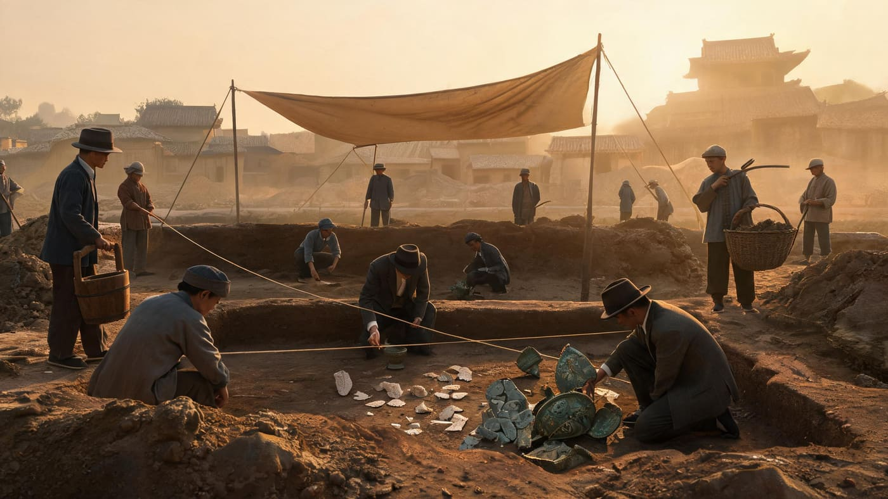
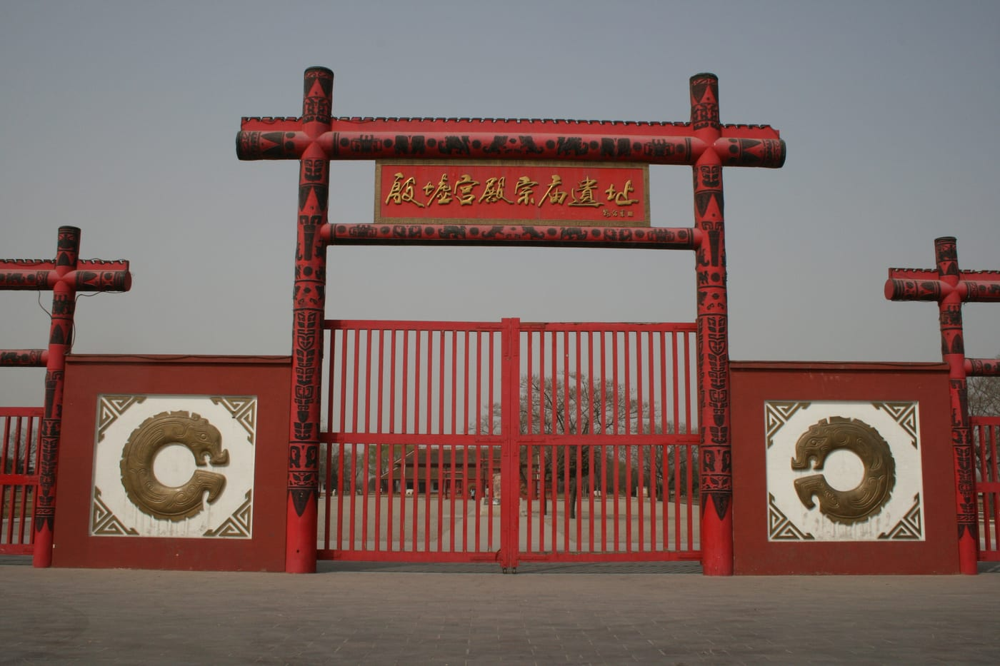
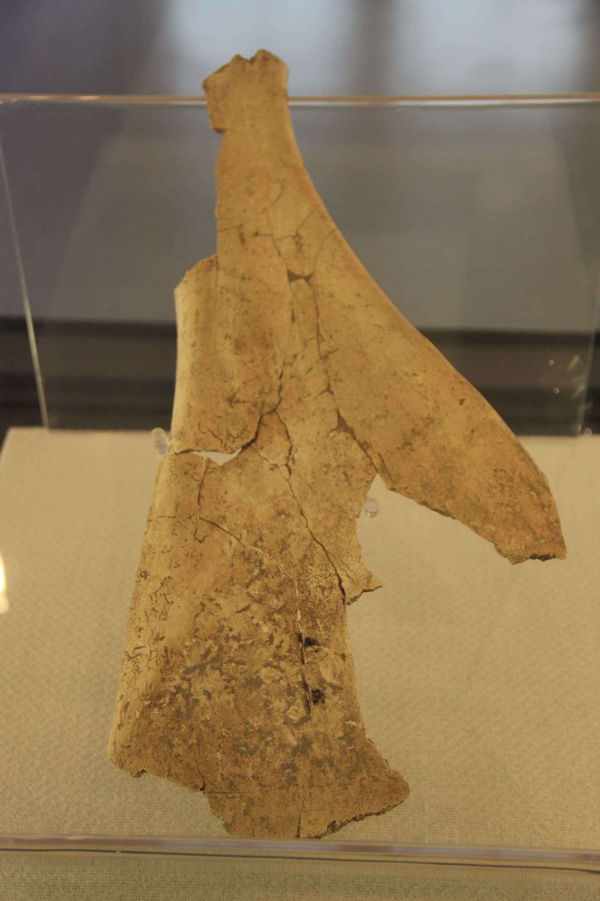
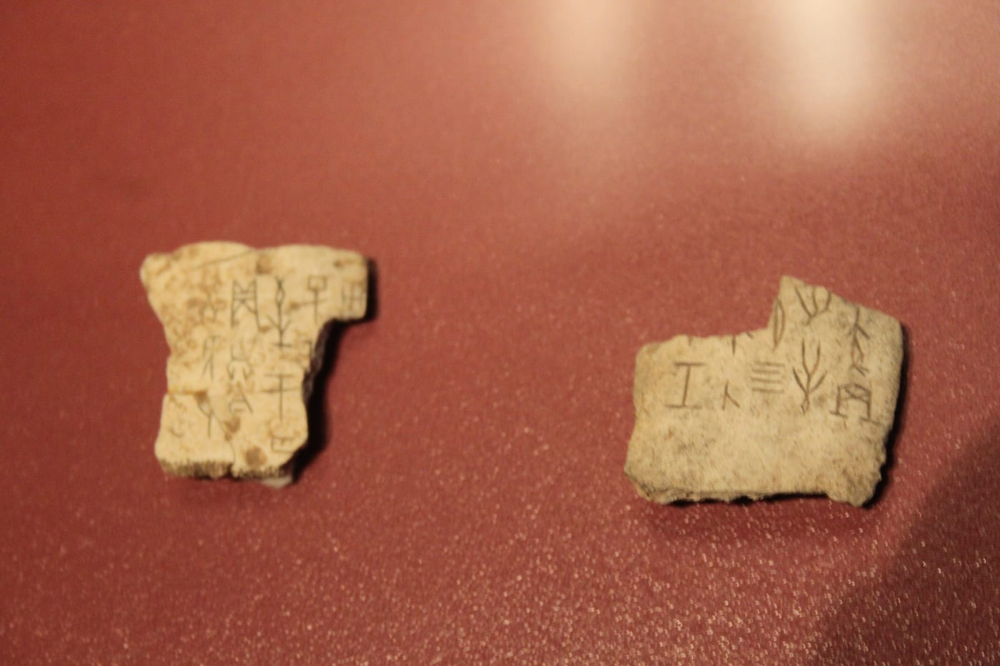
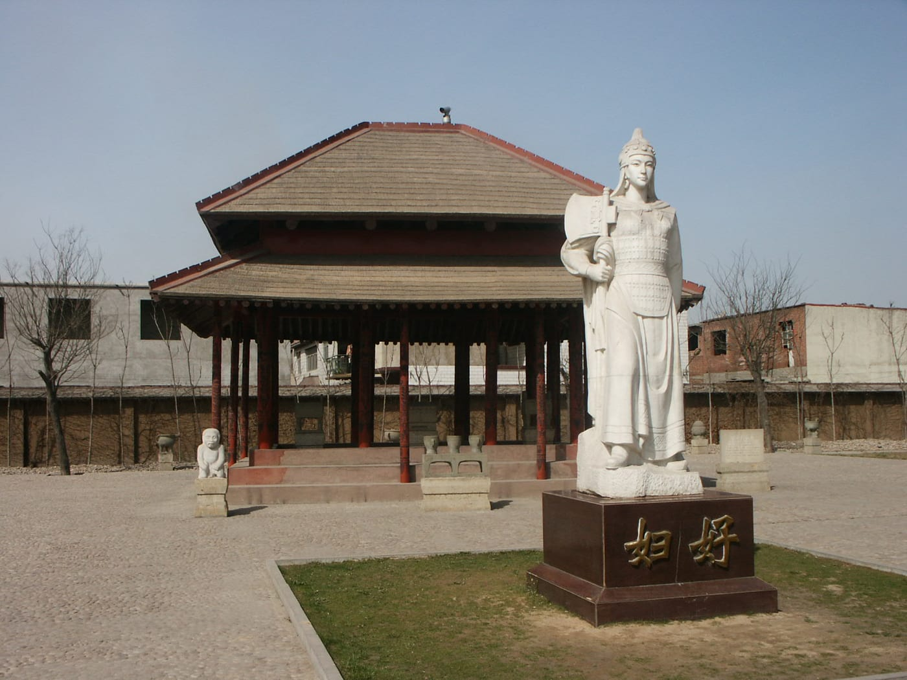
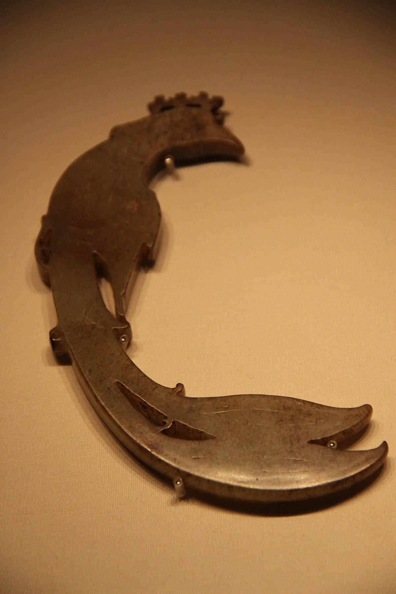

## 1. The Bones in the Medicine Packet

Beijing, 1899. Wang Yirong, director of the Imperial Academy, came down with malaria and sent out for medicine. The packet was opened on his table. Among the ingredients was "dragon bone", ground into small pieces and mixed with herbs.

He picked one up and saw marks. Not cracks, not cuts, but lines cut stroke by stroke. He recognised several of them as characters.

Later generations took that year as the moment oracle bone script was identified. What Wang saw was a medicine, not a record.

## 2. Xiaotun

The "dragon bones" came from Henan. At Xiaotun, a village outside Anyang, farmers turned up bone fragments in their fields. They sold them to medicine traders, who sold them to pharmacies in town and eventually to Beijing.

Once Wang had recognised the characters, word spread and the price of bone fragments rose. Antique dealers began buying, collectors began collecting, and villagers began digging for themselves. In a few decades tens of thousands of pieces were dug out; most were scattered, some left the country.

The trail led back to Xiaotun. This was the site of the late Shang capital. After the dynasty fell the city was abandoned and became ruins; later ages called it Yinxu, the Ruins of Yin.

## 3. The List of 1917

In 1917 the scholar Wang Guowei sorted out the names of Shang kings on the bones and built a genealogy from them. He set it against the Shang chapter of Sima Qian's Records of the Grand Historian. The two orders matched.

The step was crucial. Sima Qian wrote about the Shang nearly a thousand years after its fall; the bones were cut by Shang people themselves. If the two lists agreed, the kings in the Records were not invented, and the bones were genuinely Shang.

One bone records who sacrificed to whom; another records who marched and who came back. Put the names in order and a dynasty stands up out of legend.

## 4. 1928

In 1928 the Institute of History and Philology of the Academia Sinica began digging at Anyang. It was the first large-scale field project run by Chinese scholars themselves. Work continued for ten years and stopped when the war with Japan began.

They uncovered rammed-earth foundations of palaces, royal tombs and workshops, and piles of oracle bones. Excavation has continued, on and off, to the present. The site covers about thirty square kilometres and has produced more than eighty rammed-earth foundations; it is one of the largest ancient capital sites in China.

*Reconstruction: trenches and tools at the Yinxu excavation of 1928. Not a historical photograph. XIQIQI Editorial, CC BY-SA 4.0.*

*Site photograph: Yinxu, Anyang, Henan, 2008. Gary Todd, CC0 (Wikimedia Commons).*

## 5. Asking the Gods

The Shang divined on turtle plastrons and ox shoulder blades.

The method was fixed: pits were drilled into the bone with a groove cut alongside; a hot point was applied and the bone cracked, and the direction of the crack was the answer. The diviner then carved the question, the date and the outcome beside it, sometimes with a note on whether it came true.

The questions are concrete: will it rain this month; when will the king's toothache stop; are the offerings to a certain ancestor enough; who should lead this campaign. A single bone could be used again and again, questions lined along its edge.

Yinxu has yielded more than 150,000 oracle bones, with a range of glyphs, sentence grammar and record-keeping. They are the earliest known systematic writing in China.

*Site photograph: a Shang ox scapula with divination inscriptions, from Yinxu. Gary Todd, CC0 (Wikimedia Commons).*

*Site photograph: a group of Shang oracle bones on display. Gary L. Todd, CC0 (Wikimedia Commons). The drilled pits and scorch marks were made during divination.*

## 6. The Tomb of 1976

In 1976 a Shang tomb was found at Yinxu. The excavation was led by Zheng Zhenxiang.

It had not been robbed. Most Shang royal tombs had been looted centuries before; this one was the exception. The coffin and chamber had rotted, but the objects were still where they had been placed. One bronze carried an inscription: Fu Hao.

Fu Hao was a wife of King Wu Ding. Oracle bones record her leading troops, presiding at sacrifices, and giving birth with complications. The bronzes, jades, bone objects and sea shells in her tomb had lain untouched for more than two thousand years.

Six dogs and sixteen people had been buried with her.

*Site photograph: the tomb chamber of Fu Hao and the statue in front of it, Yinxu (the tomb dates from about 1200 BC; the photograph is modern). Gary Todd, CC0 (Wikimedia Commons).*

*Site photograph: a Shang jade phoenix from the tomb of Fu Hao, c. 1200 BC. Gary Todd, CC0 (Wikimedia Commons).*

## 7. The Ding

The largest bronze from Yinxu is the Houmuwu ding. Its body was cast in sections from several clay moulds and then assembled; the handles were cast separately and joined on. A workshop three thousand years ago had to organise dozens or hundreds of people, sequence the work and control the heat to pour a single complete vessel.

The same city held bronze-casting workshops, bone workshops and pottery workshops. The bones asked about war and weather; the workshops made the vessels those questions required.

## 8. The Name

On the oracle bones the Shang called their state Shang, and their capital Dayi Shang, the Great Settlement of Shang. They did not call themselves Yin. Yin was the name later Zhou writers used, and it passed into the Book of Documents, into Sima Qian and down to the present.

A dynasty's name was given to it by its rivals. The name it carved on its own bones had to wait three thousand years, and a medicine packet, before anyone read it again.

## 9. Today

In 2006 Yinxu was inscribed on the UNESCO World Heritage list.

In 2024 the new Yinxu Museum opened with nearly four thousand objects on display. In a sacrificial pit excavated in 2023, human bones were down by 67 per cent against earlier periods, with more cattle and sheep remains; the human bones that remained belonged to prisoners of war. Behind the figures lies a change of practice, or a shortage of resources; the report is still being written.

Go back to the table in 1899. Wang Yirong saw a medicine. Today, on the oracle bones, one diviner's name is Zheng, and he presided over many divinations in the reign of Wu Ding. His name was cut into the bone, and the bone was broken, cracked, ground into pieces and mixed into a medicine packet, and then picked out of it again.

A man who questioned the gods ended up as the object of a question.

---

**Sources and licenses**: sources are listed in the ledger S1–S7 at the foot of this entry. Text and original diagrams are CC BY-SA 4.0. The article keeps apart the discovery of 1899, the excavations from 1928 onward, oracle bone divination, the tomb of Fu Hao and the documented history of the Shang; the bones and the site are archaeological evidence. The reconstruction is not a historical photograph; the site and object photographs are CC0.
