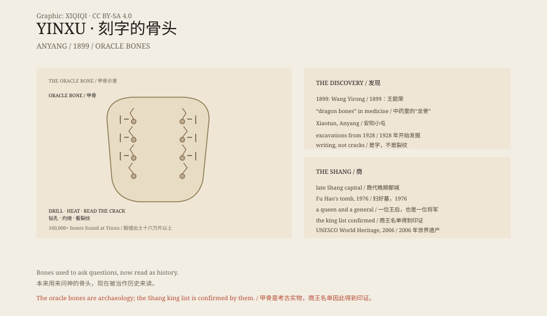

## 1. 1899

In 1899 in Beijing, an official named Wang Yirong fell ill and bought Chinese medicine.

One ingredient was "dragon bone". He noticed strange marks on the bones.

They were not cracks. They were writing.

That is how oracle bone script was identified.

## 2. Anyang

The "dragon bones" came from Xiaotun village near Anyang, Henan.

It was the capital of the late Shang dynasty, called Yin. After the dynasty fell the capital became ruins, so the site is called Yinxu, the Ruins of Yin.

In 1928 archaeologists began excavating there.

## 3. The Bones

The Shang used turtle shells and ox shoulder blades for divination.

They drilled small pits in the bone, applied heat, and read the cracks to judge the answer. Then they carved the question, the date and the result beside it.

"Will it rain this year?" "Will the queen give birth?" "Will this campaign succeed?"

More than 160,000 oracle bones have been excavated at Yinxu. They are the earliest known systematic writing in China.

## 4. Fu Hao

In 1976 archaeologists found an undisturbed Shang tomb: the tomb of Fu Hao.

Fu Hao was a wife of King Wu Ding and also a general. Her tomb contained bronzes, jades, bone objects and sea shells, as well as inscriptions bearing her name.

## 5. Documented History

The oracle bones turned the Shang from legend into recorded history.

The list of Shang kings in Sima Qian's Records of the Grand Historian matches the royal sacrificial lists on the bones. The documented history of China was pushed back by more than a thousand years.

## 6. Bone

The bones of Yinxu were originally used to ask the gods.

Now they lie in museums, lit by lamps, read by us.

The gods did not answer. The writing remained.

*Original schematic: the drilling and heating of oracle bones, the tomb of Fu Hao and the late Shang timeline. Not a photograph of an artefact. Oddity Archive, CC BY-SA 4.0.*

---

**Sources and licenses**: the factual sources are listed in the source ledger S1–S4 at the bottom of this entry. Text and original diagrams are licensed under CC BY-SA 4.0. This article separates the 1899 discovery, the Anyang excavations, oracle bone divination, the tomb of Fu Hao and the documented Shang history; the bones and the site are archaeological evidence. The illustration is a scene reconstruction, not a photograph of an artefact.
