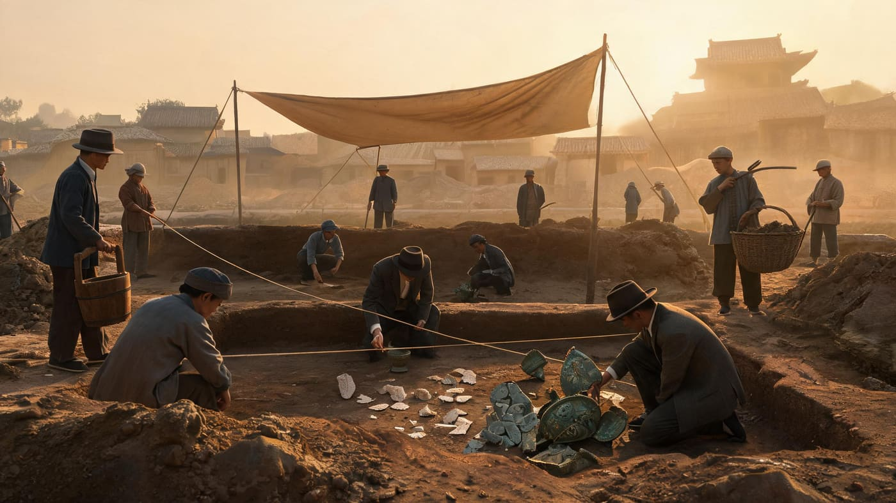
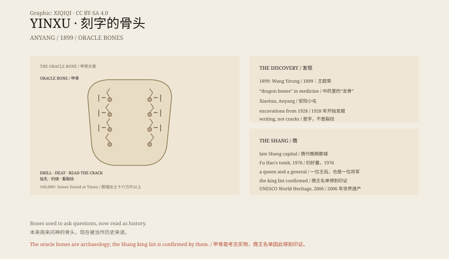

## 一、1899 年

1899 年，北京。一个叫王懿荣的官员生病，买中药。

那是清末的北京，王懿荣在灯下摊开药包。龙骨被磨成碎块，混在药材里，本来只是治病的材料。

药里有一味“龙骨”。他发现，骨头上刻着奇怪的纹路。

那不是裂纹，是字。

甲骨文，就这样被认出来了。

## 二、安阳

这些“龙骨”来自河南安阳的小屯村。

那里是商朝晚期的都城，叫殷。商朝灭亡后，都城变成废墟，所以叫殷墟。

1928 年，考古学家开始在这里发掘。

*场景复原：1928 年安阳殷墟的考古发掘现场。不是历史照片。稀奇奇编辑部，CC BY-SA 4.0。*

## 三、甲骨

商人用龟甲和牛肩胛骨占卜。

占卜不是一次性的。一块龟甲可以被反复使用，问题刻在边缘，裂纹穿过中间的钻孔。档案就这样一层一层留在了骨头上。

他们在骨头上钻出小坑，用火烤，看裂纹判断吉凶。然后把问题、日期、结果刻在旁边。

“今年会下雨吗？”“王后会不会生孩子？”“这场仗能赢吗？”

今天，殷墟出土的甲骨超过十六万片。这是中国最早的成体系文字。

## 四、妇好

1976 年，考古学家发现了一座没有被盗过的商代墓葬：妇好墓。

墓没有被盗过，器物还在原位。青铜器上的铭文写着她的名字，也写着她带兵打仗的事。

妇好是商王武丁的妻子，也是一位将军。墓里有青铜器、玉器、骨器和海贝，还有刻着她名字的铭文。

## 五、信史

甲骨文让商朝从传说变成了信史。

《史记》里的商王名单，和甲骨上的祭祀名单能对上。中国有文字可考的历史，向前推了一千多年。

## 六、骨头

殷墟的骨头，原本是用来问神的。

现在，它们躺在博物馆里，被灯光照着，被我们读。

神没有回答。但字留下来了。

*原创示意图：甲骨占卜的钻孔与灼烧、妇好墓与晚商时间线。不是文物照片。稀奇奇编辑部，CC BY-SA 4.0。*

---

**来源与许可**：本文的事实来源见条目底部来源台账 S1–S4。文字与原创示意图采用 CC BY-SA 4.0。文中把 1899 年发现、安阳发掘、甲骨占卜、妇好墓与商代信史分开叙述；甲骨文与殷墟有考古依据。插图是场景复原，不是文物照片。
