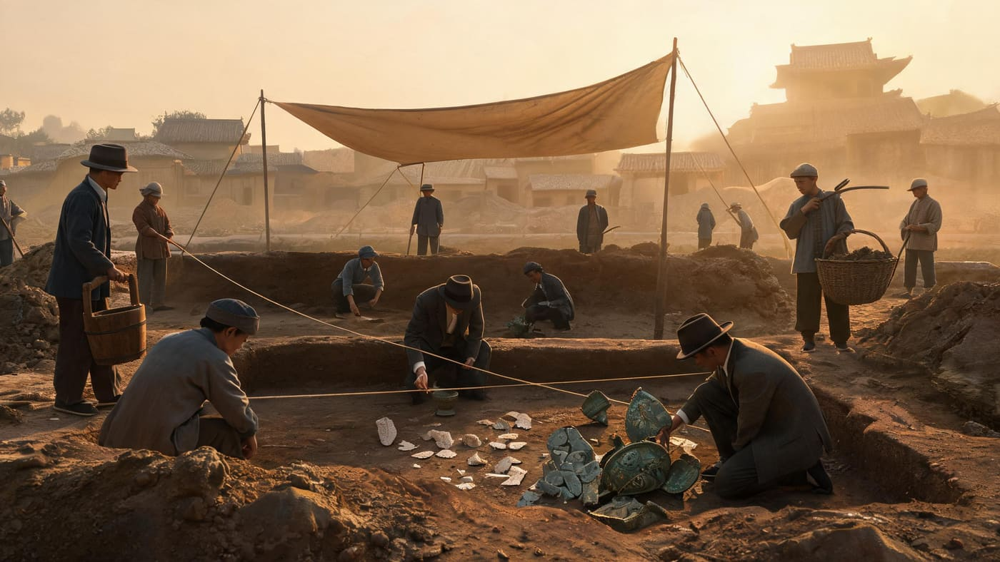
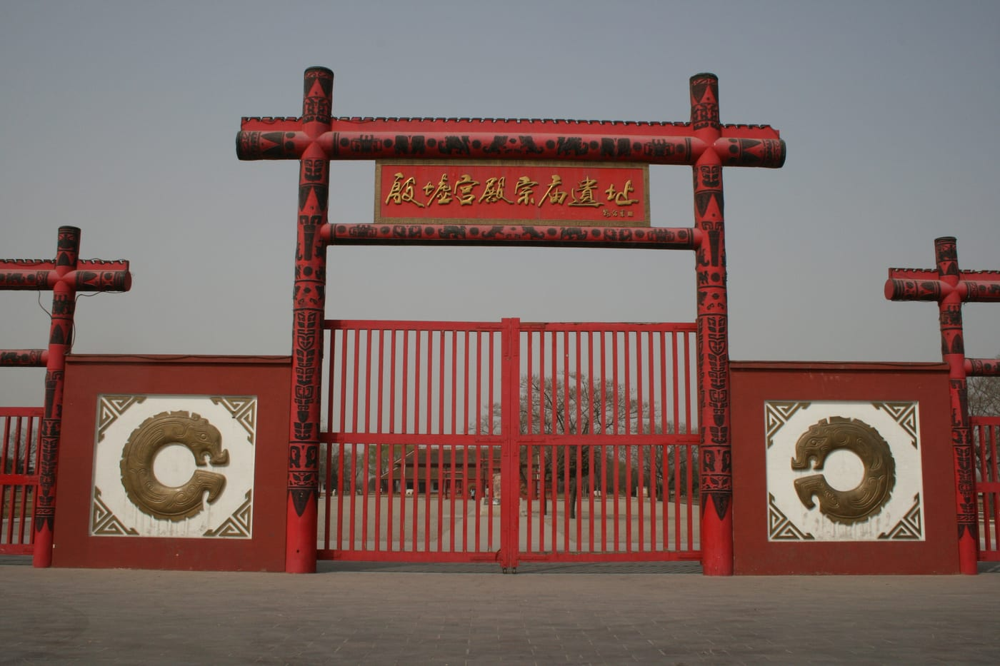
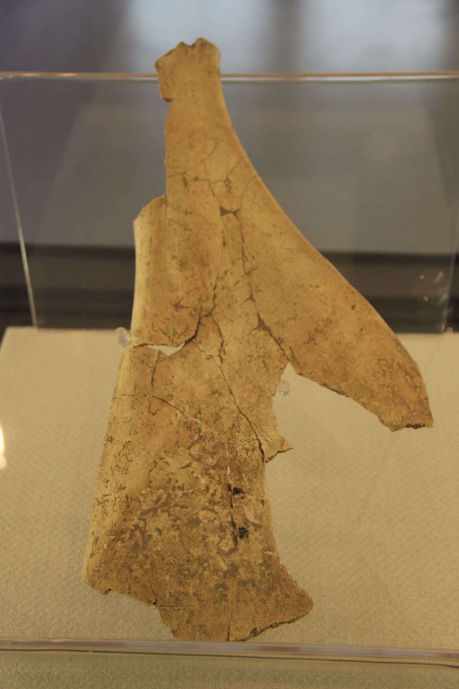
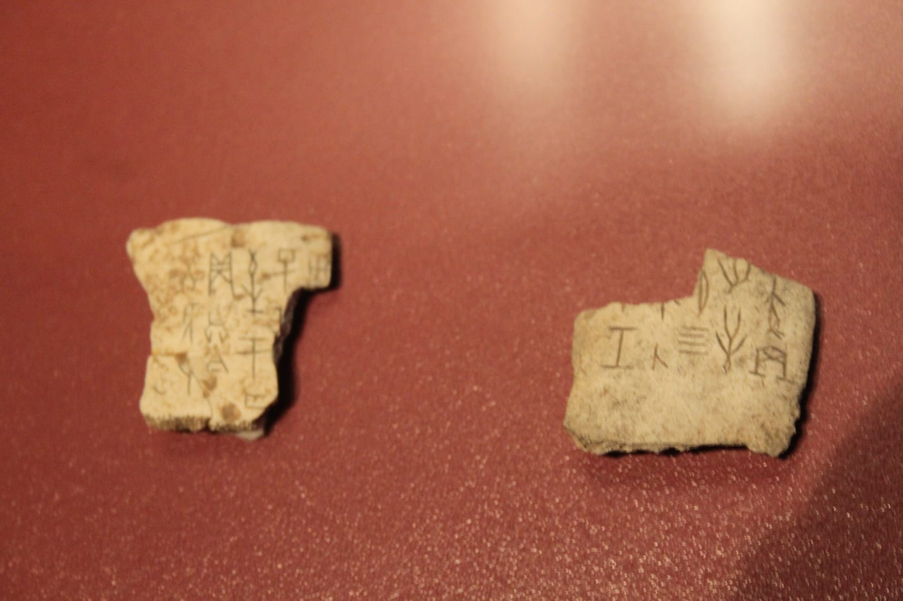
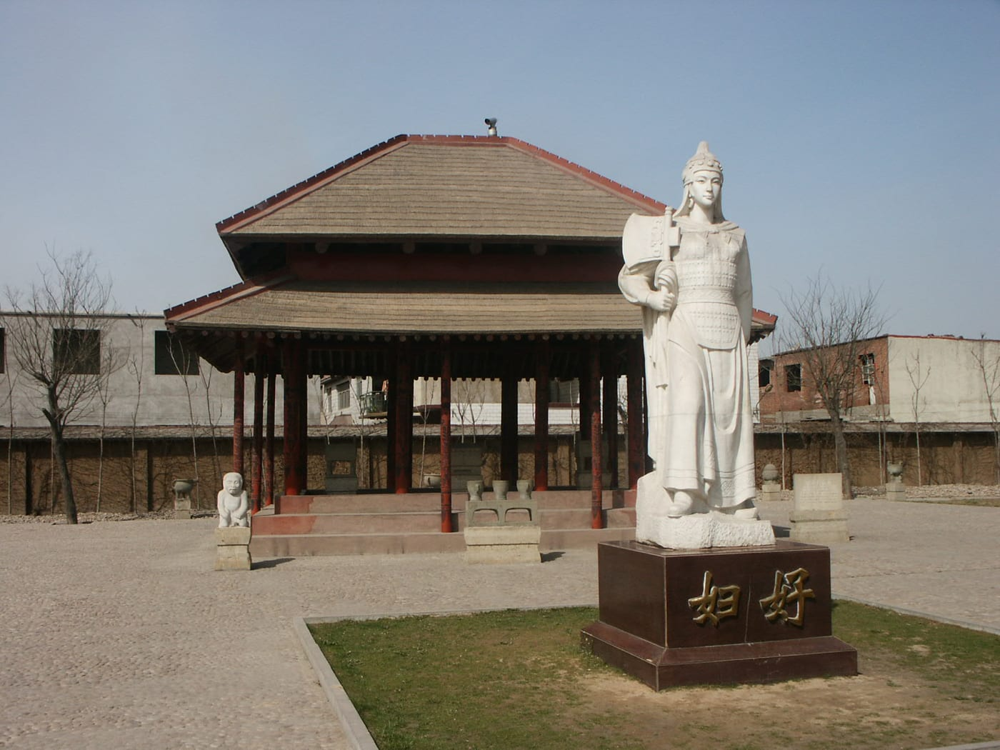
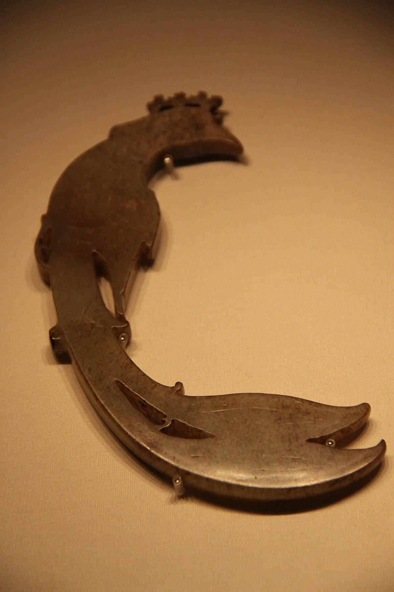

## 一、药包里的骨头

1899 年，北京。国子监祭酒王懿荣得了疟疾，派人去药铺抓药。药包摊开在桌上，里面有一味“龙骨”，磨成小块，混在别的药材里。

他拿起一块，看见上面有刻痕。不是裂纹，也不是刀伤，是一笔一笔刻出来的线条。他认出了其中几个字。

后来的人把这一年当作甲骨文被认出来的年份。王懿荣当时看到的是一味药，不是档案。

## 二、小屯村

“龙骨”从河南来。安阳城外的小屯村，村民在田里翻地，常翻出骨片。骨片卖给收药材的贩子，贩子卖给城里的药铺，一路卖到北京。

王懿荣认出字以后，消息传开，骨片的价格涨了。古董商开始收，收藏家开始买，村民开始自己挖。几十年里，挖出来的骨片以万计，大部分流散，一部分出了国。

线索最后指向小屯村。那里是商朝晚期的都城所在，商亡之后城废，成为废墟，后人叫它殷墟。

## 三、1917 年的对照

1917 年，学者王国维把甲骨上的商王名字一个个排出来，排成一份世系。他拿这份世系去对《史记·殷本纪》，两边的顺序基本吻合。

这一步很关键。司马迁写商朝，离商亡已经隔了近千年；甲骨是商朝人自己刻的。两套名单对得上，说明《史记》里的商王不是编的，也说明这些骨头确实来自商朝。

一片甲骨上记着谁祭祀谁，另一片记着谁出征谁回来。把这些名字按时间排好，一个朝代就从传说里站起来了。

## 四、1928 年

1928 年，中央研究院历史语言研究所开始在安阳发掘。这是中国学者自己主持的第一次大规模田野考古，挖了十年，抗战爆发后停。

他们挖出了宫殿的夯土地基、王陵、作坊，还有成堆的甲骨。战后的发掘一直继续到今天。整个遗址面积约三十平方公里，夯土基址八十多处，是中国规模最大的古代都城遗址之一。

洹河对岸还有一座同时期的城，压在安阳机场下面，发掘受限，至今没有出土带字的甲骨。

*场景复原：1928 年殷墟发掘现场的探方与工具。不是历史照片。稀奇奇编辑部，CC BY-SA 4.0。*

*现场照片：殷墟遗址，河南安阳，2008 年。Gary Todd，CC0（Wikimedia Commons）。*

## 五、问神

商朝人用龟甲和牛的肩胛骨占卜。

做法有固定流程：先在骨面钻出小坑，旁边凿一道槽；占卜时用火在坑里烧，骨头受热开裂，裂纹的走向就是回答。主持占卜的人把问题、日期、结果，有时还有应验，刻在裂纹旁边。

问题很具体：这个月会不会下雨；王的牙疼什么时候好；某位先王的祭品够不够；这一仗派谁去。一片骨头可以反复用，问题刻在边缘，一条一条排着。

殷墟出土的甲骨超过十五万片，上面有不同的字形，有成句的文法，有记事的内容。这是中国目前发现的最早的成体系文字。

甲骨上还刻着主持占卜的人的名字。学者把这些人叫“贞人”，靠贞人的名字给骨片分组，再按组排年代。一片骨头属于哪一朝，很多时候是靠一个人的名字定下来的。

*现场照片：商代牛肩胛骨上的占卜刻辞，殷墟出土。Gary Todd，CC0（Wikimedia Commons）。*

*现场照片：成组陈列的商代甲骨。Gary L. Todd，CC0（Wikimedia Commons）。骨片上的钻孔与灼痕是占卜时留下的。*

## 六、1976 年的墓

1976 年，考古队在殷墟发现一座商代墓葬。主持发掘的是郑振香。

墓没有被盗过。商代王陵大多在早年被盗，这一座是例外：棺椁朽了，器物还在原位。墓里有一件青铜器，铭文写着“妇好”。

妇好是商王武丁的妻子。甲骨里有她带兵出征的记录，有她主持祭祀的记录，也有她生孩子难产的记录。墓里出土的青铜器、玉器、骨器、海贝，摆了两千多年没有动过。

墓内还殉葬六条狗和十六个人。

*现场照片（妇好墓墓圹）：妇好墓的墓圹与墓前雕像，殷墟（墓葬年代约公元前 1200 年，照片为现代）。Gary Todd，CC0（Wikimedia Commons）。*

*现场照片（商代玉凤）：妇好墓出土的商代玉凤，约公元前 1200 年。Gary Todd，CC0（Wikimedia Commons）。*

## 七、鼎

殷墟出土的青铜器里，最大的一件是后母戊鼎（旧称司母戊鼎）。器身用多块陶范分铸再合范，耳朵单独铸好，最后嵌上去。三千年前的作坊要组织几十上百人，分工序，控制火候，才能浇出一件完整的鼎。

同一座城里还有铸铜作坊、制骨作坊、制陶作坊。甲骨上问的是战争和天气，作坊里做的是这些问话要用的礼器。

## 八、名字

甲骨文里，商朝人叫自己的国家“商”，叫都城“大邑商”。他们不叫自己“殷”。“殷”是后来周人的叫法，写进《尚书》，写进《史记》，一直用到今天。

一个朝代的名字，是它的对手起的。它自己刻在骨头上的名字，要等三千年后被人从药包里认出来，才重新被人读到。

## 九、今天

2006 年，殷墟被列入联合国教科文组织世界遗产名录。

2024 年，殷墟博物馆新馆开放，展出近四千件文物。2023 年发掘的一座祭祀坑里，人骨比更早的时期少了六成七，牛骨和羊骨更多，剩下的人骨属于战俘。数字背后是一次制度的变化，或者是一次资源的紧张，考古报告还在写。

回到 1899 年那张药桌。王懿荣看到的是一片药。今天，出土的甲骨上，一位占卜者的名字叫“争”，他在武丁一朝主持过很多次占卜。他的名字刻在骨头上，骨头碎过、裂过、被磨成小块混进药包，又被人从药包里挑出来。

一个问神的人，最后成了被问的对象。

---

**来源与许可**：文字与原创示意图采用 CC BY-SA 4.0；第三方图片与资料的许可见文末来源台账。
