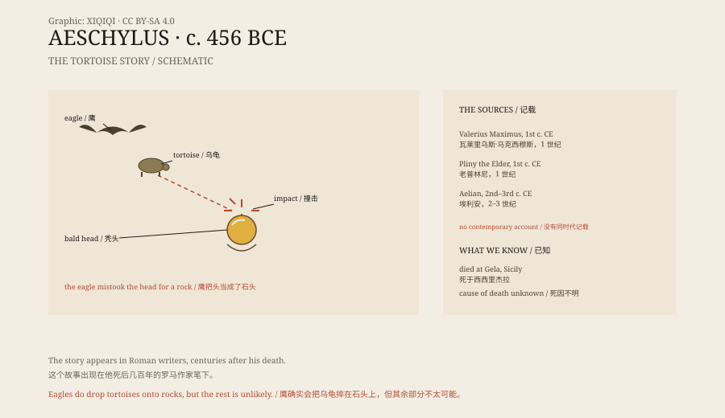

## 1. The end at Gela

In 456 or 455 BCE, Aeschylus died at Gela in Sicily.

He was not in Athens. In his later years he had left the city where he had made his name and gone to Sicily. Some say a tragedy of his had been badly received; others say he simply wanted a change. Whatever the reason, he died there.

He was about sixty-seven. By Greek standards, that was a long life.

## 2. The tortoise

His death was turned into a strange story by ancient writers.

The first-century Roman writer Valerius Maximus says that Aeschylus was sitting outside the city in the sun when an eagle flew over, carrying a tortoise in its claws. The eagle saw his bald head, mistook it for a rock, and dropped the tortoise to break the shell.

The tortoise hit his head. He died.

Pliny the Elder and Aelian told similar stories. The details differ, but the core is the same: a bald head, an eagle, a tortoise, and a fatal fall.

*Original schematic: the structure of the tortoise story, the ancient accounts, and how it travelled. Not a historical scene. Oddity Archive, CC BY-SA 4.0.*

## 3. Eagles and tortoises

The story is not entirely invented.

Some birds of prey do drop tortoises or bones from a height onto rocks, breaking them open before eating. The bearded vulture does exactly this. A tortoise shell is hard, and it has to fall onto stone to crack.

So an eagle dropping a tortoise is not impossible in itself.

The problem is why an eagle would mistake a bald head for a rock. It requires the bird's eyesight, the light, the angle, and the poet's position to line up at the same moment. The story sounds plausible, but it feels more like an answer invented to explain how a poet could be killed by a tortoise.

## 4. What he actually wrote

Aeschylus was one of the three great tragedians of ancient Greece.

He wrote somewhere between seventy and ninety plays, of which seven survive. The most famous is the Oresteia trilogy, about a family's blood debt and revenge. The Persians is about the Greek victory over Persia at sea, and Prometheus Bound is about the Titan who stole fire.

He fought at Marathon. His epitaph does not mention drama at all; it says only that he fought at Marathon. To the Athenians of his time, that may have mattered more than poetry.

## 5. The ancient taste for strange deaths

Ancient writers loved collecting bizarre deaths.

One man was killed by a tortoise, one was suffocated by cloaks, one died laughing, one choked on a fish bone. These stories were written into notebooks, speeches, and miscellanies to show how unpredictable fate was, or simply to entertain.

They are not necessarily false, but they are not necessarily true either. The ancient world had no archives or coroners as we know them. A good story, repeated often enough, becomes a fact.

Aeschylus and the tortoise is the most famous of them.

## 6. Now

Today, most scholars of ancient Greece accept that Aeschylus died at Gela, but the cause is unknown.

The tortoise story is still repeated in trivia books, histories of drama, and travel guides. Gela has a tomb traditionally attributed to him.

A man who wrote so much about revenge, oracles, and blood debts was finished off by a tortoise. The ending is too neat, as if someone else had written it for him.

---

**Sources and licenses**: the factual sources are listed in the source ledger S1–S3 at the bottom of this entry. Text and original diagrams are licensed under CC BY-SA 4.0. This article separates Aeschylus's life, the ancient tortoise story, the behaviour of birds of prey, and the tradition of strange deaths; the tortoise story appears in ancient writers but lacks contemporary evidence, and the real cause of death is unknown.
