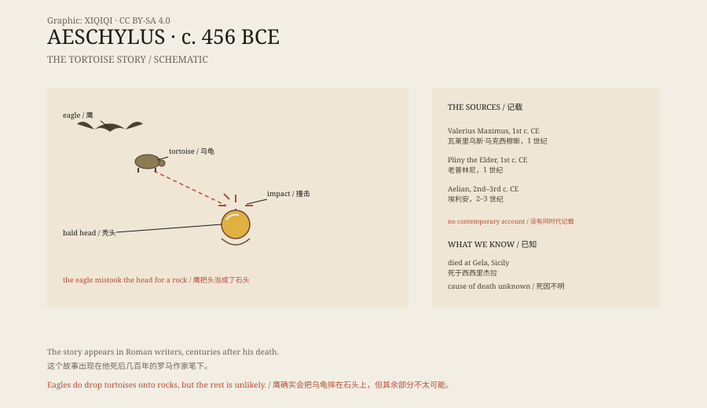

## 1. The end at Gela

In 456 or 455 BCE, Aeschylus died at Gela in Sicily.

He was not in Athens. In his later years he had left the city where he had made his name and gone to Sicily. Some say a tragedy of his had been badly received; others say he simply wanted a change. Whatever the reason, he died there.

He was about sixty-seven. By Greek standards, that was a long life.

## 2. The tortoise

His death was turned into a strange story by ancient writers.

The first-century Roman writer Valerius Maximus says that Aeschylus was sitting outside the city in the sun when an eagle flew over, carrying a tortoise in its claws. The eagle saw his bald head, mistook it for a rock, and dropped the tortoise to break the shell.

The tortoise hit his head. He died.

Pliny the Elder and Aelian told similar stories. The details differ, but the core is the same: a bald head, an eagle, a tortoise, and a fatal fall.

*Original schematic: the structure of the tortoise story, the ancient accounts, and how it travelled. Not a historical scene. Oddity Archive, CC BY-SA 4.0.*

## 3. Eagles and tortoises

The story is not entirely invented.

Some birds of prey do drop tortoises or bones from a height onto rocks, breaking them open before eating. The bearded vulture does exactly this. A tortoise shell is hard, and it has to fall onto stone to crack.

So an eagle dropping a tortoise is not impossible in itself.

The problem is why an eagle would mistake a bald head for a rock. It requires the bird's eyesight, the light, the angle, and the poet's position to line up at the same moment. The story sounds plausible, but it feels more like an answer invented to explain how a poet could be killed by a tortoise.

## 4. What he actually wrote

Aeschylus was one of the three great tragedians of ancient Greece.

He wrote somewhere between seventy and ninety plays, of which seven survive. The most famous is the Oresteia trilogy, about a family's blood debt and revenge. The Persians is about the Greek victory over Persia at sea, and Prometheus Bound is about the Titan who stole fire.

He fought at Marathon. His epitaph does not mention drama at all; it says only that he fought at Marathon. To the Athenians of his time, that may have mattered more than poetry.

## 5. The ancient taste for strange deaths

Ancient writers loved collecting bizarre deaths.

One man was killed by a tortoise, one was suffocated by cloaks, one died laughing, one choked on a fish bone. These stories were written into notebooks, speeches, and miscellanies to show how unpredictable fate was, or simply to entertain.

They are not necessarily false, but they are not necessarily true either. The ancient world had no archives or coroners as we know them. A good story, repeated often enough, becomes a fact.

Aeschylus and the tortoise is the most famous of them.

## 6. Now

Today, most scholars of ancient Greece accept that Aeschylus died at Gela, but the cause is unknown.

The tortoise story is still repeated in trivia books, histories of drama, and travel guides. Gela has a tomb traditionally attributed to him.

A man who wrote so much about revenge, oracles, and blood debts was finished off by a tortoise. The ending is too neat, as if someone else had written it for him.

## Gela
Aeschylus was an ancient Greek tragedy writer.

He died in Gela, Sicily, in 456 or 455 BC.

## The Tortoise
Legend has it that an eagle grabbed a turtle and tried to throw it against a stone.

The eagle mistook Aeschylus' bald head for a stone. The turtle hit him on the head and he died.

## The Eagle and the Tortoise
This legend comes from ancient times.

It says that Aeschylus died in a "prophecy": that he would die from "something falling from heaven."

## What Did He Write

Aeschylus wrote "The Persians", "Seven Against Thebes", "Prometheus Bound" and "The Oresteia".

He is one of the three major tragedians in ancient Greece.

## Strange Death

Ancient people liked stories of "strange deaths".

The death of Aeschylus became a typical example: a great man died in a ridiculous accident.

## Now

His play is still going on.

His death is still being talked about.

## Tragedy

Aeschylus is the founder of ancient Greek tragedy.

He increased the number of actors from one to two, making dialogue the heart of the drama.

## Drama

"The Persians" writes about the Greeks' defeat of Persia.

"Seven Generals Attack Thebes" is about brothers killing each other.

"Prometheus Bound" describes the conflict between gods and humans.

"Oresteia" writes about the family's blood debt.

## Die

His death is a legend.

The eagle threw the turtle on his head, because he was as bald as a stone.

His death was an accident.

His death was an accident. The eagle, the turtle, and the bald head, when these three things come together, they become a story.

## Heritage

His plays influenced the entire Western drama.

His death became a typical example of ancient "strange death" stories.

His plays influenced Shakespeare, Goethe and modern drama.

His death affected the "strange death" story.

## Supplementary Note

The plays of Aeschylus are the starting point of ancient Greek drama.

He writes about gods, humans, fate and bloodshed. His character is not a good guy or a bad guy, but a person pushed by fate.

## Remember Again

The plays of Aeschylus are the starting point of ancient Greek drama.

His death was an accident.

## Last Note

The plays of Aeschylus are the starting point of ancient Greek drama.

Only seven complete plays by Aeschylus have survived. He wrote more than seventy works, most of which only fragments remain. His death is more absurd than his play, and more like a myth. Only seven of Aeschylus's plays have survived in their entirety.

He died in the fifth century BC, but his plays continue to be performed to this day. A man who was killed by a turtle left the starting point of Western drama.

## File

His play tells a myth in three parts. Only the Oresteia remains intact.

Aeschylus fought in the Battle of Marathon. On his tombstone, he only wrote about his bravery in battle and did not mention drama. His plays are still performed to this day.

His tombstone is said to have been written by himself. It only mentions the marathon, not the drama. The reputation of a warrior overshadows the reputation of a poet.

---

**Sources and licenses**: the factual sources are listed in the source ledger S1–S3 at the bottom of this entry. Text and original diagrams are licensed under CC BY-SA 4.0. This article separates Aeschylus's life, the ancient tortoise story, the behaviour of birds of prey, and the tradition of strange deaths; the tortoise story appears in ancient writers but lacks contemporary evidence, and the real cause of death is unknown.
