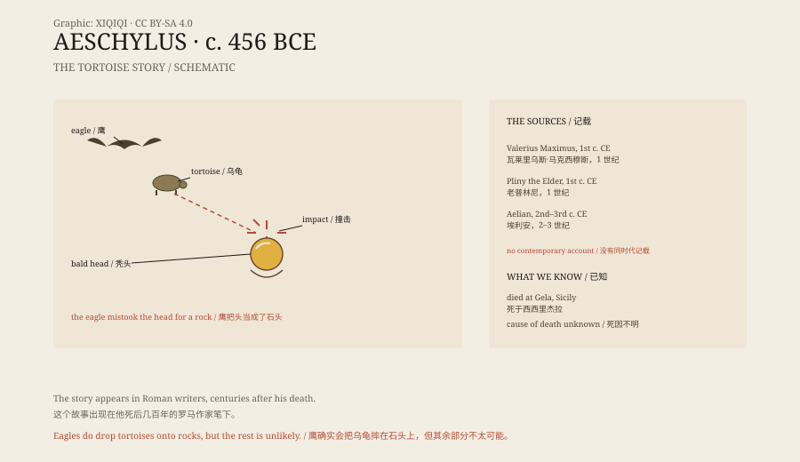

## 一、杰拉的结局

公元前 456 年或 455 年，埃斯库罗斯在西西里的杰拉去世。

他不在雅典。晚年的他离开了那座他成名的城市，去了西西里。有人说他是因为某部悲剧不受欢迎，有人说他只是想换个地方。无论原因是什么，他死在了那里。

他活了大约六十七岁。按古希腊的标准，这已经是高寿。

## 二、乌龟

他的死，被古代作家写成了一个离奇的故事。

一世纪的罗马作家瓦莱里乌斯·马克西穆斯写道：埃斯库罗斯坐在城外晒太阳，一只鹰从天上飞过，爪子里抓着一只乌龟。鹰看到了他的秃头，以为那是一块石头，就把乌龟砸了下去，想砸开龟壳。

乌龟砸中了他的头。他死了。

老普林尼和埃利安也写过类似的故事。细节略有不同，但核心一样：秃头、鹰、乌龟、致命的坠落。

*原创示意图：乌龟故事的结构、古代记载与流传路径。不是历史现场。稀奇奇编辑部，CC BY-SA 4.0。*

## 三、鹰与乌龟

这个故事不是完全凭空来的。

某些猛禽确实会把乌龟或骨头从高空扔到岩石上，摔碎后再吃。胡兀鹫就有这种习惯。乌龟壳很硬，从高处落下，砸在石头上，才会裂开。

所以，鹰扔乌龟这件事，本身有现实依据。

问题在于，鹰为什么要把一个光头当成石头。这需要鹰的眼睛、光线、角度和诗人的姿势同时配合。故事听起来合理，但更像是一个为了解释“一个诗人怎么会死于乌龟”而编出来的答案。

## 四、他真正写了什么

埃斯库罗斯是古希腊三大悲剧诗人之一。

他写过大约七十到九十部剧，流传下来的只有七部。最著名的是《俄瑞斯忒亚》三部曲，讲的是一个家族的血债和复仇。《波斯人》写的是希腊人战胜波斯的海战，《被缚的普罗米修斯》写的是盗火者受罚。

他参加过马拉松战役。他的墓志铭没有提戏剧，只写了他在马拉松作战。对当时的雅典人来说，那可能比写诗更重要。

## 五、古代的“奇死”故事

古代作家喜欢收集名人的离奇死亡。

有人被乌龟砸死，有人被斗篷闷死，有人笑死，有人被鱼刺噎死。这些故事被写进笔记、演说和杂录，用来证明命运无常，或者单纯为了好玩。

它们不一定是假的，但也不一定是真的。古代没有今天的档案和死因调查。一个好听的故事，只要重复得够多，就会被当成事实。

埃斯库罗斯的乌龟故事，就是其中最著名的一个。

## 六、现在

今天，研究古希腊的学者大多认为，埃斯库罗斯死于杰拉，但具体死因不明。

乌龟的故事仍然被写进趣闻书、戏剧史和旅游手册。杰拉有一座传说中属于他的墓。

一个写了那么多复仇、神谕和血债的人，最后被一只乌龟结束了生命。这个结局太整齐了，整齐得像是别人替他写的。

---

**来源与许可**：本文的事实来源见条目底部来源台账 S1–S3。文字与原创示意图采用 CC BY-SA 4.0。文中把埃斯库罗斯的生平、古代“乌龟”故事、猛禽习性与“奇死”传统分开叙述；乌龟故事见于古代作家的记载，但缺乏同时代证据，真实死因不明。
