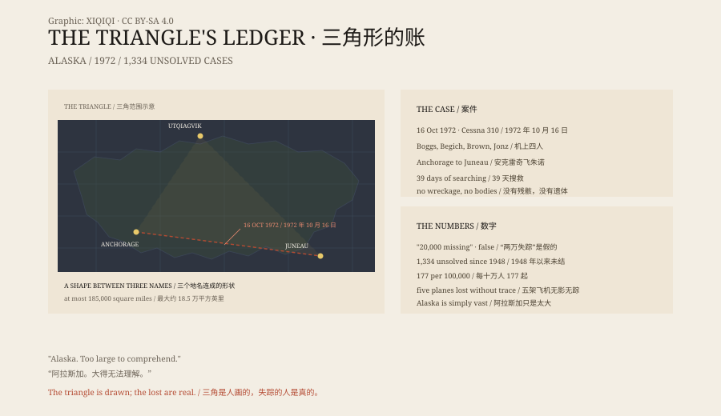

## 1. 16 October 1972

Anchorage, 9.09 a.m. A twin-engine Cessna 310 took off for Juneau.

There were four men aboard: House Majority Leader Hale Boggs, Alaska Congressman Nick Begich, Begich's aide Russell Brown, and the pilot, Don Jonz.

The plane entered low cloud and disappeared.

It became the largest search and rescue operation in Alaska's history: 39 days, 3,600 flight hours, 325,000 square miles. Military aircraft, civilian planes and the Coast Guard all took part.

No plane, no bodies, no wreckage.

## 2. The Triangle

The Alaska Triangle is usually drawn between Anchorage, Juneau and Barrow, now Utqiagvik.

It is a long, narrow triangle, at most about 185,000 square miles. It reaches into part of Canada and leaves out much of Alaska.

In other words, it is not a natural region. It is a shape drawn between three place names that people have heard of.

## 3. Twenty Thousand

The most common claim about the triangle is that twenty thousand people have disappeared inside it since 1972.

The number is false, exaggerated by a factor of about fifteen.

As of 2025, Alaska had 1,334 unsolved missing-person cases going back to 1948. By population, that is 177 per hundred thousand, ten times the rate of the next state, Hawaii.

But Alaska has only about 730,000 people and covers 1.7 million square kilometres. A person can walk into the wilderness and not meet anyone for days. A plane can go down on a glacier and not be found for decades.

## 4. The Name

The name "Alaska Triangle" did not appear in 1972.

It is not in the newspapers, government files or search reports of that year. It first appeared on television in 2001, in a History Channel episode called "Alaska's Bermuda Triangle".

Earlier, in 1978, the Alaska poet Sheila Nickerson used the phrase "Alaska's Bermuda Triangle" in a poem. In 1996 she used it again in her prose book *Disappearance: A Map*.

The name came later. The story came first.

## 5. The Planes

In Alaska, only five aircraft have vanished without a trace: 1947, 1951, 1972, 1992 and 2013.

Add a Navy PBY lost offshore in the Second World War, and it is six.

That is not a large number, but each one says the same thing: in Alaska, search and rescue is not guaranteed. The place is too big, the weather too fast, the glaciers too deep.

## 6. The Ledger

Sheila Nickerson began *Disappearance: A Map* with this:

"I live in a place where people disappear. Alaska. Too large to comprehend."

A triangle is a convenient shape for a story. Three points, a centre, and everything inside belongs to it.

But the real ledger has 1,334 names. They did not disappear inside a triangle. They disappeared inside a land too large to comprehend.

*Original schematic: the triangle, the 1972 Cessna 310 route and the missing-person statistics. Not a photograph of a site. Oddity Archive, CC BY-SA 4.0.*

## Geography

Alaska Triangle is not an official geographical name.

It usually refers to a region in south-east Alaska: the triangle between Ancrechi, Juno and Utchavik. It's large, it's complex, it's glaciers, forests, mountains and coasts.

## Weather

Alaska's weather, changing fast.

The wind, snow, fog, and low temperatures can drive the aircraft out of direction. Small aircraft fly in mountainous areas, encounter a reduced flow of air and visibility, and are at high risk.

Alaska's winter, long.

Low temperatures, wind, snow. Pilots need experience, equipment and luck.

## Aircraft

Alaska's got a lot of planes.

Many villages have no roads and are transported by air.

Alaska's small planes, many of them on water.

They rise and fall from villages without runways, by lakes and by the coasts. As soon as the weather changes, the flight is dangerous.

## Missing

Missing planes, usually hard to find.

The terrain is big, the forest is dense, the snow is deep. It takes days or weeks for rescue teams to reach a possible crash site. Some planes are discovered decades later.

## Twenty thousand

The figure of “20,000 missing” has no reliable sources.

It brings together the missing persons of different ages, different causes, different places. Alaska has a very small population, 20,000 being a large number.

## Name

The name "triangular" was used in the media.

It mimics the Bermuda Triangle, tying a section and a number together. The bigger the name, the bigger the story.

## Statistics

The rate of disappearance in Alaska is indeed higher than the average in the United States.

The reason is that the environment, transport and population distribution are not “supernatural”. People in remote areas are more likely to get lost, hurt or die in the wild.

The number of missing persons in Alaska is not as high as “20,000”.

There are dozens to hundreds of reports of disappearances every year. Most are found, a few are not.

## The story

The Alaska Triangle story is about the wilderness.

The wilderness is big, the people are small. A plane disappears, probably covered by the forest and snow.

Alaska triangle, not supernatural.

It is a story of wilderness, transportation and risk.

## Anecret

Andrech is the largest city in Alaska.

It is a traffic hub, with airports, ports and roads. Many small aircraft take off from there and fly to villages, mines and fishing grounds.

## Juno

Juno is the capital of Alaska.

There are no roads connecting to other cities on the islands in the south-east.

## Utchavik

Utchavik, north coast of Alaska.

It's the northernmost city in the United States, by whaling and oil. It's a long winter and the sun hasn't come out.

## Search and rescue

The search and rescue team in Alaska consists of the National Guard, the police, volunteers and hunters.

They know the terrain and can fly small planes, snow trucks and boats. But the area is too big, the weather is too bad, search and rescue often fail.

Search and rescue teams, volunteers and hunters.

They know the terrain, they drive snowmobiles and boats. But it's too big, too bad weather.

## Village

The village of Alaska is scattered.

Some villages have no roads, no hospitals, no shops.

## Memory

The number of missing persons in Alaska has been magnified by the media.

The real problem is not “triangulation”, but transportation and weather in remote areas.

Every missing person has a specific story. It's more important than numbers.

---

**Sources and licenses**: the factual sources are listed in the source ledger S1–S4 at the bottom of this entry. Text and original diagrams are licensed under CC BY-SA 4.0. This article separates the 1972 case, the triangle legend, the official statistics and the ordinary explanations; the claim of twenty thousand disappearances is not supported by the data. The illustration is a scene reconstruction, not a photograph of a site.
