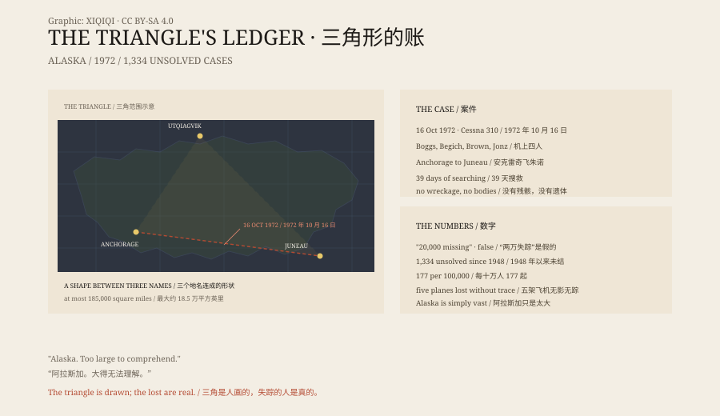

## 一、1972 年 10 月 16 日

安克雷奇，上午 9 点 09 分。一架双引擎 Cessna 310 起飞，目的地朱诺。

机上有四个人：众议院多数党领袖黑尔·博格斯，阿拉斯加众议员尼克·比吉奇，比吉奇的助手拉塞尔·布朗，飞行员唐·琼兹。

飞机进入低云，然后消失。

这是阿拉斯加历史上最大的一次搜救：39 天，3600 个飞行小时，32.5 万平方英里的区域。军方、民用飞机、海岸警卫队都参加了。

没有找到飞机，没有找到人，没有找到碎片。

## 二、三角

阿拉斯加三角，通常画在安克雷奇、朱诺和巴罗（今乌特恰维克）之间。

这是一个又长又窄的三角形，最大约 18.5 万平方英里。它穿过加拿大的一部分，也漏掉了阿拉斯加的很多地方。

换句话说，它不是一片自然区域，而是三个大家听说过的地名连起来的形状。

## 三、两万人

关于这个三角，最常见的说法是：自 1972 年以来，有两万人在里面失踪。

这个数字是假的，夸大了大约十五倍。

截至 2025 年，阿拉斯加自 1948 年以来共有 1334 起未结失踪案。按人口比例，阿拉斯加每十万人有 177 起，是第二名夏威夷的十倍。

但阿拉斯加只有 73 万人口，面积却有 171 万平方公里。一个人走进荒野，可能几天都遇不到人；飞机掉进冰川，可能几十年都找不到。

## 四、名字

“阿拉斯加三角”这个名字，不是 1972 年出现的。

1972 年的报纸、政府文件、搜救报告里，都没有这个词。它第一次出现在电视上，是 2001 年历史频道的一集《阿拉斯加的百慕大三角》。

再往前，1978 年，阿拉斯加诗人希拉·尼克森在一首诗里用过“阿拉斯加的百慕大三角”。1996 年，她在散文集《消失：一张地图》里又用了一次。

名字是后来加的。故事先有了。

## 五、飞机

在阿拉斯加，真正消失得无影无踪的飞机，只有五架：1947、1951、1972、1992、2013。

加上二战时一架离岸的海军 PBY，是六架。

这个数字不算多，但每一架都说明一件事：在阿拉斯加，搜救不是万能的。地方太大，天气太快，冰川太深。

## 六、账

希拉·尼克森在《消失：一张地图》的开头写：

“我住在一个人们会消失的地方。阿拉斯加。大得无法理解。”

三角是一个方便讲故事形状。三个点，一个中心，里面发生的一切都归它。

但真正的账本上，是 1334 个名字。他们不是在三角形里消失的，他们是在一片太大的土地上消失的。

*原创示意图：三角范围、1972 年 Cessna 310 航线与失踪统计对比。不是现场照片。稀奇奇编辑部，CC BY-SA 4.0。*

---

**来源与许可**：本文的事实来源见条目底部来源台账 S1–S4。文字与原创示意图采用 CC BY-SA 4.0。文中把 1972 年案件、三角传说、官方统计与普通解释分开叙述；“两万人失踪”的说法没有数据支持。插图是场景复原，不是现场照片。
