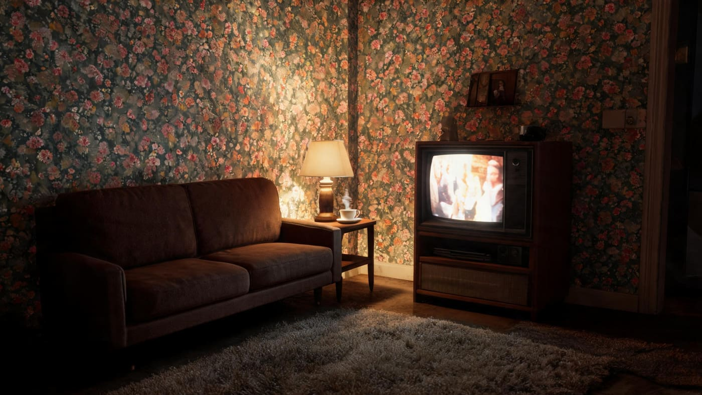
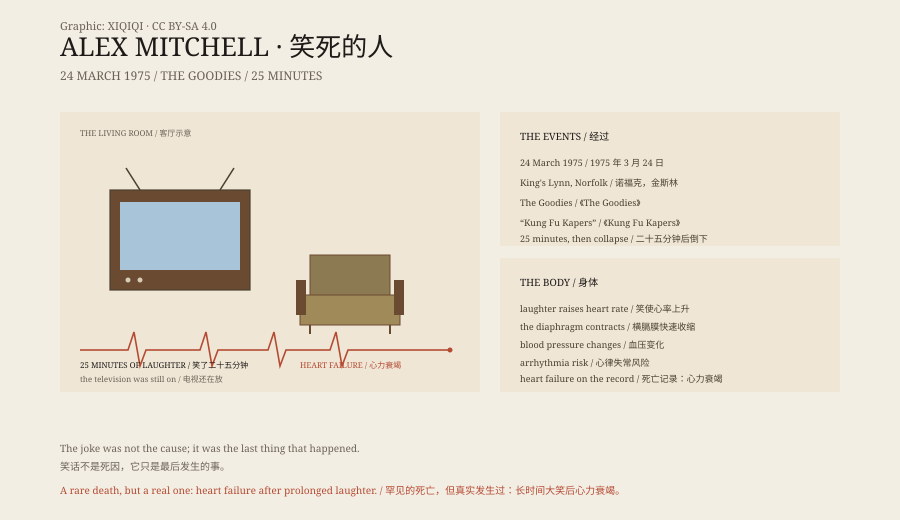

## 1. 24 March 1975

King's Lynn, Norfolk. On the evening of 24 March 1975, Alex Mitchell, a bricklayer of fifty, sat on the sofa in his living room and watched television.

He built walls for a living. That evening there were only two people in the house: him and his wife. The television was on, showing the BBC comedy The Goodies.

## 2. That Episode

The Goodies were three men: Tim Brooke-Taylor, Graeme Garden and Bill Oddie. The show began in 1970, a sketch comedy in which the three of them played tricks on one another.

All three had met as students at Cambridge and had been members of the Footlights club. Brooke-Taylor read law, Garden medicine, Oddie English. Among their contemporaries were John Cleese and Graham Chapman, later of Monty Python. In the 1960s they worked together on a BBC radio comedy; in 1970 they moved to television and stayed until 1982, leaving 67 episodes.

The episode that night was called Kung Fu Kapers. In one sketch Brooke-Taylor, in a kilt, played a Scottish martial artist whose art was "Hoots-Toot-ochaye". Oddie played the master of a Lancashire martial art called "Ecky-Thump", armed with a black pudding. The two fought with bagpipes and a blood sausage; the bagpipes made their noise, the pudding was used like a pair of nunchucks.

It was nonsense. It took two local things, the Scottish bagpipe and the Lancashire black pudding, and turned them into a serious martial art. That was the joke.

## 3. Twenty-Five Minutes

Mitchell began to laugh.

His wife was beside him. Afterwards she said he could not stop, that it grew worse and worse, and that at last he gave a long belly laugh and slumped on the sofa.

He laughed for twenty-five minutes.

Twenty-five minutes is not a figure of speech. A man laughing without a break for twenty-five minutes has his breathing broken up, his diaphragm in spasm, his heart rate raised, his blood oxygen falling. Towards the end he was not laughing; his body would not stop.

The television was still on. The programme ran on, and the room was left with the sound of it.

## 4. Heart Failure

Mitchell died of heart failure. The death certificate did not say "laughing"; it said the heart had stopped. Cardiac failure means the heart's pumping has failed, the organs are short of oxygen, and the heart stops.

Whether he had a heart condition before that night is not consistent in the public record. Some reports say he did; some say he did not. What is certain is that a man of fifty, after twenty-five minutes of continuous laughter, went into cardiac arrest.

Physiologically it can be explained. Laughter raises the heart rate and blood pressure, changes pressure inside the chest and stimulates the vagus nerve. In a healthy person these changes are safe. In someone with a latent heart problem, an extreme emotional surge can be the last straw.

The last straw is not the cause. The cause is the crack that was already there underneath it.

## 5. 2012

Thirty-seven years later, in 2012, Mitchell's granddaughter suffered a cardiac arrest and was diagnosed with Long QT syndrome.

This is an inherited arrhythmia. On an electrocardiogram the QT interval is longer than normal; under certain conditions — emotional stress, strenuous exercise, fright — the heart can move into a dangerous rhythm, or stop.

Because the condition is inherited, the family looked back at the evening in 1975. They believe Mitchell had the same problem and that it was never diagnosed. The laughter did not kill him; it pressed a switch that was already wired.

The claim cannot be proved. There is no post-mortem record and no electrocardiogram. But it brings a death that sounds like a joke back to a specific medical term.

## 6. Laughter

Laughter is usually thought to be good for you. It releases endorphins, lowers stress and connects people.

It is also a physiological reaction: the diaphragm contracts rapidly, breathing is cut into pieces, the heart rate rises, tears come, sometimes the bladder gives way, sometimes the person faints. The medical literature has a term, laughter-induced syncope, for people who lose consciousness briefly after laughing hard.

The triggers recorded in the literature are specific: a joke, a comedy, a tickle. In 1975 Britain had three television channels, and in the evening a family gathered around one set and watched the same programme. A single sketch could enter millions of living rooms at once. Mitchell's living room was one of them.

Death by laughter is rare, and Mitchell is its most famous case. His name went into newspapers, television and the internet, and became shorthand for dying laughing. In those retellings the twenty-five minutes are usually compressed into one sentence, and the diagnosis of 2012 is usually left out.

## 7. The Living Room

The television was still on. His wife was beside him. On the screen the bagpipes and the black pudding were still fighting.

Mitchell did not see the end. He fell back on the sofa, and he was still laughing when he went.

Later his wife wrote to the three Goodies to thank them for making his last moments so pleasant.

The same show produced another physiological event. On 1 November 1977 a 32-year-old housewife in Leicester, Seema Bakewell, went into labour while laughing at a different Goodies sketch. She refused to leave for the hospital until the episode had finished, and watched it to the end.

In 2007 the American band The White Stripes released an album called Icky Thump, named after "Ecky-Thump" in that sketch, with one letter changed to make the title easier for an American teenage audience. A bricklayer's death in King's Lynn and a rock album are joined by a blood sausage.

That is perhaps the strangest part of the story: it is both a tragedy and a joke, and neither cancels the other.

English has a hyperbolic phrase, "I literally died laughing". After 24 March 1975 the phrase had a literal instance in King's Lynn. Mitchell built walls in a port town in Norfolk all his working life; his name is now tied to a piece of internet slang.

*Reconstruction: an English living room in 1975, the television still on. Not a site photograph. XIQIQI Editorial, CC BY-SA 4.0.*

*Original schematic: the events of 24 March 1975, the sitcom and the physiology of laughter. Not a site photograph. XIQIQI Editorial, CC BY-SA 4.0.*

---

**Sources and licenses**: for “He Died Laughing”, sources are listed in the ledger S1–S3 at the foot of this entry. Text and original diagrams are CC BY-SA 4.0. The article keeps apart the events, the death record, the family's Long QT explanation and the physiology of laughter; Mitchell's death is publicly reported, there is no post-mortem record of the cause, and the Long QT explanation is the family's inference. The illustrations are a reconstruction and a schematic, not site photographs.
