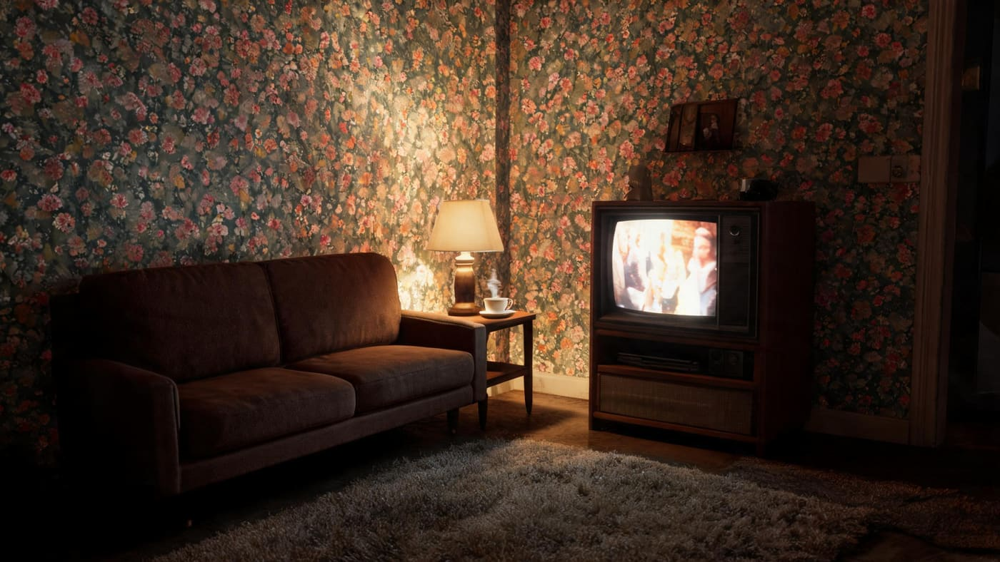
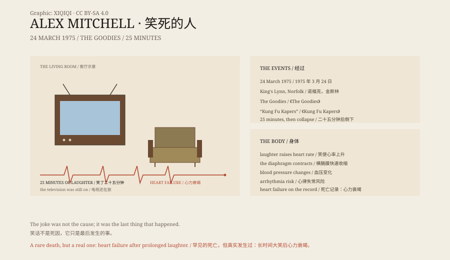

## 一、1975 年 3 月 24 日

英国诺福克郡，金斯林。1975 年 3 月 24 日晚上，50 岁的建筑工人亚历克斯·米切尔（Alex Mitchell）坐在自家客厅的沙发上，看电视。

他是砌砖的，白天在工地上干活。那天晚上，家里只有他和妻子。电视开着，放的是 BBC 的喜剧节目《The Goodies》。

## 二、那一集

《The Goodies》是三个人的节目：蒂姆·布鲁克-泰勒（Tim Brooke-Taylor）、格雷姆·加登（Graeme Garden）、比尔·奥迪（Bill Oddie）。1970 年开播，形式是小品喜剧，三个人在节目里互相整蛊。

三个人在剑桥读书时认识，都是“脚灯”剧社（Footlights）的成员。布鲁克-泰勒学法律，加登学医，奥迪学英语。他们的同学里有约翰·克里斯和格雷厄姆·查普曼，后来组了《巨蟒剧团》。1960 年代，他们先一起做 BBC 的广播喜剧，1970 年转到电视，一直做到 1982 年，留下 67 集。

那一集叫《Kung Fu Kapers》。里面有一段，布鲁克-泰勒穿着苏格兰裙，扮成一个苏格兰武术家，说自己练的是“Hoots-Toot-ochaye”。奥迪扮成兰开夏郡武术“Ecky-Thump”的掌门，武器是一根黑布丁（black pudding，一种血肠）。两个人用风笛和血肠对打，风笛发出声音，血肠被当成双节棍。

这一段是胡闹。它把两种地方性的东西——苏格兰的风笛、兰开夏的血肠——变成了一本正经的“武术”。观众笑的就是这个。

## 三、二十五分钟

米切尔开始笑。

妻子在旁边。她后来说，他笑得停不下来，越笑越厉害，最后发出一声很长的、肚子里的笑，倒在沙发上。

他笑了二十五分钟。

二十五分钟不是夸张的修辞。一个人连续笑二十五分钟，中间没有停，呼吸被打断，横膈膜一直在抽，心跳加快，血氧下降。到最后，他不是在笑，是身体停不下来。

电视还开着。节目继续往下放，客厅里只剩下电视里的声音。

## 四、心力衰竭

米切尔死于心力衰竭。死亡证明上没有写“笑”，写的是心脏停了。心力衰竭的医学名字是 cardiac failure：心脏泵血的能力下降，器官供氧不足，最后停下来。

他生前有没有心脏病，公开资料并不一致。有的报道说他有心脏病史，有的说没有。能确定的只有：一个 50 岁的男人，在连续笑了二十五分钟之后，心脏停了。没有留下尸检记录，心脏的真相被搁了三十七年。

从生理上看，这件事可以解释。笑会让心率加快、血压升高，胸腔压力变化，迷走神经受刺激。对健康人来说，这些变化是安全的；对心脏有隐患的人，一次极端的情绪波动，可能成为最后一根稻草。

“最后一根稻草”不是死因。死因是那根稻草下面早就存在的裂缝。

## 五、2012 年

三十七年后，米切尔的孙女在 2012 年经历了一次心脏骤停，随后被诊断出长 QT 综合征（Long QT Syndrome）。

这是一种遗传性的心律失常。患者的心电图上，QT 间期比正常人长；在某些条件下——情绪激动、剧烈运动、惊吓——心脏可能进入危险的节律，甚至停跳。这个名词就来自心电图上的那一段波段。

因为这种病会遗传，家人回头去看 1975 年那个晚上。他们相信，米切尔的心脏里也有同一个问题，只是当年没有查出来。那场笑没有杀死他，它只是按下了开关。

这个说法无法证实。米切尔没有留下尸检记录，也没有心电图。但它让一个听起来像笑话的死法，落回到一个具体的医学名词上。

## 六、笑

笑通常被认为是一件好事。它会释放内啡肽，降低压力，让人和人连在一起。

它同时也是一种生理反应：横膈膜快速收缩，呼吸被切成一段一段，心率上升，眼泪出来，有时会尿失禁，有时会晕过去。医学文献里有“笑晕厥”（laughter-induced syncope）这个说法，指人大笑之后短暂失去意识。

笑晕厥的诱因写得很具体：一个笑话，一段喜剧，一次挠痒。1975 年的英国只有三家电视台，晚上一家人围着一台电视，看的是同一个节目。一个小品能同时进入几百万个客厅。米切尔的客厅是其中之一。

极端的笑致人死亡，案例很少，米切尔是最有名的一个。他的名字被写进报纸、电视、网络，被当作“笑死”的代名词。但在这些转述里，那个 25 分钟常常被缩成一句“他笑死了”，那个 2012 年的诊断常常被删掉。

## 七、客厅

那台电视还在放。妻子坐在旁边。节目里的风笛和血肠还在打。

米切尔没有看到结尾。他倒在沙发上，走的时候还在笑。这段经过没有留下影像，只有他妻子的讲述。客厅的灯还亮着。

后来，他的妻子给《The Goodies》的三个人写了一封信，感谢他们让他笑着离开。

同一档节目还制造过另一桩生理事件。1977 年 11 月 1 日，莱斯特一位 32 岁的家庭主妇西玛·贝克韦尔（Seema Bakewell）在看《The Goodies》的另一个小品时开始分娩。她不肯在节目结束前离家去医院，一直看到最后。

2007 年，美国乐队 The White Stripes 发行专辑《Icky Thump》，名字来自这段小品里的“Ecky-Thump”，为了照顾美国听众，改了一个字母。一个金斯林建筑工人的死亡，和一张摇滚专辑，通过一根血肠连在了一起。

这大概是这件事最奇怪的地方：它既是一个悲剧，也是一个笑话，两者都没有被取消。

英语里有一句夸张的口语，“I literally died laughing”——我笑死了。1975 年 3 月 24 日之后，这句话在金斯林有了一次字面意义上的实例。金斯林是诺福克郡的一个港口小镇，米切尔在那里砌了一辈子砖；他的名字现在和一句网络用语绑在一起。

*场景复原：1975 年一个英国家庭的客厅，电视还开着。不是现场照片。稀奇奇编辑部，CC BY-SA 4.0。*

*原创示意图：1975 年 3 月 24 日的经过、情景喜剧与笑声的生理反应。不是现场照片。稀奇奇编辑部，CC BY-SA 4.0。*

---

**来源与许可**：文字与原创示意图采用 CC BY-SA 4.0；第三方图片与资料的许可见文末来源台账。
