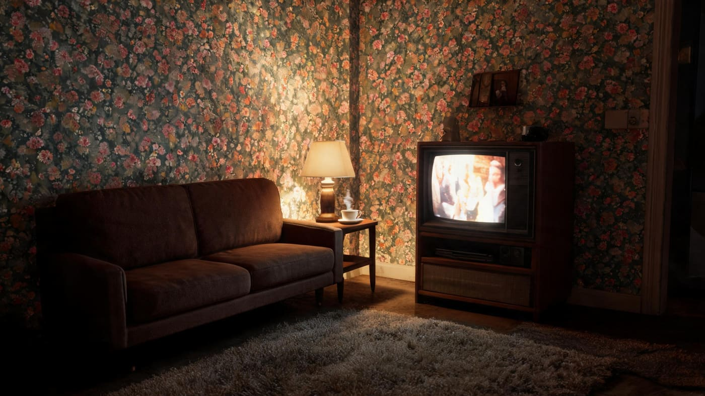
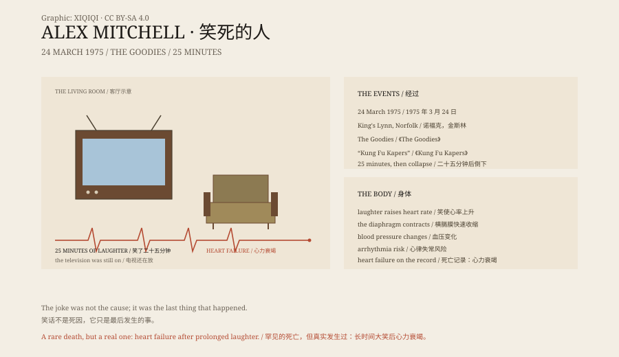

## 一、1975 年 3 月 24 日

英国诺福克郡，金斯林。50 岁的建筑工人亚历克斯·米切尔坐在客厅里，看电视。

节目是 BBC 的喜剧《The Goodies》，这一集叫《Kung Fu Kapers》。

剧里，蒂姆·布鲁克-泰勒用一种叫“Ecky Thump”的“武术”对付敌人，武器是一对风笛。

米切尔开始笑。

客厅里只有电视的光。他坐在沙发上，妻子在旁边。节目里的风笛声和打斗声混在一起，他笑得越来越厉害。

## 二、二十五分钟

他笑了二十五分钟。

*场景复原：1975 年一个英国家庭的客厅，电视还开着。不是现场照片。稀奇奇编辑部，CC BY-SA 4.0。*

他的妻子在旁边。她说，他笑得停不下来，最后发出一声“巨大的肚皮笑”，倒在沙发上。

他死于心力衰竭。

电视还开着。节目继续往下放，客厅里只剩下电视的对白。

## 三、心脏

死亡证明写的是心力衰竭。他之前有没有心脏病，公开资料并不一致。

大笑会让心跳加快、血压变化，也会让胸腔压力改变。对健康人来说，笑是安全的；对心脏不好的人，极端的情绪或用力，可能诱发心律失常。

医生当时没有把“笑”写成死因。他们写的是心脏停了。

## 四、之后

他的妻子给《The Goodies》的演员写了一封信，感谢他们“让他笑着离开”。

这件事后来被写进报纸、电视和网络，成了“笑死”的经典案例。

多年后，他的家人还在讲这个故事。对他们来说，它既是一个损失，也是一个奇怪的家庭传说。

## 五、笑

笑通常被认为是一件好事。

但它也是一种生理反应：横膈膜快速收缩，呼吸被打断，心率上升。极端情况下，它可以让一个人晕倒，甚至诱发心脏问题。

米切尔不是唯一一个“笑死”的人，但他是最有名的一个。

## 六、那一集

《Kung Fu Kapers》在 1975 年 3 月播出。

米切尔没有看到结尾。他倒在沙发上，电视还在放。

他的妻子说，他走的时候还在笑。

*原创示意图：1975 年 3 月 24 日的经过、情景喜剧与笑声的生理反应。不是现场照片。稀奇奇编辑部，CC BY-SA 4.0。*

---

**来源与许可**：本文的事实来源见条目底部来源台账 S1–S3。文字与原创示意图采用 CC BY-SA 4.0。文中把事件经过、死亡记录与笑声的生理机制分开叙述；米切尔的死亡有公开报道，具体病因没有完整的尸检记录。插图是场景复原，不是现场照片。
